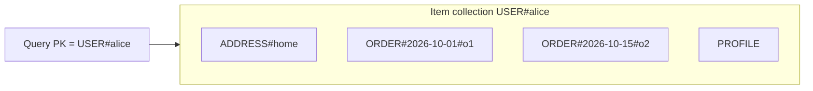
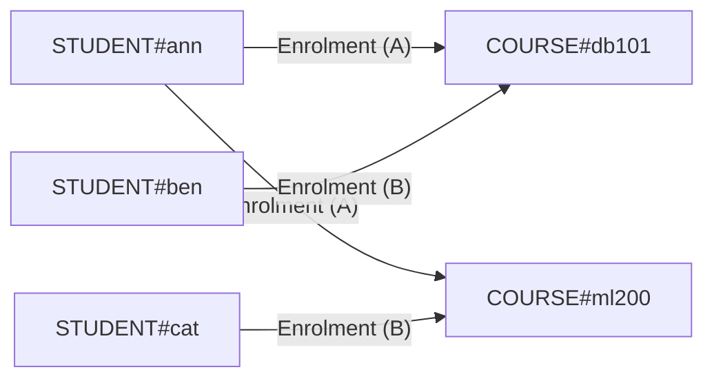

Modelling is the heart of DynamoDB. Everything comes down to one decision: **what goes in the partition key, the sort key and the indexes**, so that every access pattern the application needs is a single `GetItem` or `Query`. Most of the rest of the series builds on the patterns in this article.

A few ideas run through all of them. **Access patterns come first**: we list the questions the app asks, then design keys to answer them, so the table's shape follows from the queries rather than the other way round. **Keys are strings we design**: prefixes (`USER#`, `ORDER#`) and composite values (`COUNTRY#STATE#CITY`) turn one key attribute into a flexible, sortable path. **One table can hold many entities**: items that are read together share a partition key, so one `Query` returns all of them (an _item collection_). **Indexes give us more ways in**: a GSI re-keys the same data, swapping PK and SK (an inverted index) answers the reverse question, generic `GSI1PK`/`GSI1SK` attributes let one index serve many patterns, and leaving the key off an item keeps it out of the index entirely (sparse). Finally, **we duplicate on write to save reads**: copying a value onto the items that need it is normal, as long as we have a plan for updating the copies.

| # | Pattern | What we'll learn |
|---|---|---|
| 02 | [Access-pattern-first design](#02--access-pattern-first-design) | Deriving a table and indexes from a list of queries |
| 03 | [Key prefixes and key overloading](#03--key-prefixes-and-key-overloading) | `TYPE#id` keys, avoiding collisions, key-builder helpers |
| 04 | [Single-table design](#04--single-table-design) | Several entity types in one table; fetching related data in one query |
| 05 | [Composite sort keys](#05--composite-hierarchical-sort-keys) | Hierarchies with `begins_with`, ranges with `between` |
| 06 | [Sortable IDs, latest first](#06--sortable-ids-latest-first) | ISO-8601 timestamps and ULIDs as sort keys; newest-first queries |
| 07 | [Inverted index](#07--inverted-index) | A GSI with PK/SK swapped to query relationships backwards |
| 08 | [Adjacency list](#08--adjacency-list-many-to-many) | Many-to-many relationships as edge items |
| 09 | [GSI overloading](#09--gsi-overloading) | One generic GSI serving several access patterns |
| 10 | [Sparse index](#10--sparse-index) | Indexes that only contain the items we care about |
| 11 | [Denormalization](#11--denormalization-and-duplication) | Copying and embedding data, and keeping copies in sync |

Every example below was run against DynamoDB Local. The `>>>` lines are the actual requests each script sent, printed by the repo's request logger.

---

## 02 · Access-pattern-first design

**Code:** [02-access-pattern-first.py](https://github.com/jfgrea27/dynamodb-patterns/blob/main/patterns/02-modelling/02-access-pattern-first/02-access-pattern-first.py) · run with `just run 02`

### Problem

In SQL we model the entities first and write the queries later, and the query planner sorts it out. DynamoDB has no planner. If a query isn't backed by a key or an index, the only option left is a `Scan`.

### Pattern

We flip the order and work in three steps:

1. Write down **every** read and write the app needs, with a rough frequency for each.
2. For each one, decide which request will serve it: a `GetItem`, a `Query` on the table, or a `Query` on a GSI.
3. Derive the `PK`/`SK` and GSI keys from that list, then check that nothing needs a `Scan`.

For a simple customers-and-orders app, the list looks like this:

| Access pattern                      | Request                                               |
|-------------------------------------|-------------------------------------------------------|
| Get customer                        | `GetItem PK=CUST#<id>, SK=PROFILE`                    |
| Customer's orders, newest first     | `Query PK=CUST#<id>, SK begins_with ORDER#` (desc)    |
| Order by id                         | `Query GSI1 GSI1PK=ORDER#<id>`                        |
| Orders by status for a day          | `Query GSI2 GSI2PK=STATUS#<s>, GSI2SK begins_with <date>` |

Keep this table in the repo. In DynamoDB, it _is_ the schema.

### In practice

The script starts by writing the access patterns down, and only then creates the table. Both GSIs fall straight out of the list, and each order item fills in the attributes those indexes need:

```python
table = recreate_table("p02-access-patterns", gsis=[gsi("GSI1"), gsi("GSI2")])

def order(cust, order_id, date, status, total):
    return {
        "PK": f"CUST#{cust}",
        "SK": f"ORDER#{date}#{order_id}",
        "GSI1PK": f"ORDER#{order_id}",  # lookup by order id
        "GSI1SK": f"ORDER#{order_id}",
        "GSI2PK": f"STATUS#{status}",  # orders by status + date
        "GSI2SK": f"{date}#{order_id}",
        "type": "Order",
        "orderId": order_id,
        "status": status,
        "total": total,
    }
```

Then it checks that every access pattern really is a single key-based request:

```text
>>> GetItem p02-access-patterns
    key:        {PK: 'CUST#c1', SK: 'PROFILE'}

=== AP1 customer ===
{
  "SK": "PROFILE",
  "name": "Carol",
  "PK": "CUST#c1",
  "type": "Customer"
}

>>> Query p02-access-patterns
    key:        (PK = 'CUST#c1' AND begins_with(SK, 'ORDER#'))
    ScanIndexForward: False

=== AP2 customer orders ===
[
  "o2",
  "o1"
]

>>> Query p02-access-patterns
    key:        GSI1PK = 'ORDER#o3'
    IndexName:  GSI1

=== AP3 order by id ===
"o3"

>>> Query p02-access-patterns
    key:        (GSI2PK = 'STATUS#PENDING' AND begins_with(GSI2SK, '2026-10-20'))
    IndexName:  GSI2

=== AP4 pending orders today ===
[
  "o2",
  "o3"
]
```

Four access patterns, four requests, and not a `Scan` in sight. Note that AP4 returns orders from two different customers (`o2` belongs to `c1`, `o3` to `c2`), which the base table alone could never do in one request.

### Why

Every request stays a key lookup, so latency is flat at any scale. The exercise also shows early on which GSIs we need, and just as usefully, which ones we don't.

### Trade-offs

New access patterns that turn up later may need a new GSI or a backfill. It also takes more design work up front than "just add a table".

### Gotchas

- Include the **write** patterns too (e.g. "update order status"). They decide which attributes get duplicated (see [denormalization](#11--denormalization-and-duplication)).
- Low-cardinality GSI keys like `STATUS#PENDING` can get hot. If the volume is high, shard them ([write sharding](../07-performance-and-scale/#35--write-sharding)).

Related: [single-table design](#04--single-table-design), [GSI overloading](#09--gsi-overloading).

---

## 03 · Key prefixes and key overloading

**Code:** [03-key-prefixes.py](https://github.com/jfgrea27/dynamodb-patterns/blob/main/patterns/02-modelling/03-key-prefixes/03-key-prefixes.py) · run with `just run 03`

### Problem

In a single table, many entity types share the same `PK`/`SK` attributes. A user with id `42` and an org with id `42` would collide. Raw ids also make it hard to tell what an item actually is.

### Pattern

We prefix every key value with its entity type and a delimiter:

| PK        | SK               | type       |
|-----------|------------------|------------|
| `USER#42` | `USER#42`        | User       |
| `ORG#42`  | `ORG#42`         | Org        |
| `ORG#42`  | `MEMBER#USER#42` | Membership |
| `ORG#42`  | `PROJECT#p1`     | Project    |

_Key overloading_ means the same attribute (here `SK`) holds different kinds of values on different items. Prefixes keep that safe, and `begins_with(SK, "MEMBER#")` picks out one kind.

### In practice

The script writes the four items above and keeps key building in small helpers rather than scattering f-strings around:

```python
def user_key(user_id):
    return {"PK": f"USER#{user_id}", "SK": f"USER#{user_id}"}

def org_pk(org_id):
    return f"ORG#{org_id}"

resp = table.query(KeyConditionExpression=Key("PK").eq(org_pk("42")) & Key("SK").begins_with("MEMBER#"))
```

```text
>>> GetItem p03-key-prefixes
    key:        {PK: 'USER#42', SK: 'USER#42'}

=== User 42 ===
{
  "SK": "USER#42",
  "name": "Dana",
  "PK": "USER#42",
  "type": "User",
  "userId": "42"
}

>>> Query p03-key-prefixes
    key:        PK = 'ORG#42'

=== Org 42 item collection ===
[
  ["MEMBER#USER#42", "Membership"],
  ["ORG#42", "Org"],
  ["PROJECT#p1", "Project"]
]

>>> Query p03-key-prefixes
    key:        (PK = 'ORG#42' AND begins_with(SK, 'MEMBER#'))

=== Org 42 members only ===
[
  "MEMBER#USER#42"
]

=== Parsed key ===
{
  "entity": "ORG",
  "id": "42"
}
```

User `42` and org `42` live happily side by side. The org's item collection holds three kinds of item under one partition key, and the `MEMBER#` prefix narrows it to memberships only. The last block shows that we _can_ parse a key back into its parts, but as the gotchas below say, we'd rather not need to.

### Why

- There are no id collisions between entity types.
- Keys are readable in the console and in logs.
- Prefixes give us cheap per-type filtering inside an item collection.

### Trade-offs

Keys get a little longer, and key bytes count towards item size and index storage. Every caller must also build keys exactly the same way, so put the key builders in one module.

### Gotchas

- Keep a `type` attribute and the raw id (`userId`) on the item. Don't rely on parsing keys.
- Use a delimiter that can't appear in ids. `#` is the convention.
- Keep prefixes short but clear. They are written millions of times.

Related: [single-table design](#04--single-table-design), [composite sort keys](#05--composite-hierarchical-sort-keys), [GSI overloading](#09--gsi-overloading).

---

## 04 · Single-table design

**Code:** [04-single-table-design.py](https://github.com/jfgrea27/dynamodb-patterns/blob/main/patterns/02-modelling/04-single-table-design/04-single-table-design.py) · run with `just run 04`

### Problem

In a relational database we'd have `users`, `orders` and `addresses` tables and JOIN them. DynamoDB has no joins. With one table per entity, showing a single page takes several round trips.

### Pattern

We put every entity type in **one table** with generic key names (`PK`, `SK`). Items that are read together share a partition key, and together they form an **item collection**, which one `Query` fetches in full.

| PK           | SK                    | type    | attributes           |
|--------------|-----------------------|---------|----------------------|
| `USER#alice` | `PROFILE`             | User    | name, email          |
| `USER#alice` | `ADDRESS#home`        | Address | city                 |
| `USER#alice` | `ORDER#2026-10-01#o1` | Order   | total                |
| `USER#alice` | `ORDER#2026-10-15#o2` | Order   | total                |
| `USER#bob`   | `PROFILE`             | User    | name, email          |

This layout serves three access patterns:

- **Get profile:** `GetItem(PK=USER#alice, SK=PROFILE)`
- **Everything for a user:** `Query(PK=USER#alice)`
- **User's orders, newest first:** `Query(PK=USER#alice, SK begins_with ORDER#, ScanIndexForward=False)`



### In practice

```python
# Access pattern 2: everything about a user in one request
resp = table.query(KeyConditionExpression=Key("PK").eq("USER#alice"))

# Access pattern 3: only a user's orders, newest first
resp = table.query(
    KeyConditionExpression=Key("PK").eq("USER#alice") & Key("SK").begins_with("ORDER#"),
    ScanIndexForward=False,
)
```

```text
>>> GetItem p04-single-table
    key:        {PK: 'USER#alice', SK: 'PROFILE'}

=== Alice's profile ===
{
  "SK": "PROFILE",
  "name": "Alice",
  "PK": "USER#alice",
  "type": "User",
  "email": "alice@example.com"
}

>>> Query p04-single-table
    key:        PK = 'USER#alice'

=== Alice's whole item collection (1 query) ===
[
  {
    "SK": "ADDRESS#home",
    "PK": "USER#alice",
    "type": "Address",
    "city": "London"
  },
  {
    "SK": "ORDER#2026-10-01#o1",
    "total": 42,
    "PK": "USER#alice",
    "type": "Order"
  },
  ...
  {
    "SK": "PROFILE",
    "name": "Alice",
    "PK": "USER#alice",
    "type": "User",
    "email": "alice@example.com"
  }
]

>>> Query p04-single-table
    key:        (PK = 'USER#alice' AND begins_with(SK, 'ORDER#'))
    ScanIndexForward: False

=== Alice's orders, newest first ===
[
  {
    "SK": "ORDER#2026-10-15#o2",
    "total": 17,
    "PK": "USER#alice",
    "type": "Order"
  },
  {
    "SK": "ORDER#2026-10-01#o1",
    "total": 42,
    "PK": "USER#alice",
    "type": "Order"
  }
]

>>> Query p04-single-table
    key:        PK = 'USER#alice'

=== Grouped by entity type ===
{
  "Address": 1,
  "Order": 2,
  "User": 1
}
```

One `Query` returns Alice's profile, address and orders together: the join has effectively happened at write time. The items come back sorted by `SK`, which is why `ADDRESS#` comes before `ORDER#` and `PROFILE`. In the last step the app groups the rows back into typed objects using the `type` attribute.

### Why

- **Fewer requests.** Related data is pre-joined at write time.
- **One table to operate.** Capacity, alarms, backups, streams and IAM all live in one place.
- **It scales.** Every access pattern is a key lookup, so latency stays flat at any size.

### Trade-offs

- We must know our access patterns up front (see [access-pattern-first design](#02--access-pattern-first-design)). Ad-hoc queries are hard.
- Items are harder to read in the console. A `type` attribute and readable prefixes help.
- Schema changes often need a backfill: re-writing items with new keys or GSI attributes.
- Multiple tables are still fine when entities are never read together, or when they have very different operational needs (e.g. TTL, streams, throughput). Single-table design is a tool, not a religion.

### Gotchas

- Store the entity's real ID as a normal attribute too (`userId`), not only inside `PK`. Parsing keys is brittle.
- An item collection has no size limit on a table with no LSIs. With an LSI, it is capped at 10 GB.

### Further reading

- Alex DeBrie, _The DynamoDB Book_
- AWS re:Invent, "Advanced design patterns for DynamoDB" (Rick Houlihan)

---

## 05 · Composite (hierarchical) sort keys

**Code:** [05-composite-sort-keys.py](https://github.com/jfgrea27/dynamodb-patterns/blob/main/patterns/02-modelling/05-composite-sort-keys/05-composite-sort-keys.py) · run with `just run 05`

### Problem

Say we need to filter stores at several levels: all stores, stores in a country, in a state, or in a city. A key condition can only use the partition key and **one** sort key, and only with `=`, `<`, `>`, `between` or `begins_with`.

### Pattern

We join the levels into a single sort key, ordered **most general → most specific**:

| PK           | SK                                  |
|--------------|-------------------------------------|
| `BRAND#acme` | `STORE#US#CA#San Francisco#s1`      |
| `BRAND#acme` | `STORE#US#CA#Los Angeles#s2`        |
| `BRAND#acme` | `STORE#US#NY#New York#s3`           |
| `BRAND#acme` | `STORE#UK#ENG#London#s4`            |

Each level is now just a longer prefix:

- **Country:** `begins_with(SK, "STORE#US#")`
- **State:** `begins_with(SK, "STORE#US#CA#")`
- **City:** `begins_with(SK, "STORE#UK#ENG#London#")`

The same idea gives us range queries when the last part is sortable, e.g. `READING#2026-10-05` `between` `READING#2026-10-31`.

### In practice

```python
def stores_under(prefix):
    resp = table.query(
        KeyConditionExpression=Key("PK").eq("BRAND#acme") & Key("SK").begins_with(f"STORE#{prefix}")
    )
    return [f"{i['city']} ({i['storeId']})" for i in resp["Items"]]

show("Country = US", stores_under("US#"))
show("State = US/CA", stores_under("US#CA#"))
show("City = London", stores_under("UK#ENG#London#"))
```

```text
>>> Query p05-composite-sk
    key:        (PK = 'BRAND#acme' AND begins_with(SK, 'STORE#'))

=== All stores ===
[
  "London (s4)",
  "Manchester (s5)",
  "Los Angeles (s2)",
  "San Francisco (s1)",
  "New York (s3)"
]

>>> Query p05-composite-sk
    key:        (PK = 'BRAND#acme' AND begins_with(SK, 'STORE#US#'))

=== Country = US ===
[
  "Los Angeles (s2)",
  "San Francisco (s1)",
  "New York (s3)"
]

>>> Query p05-composite-sk
    key:        (PK = 'BRAND#acme' AND begins_with(SK, 'STORE#US#CA#'))

=== State = US/CA ===
[
  "Los Angeles (s2)",
  "San Francisco (s1)"
]

>>> Query p05-composite-sk
    key:        (PK = 'BRAND#acme' AND begins_with(SK, 'STORE#UK#ENG#London#'))

=== City = London ===
[
  "London (s4)"
]

>>> BatchWriteItem
    p05-composite-sk: 4 puts, 0 deletes

>>> Query p05-composite-sk
    key:        (PK = 'DEVICE#d1' AND SK BETWEEN 'READING#2026-10-05' AND 'READING#2026-10-31')

=== Readings 5-31 Oct ===
[
  "READING#2026-10-10",
  "READING#2026-10-20"
]
```

The same partition answers four different questions just by lengthening the prefix. Notice the results come back grouped by the hierarchy (UK before US, CA before NY) without any sorting in our code. The last query uses `between` on the date part of the key: of the four readings written (1, 10 and 20 October, and 2 November), only the two inside the range come back.

### Why

One key answers several query shapes with no extra index, and the results come back sorted by the hierarchy for free.

### Trade-offs

- We can only filter on a **prefix**. "All stores in any city named London" isn't possible without another index.
- Changing the order of the levels means rewriting every item.

### Gotchas

- End each prefix with the delimiter (`US#`, not `US`). Otherwise `US` also matches `USA`.
- Pick a delimiter that never appears in the values, or escape it.
- Sort keys compare as strings (UTF-8 bytes). Zero-pad numbers (`0007`) and use ISO-8601 dates (see [sortable IDs](#06--sortable-ids-latest-first)).

Related: [key prefixes](#03--key-prefixes-and-key-overloading), [single-table design](#04--single-table-design).

---

## 06 · Sortable IDs, latest first

**Code:** [06-sortable-ids-latest-first.py](https://github.com/jfgrea27/dynamodb-patterns/blob/main/patterns/02-modelling/06-sortable-ids-latest-first/06-sortable-ids-latest-first.py) · run with `just run 06`

### Problem

Feeds, chat messages, audit logs and orders are almost always read newest first, or by time range. Sort keys are compared as strings, in byte order. Random IDs (UUIDv4) and unpadded numbers don't sort by time.

### Pattern

We make the sort key **sort lexicographically by time**. There are a few ways to do it:

| Option            | SK example                                      | Notes                               |
|-------------------|-------------------------------------------------|-------------------------------------|
| ISO-8601 + suffix | `MSG#2026-10-04T00:00:00.000+00:00#e15102`      | Human-readable. Suffix keeps keys unique. |
| ULID              | `MSG#01M423BP00MRKZ02TD5VJE5ZWK`                | 26 chars, unique, time-ordered.     |
| KSUID / UUIDv7    | `MSG#018f3c...`                                 | Same idea, other formats.           |

Then both of the common reads become a single `Query`:

- **Latest N:** `Query(PK=ROOM#x, ScanIndexForward=False, Limit=N)`
- **Time range:** `Key("SK").between("MSG#2026-10-02", "MSG#2026-10-05~")`

### In practice

The script writes five messages into two rooms, **deliberately out of order**: one room uses ISO-8601 keys with a random suffix, the other uses ULIDs. It uses a minimal ULID helper (a 48-bit millisecond timestamp plus 80 random bits, in Crockford base32):

```python
for day in [3, 1, 7, 2, 5]:  # written out of order on purpose
    ts = base + day * 86_400_000
    iso = datetime.fromtimestamp(ts / 1000, timezone.utc).isoformat(timespec="milliseconds")
    # Option A: ISO-8601 timestamp + random suffix to keep keys unique
    batch.put_item(Item={"PK": "ROOM#general", "SK": f"MSG#{iso}#{uuid.uuid4().hex[:6]}", "text": f"Oct {1 + day}"})
    # Option B: ULID - one sortable, unique, compact ID
    batch.put_item(Item={"PK": "ROOM#random", "SK": f"MSG#{ulid(ts)}", "text": f"Oct {1 + day}"})

resp = table.query(KeyConditionExpression=Key("PK").eq("ROOM#general"), ScanIndexForward=False, Limit=3)
```

```text
>>> Query p06-sortable-ids
    key:        PK = 'ROOM#general'
    Limit:      3
    ScanIndexForward: False

=== Latest 3 (ISO-8601 keys, newest first) ===
[
  ["MSG#2026-10-08T00:00:00.000+00:00#8c124f", "Oct 8"],
  ["MSG#2026-10-06T00:00:00.000+00:00#e76ff8", "Oct 6"],
  ["MSG#2026-10-04T00:00:00.000+00:00#013331", "Oct 4"]
]

>>> Query p06-sortable-ids
    key:        PK = 'ROOM#random'
    Limit:      3
    ScanIndexForward: False

=== Latest 3 (ULID keys, newest first) ===
[
  ["MSG#01M4CCYJ00YF4V29TPQ2Q815FN", "Oct 8"],
  ["MSG#01M4785400M01SJY52C44QG3AS", "Oct 6"],
  ["MSG#01M423BP00B2ZX7BX56Z4SG3M8", "Oct 4"]
]

>>> Query p06-sortable-ids
    key:        (PK = 'ROOM#general' AND SK BETWEEN 'MSG#2026-10-02' AND 'MSG#2026-10-05~')

=== Messages between 2 and 5 Oct ===
[
  "Oct 2",
  "Oct 3",
  "Oct 4"
]

=== uuid4 values are not time-ordered ===
[
  "070a7415",
  "4df62a9c",
  "8b980121"
]
```

Even though the messages were written out of order, both rooms return the latest three newest first, straight from DynamoDB. The ULIDs share a time-based prefix (`01M4...`), which is why they sort correctly despite looking random. The range query uses `~` as the upper bound so that any key starting `MSG#2026-10-05` is included. The final block is the counter-example: sorted UUIDv4 values are just random strings, with no relationship to when they were created.

### Why

Newest-first and time-range queries become a single cheap `Query`, and nothing is sorted in code. ULIDs give us the ID and the timestamp in one value, and no two collide.

### Trade-offs

- A time-ordered **sort key** is fine. A time-ordered **partition key** (e.g. `PK=DATE#2026-10-20`) is a hot partition. Shard or bucket it instead (see [write sharding](../07-performance-and-scale/#35--write-sharding) and [time-series tables](../07-performance-and-scale/#37--time-series-tables)).
- ULIDs aren't human-readable, so store a readable `createdAt` as well.

### Gotchas

- Always use **UTC** and a fixed format. Mixing `+00:00` and `Z`, or different precisions, breaks the ordering.
- Zero-pad numbers (`ORDER#0042`, not `ORDER#42`), or `10` sorts before `9`.
- Use `~` (which sorts after alphanumerics) as an inclusive upper bound for a prefix range.
- In real code, use the `python-ulid` package rather than the small helper in the script.

---

## 07 · Inverted index

**Code:** [07-inverted-index.py](https://github.com/jfgrea27/dynamodb-patterns/blob/main/patterns/02-modelling/07-inverted-index/07-inverted-index.py) · run with `just run 07`

### Problem

Our base table answers "what's on invoice X?" (`PK=INV#X`). We also need "which invoices contain product Y?" and "which invoices belong to customer Z?". Those values live in the **sort key**, and we can't query by sort key alone.

### Pattern

We create a GSI whose partition key is the table's `SK` and whose sort key is the table's `PK`. That's the whole trick.

| PK (base)  | SK (base)        | Inverted PK      | Inverted SK |
|------------|------------------|------------------|-------------|
| `INV#1001` | `PRODUCT#apple`  | `PRODUCT#apple`  | `INV#1001`  |
| `INV#1002` | `PRODUCT#apple`  | `PRODUCT#apple`  | `INV#1002`  |
| `INV#1001` | `CUSTOMER#c1`    | `CUSTOMER#c1`    | `INV#1001`  |

- **Lines on an invoice:** `Query PK=INV#1001`
- **Invoices with apple:** `Query Inverted SK=PRODUCT#apple`
- **Invoices for c1:** `Query Inverted SK=CUSTOMER#c1`

### In practice

Defining the index is a one-liner: the same two attributes, swapped.

```python
table = recreate_table("p07-inverted-index", gsis=[gsi("Inverted", pk="SK", sk="PK")])

resp = table.query(IndexName="Inverted", KeyConditionExpression=Key("SK").eq("PRODUCT#apple"))
```

```text
>>> Query p07-inverted-index
    key:        PK = 'INV#1001'

=== Base table: everything on INV#1001 ===
[
  ["CUSTOMER#c1", null],
  ["PRODUCT#apple", 3],
  ["PRODUCT#pear", 1]
]

>>> Query p07-inverted-index
    key:        SK = 'PRODUCT#apple'
    IndexName:  Inverted

=== Inverted: invoices containing apple ===
[
  ["INV#1001", 3],
  ["INV#1002", 5]
]

>>> Query p07-inverted-index
    key:        SK = 'CUSTOMER#c1'
    IndexName:  Inverted

=== Inverted: invoices for customer c1 ===
[
  "INV#1001",
  "INV#1002"
]
```

The base-table query lists everything on invoice 1001: its customer link (which has no quantity, hence `null`) and two product lines. On the inverted index, the very same items are queried from the other side, by product and by customer. We never added a new attribute.

### Why

One extra index answers the reverse of **every** relationship in the table, and it needs no new attributes because it reuses `PK` and `SK`.

### Trade-offs

- Every item is written to the index (it isn't sparse), so it roughly doubles write cost.
- Items whose `SK` is a constant like `PROFILE` or `METADATA` all land in one huge inverted partition. Make sure no access pattern queries those, or use a separate [overloaded GSI](#09--gsi-overloading) instead.

### Gotchas

- GSIs are eventually consistent (see [GSIs are eventually consistent](../05-consistency/#28--gsis-are-eventually-consistent)).
- Popular values (one product on millions of invoices) become hot keys.

Related: [adjacency list](#08--adjacency-list-many-to-many).

---

## 08 · Adjacency list (many-to-many)

**Code:** [08-adjacency-list.py](https://github.com/jfgrea27/dynamodb-patterns/blob/main/patterns/02-modelling/08-adjacency-list/08-adjacency-list.py) · run with `just run 08`

### Problem

Students take many courses and courses have many students. SQL handles this with a join table. DynamoDB has no joins, and we need to query in **both** directions.

### Pattern

We store each node as an item, and each **edge** as its own item. An edge item uses one node as its `PK` and the other as its `SK`. Then we add an [inverted GSI](#07--inverted-index) (`PK` = `SK`, `SK` = `PK`) to walk the edges backwards.

| PK              | SK              | type      | attrs  |
|-----------------|-----------------|-----------|--------|
| `STUDENT#ann`   | `STUDENT#ann`   | Student   | name   |
| `COURSE#db101`  | `COURSE#db101`  | Course    | title  |
| `STUDENT#ann`   | `COURSE#db101`  | Enrolment | grade  |
| `STUDENT#ben`   | `COURSE#db101`  | Enrolment | grade  |

- **Ann's courses:** `Query PK=STUDENT#ann, SK begins_with COURSE#`
- **Students in db101:** `Query Inverted SK=COURSE#db101, PK begins_with STUDENT#`



### In practice

Each node gets a "self" item where `PK == SK`, and each enrolment is an edge item that carries its own `grade`:

```python
batch.put_item(Item={
    "PK": f"STUDENT#{s}",
    "SK": f"COURSE#{c}",
    "type": "Enrolment",
    "grade": "A" if s == "ann" else "B",  # edges can carry their own attributes
})

# Backward: who is enrolled in db101? (inverted index: SK becomes the partition key)
resp = table.query(
    IndexName="Inverted",
    KeyConditionExpression=Key("SK").eq("COURSE#db101") & Key("PK").begins_with("STUDENT#"),
)
```

```text
>>> Query p08-adjacency
    key:        (PK = 'STUDENT#ann' AND begins_with(SK, 'COURSE#'))

=== Ann's courses ===
[
  ["COURSE#db101", "A"],
  ["COURSE#ml200", "A"]
]

>>> Query p08-adjacency
    key:        (SK = 'COURSE#db101' AND begins_with(PK, 'STUDENT#'))
    IndexName:  Inverted

=== Students in db101 ===
[
  "STUDENT#ann",
  "STUDENT#ben"
]

>>> Query p08-adjacency
    key:        SK = 'COURSE#ml200'
    IndexName:  Inverted

=== Everything pointing at ml200 ===
[
  ["COURSE#ml200", "Course"],
  ["STUDENT#ann", "Enrolment"],
  ["STUDENT#cat", "Enrolment"]
]
```

The forward query walks from a student to their courses, along with the grade stored on each edge. The inverted query walks from a course back to its students. The last query shows a nice side effect: because the course's own node item has `PK == SK`, it also shows up in the inverted index, so a single query returns the course _and_ everything pointing at it.

### Why

- Both directions take one `Query`.
- Edges can carry attributes (grade, role, joined date).
- It works for graphs too: followers, friends, bills of materials.

### Trade-offs

- An edge query returns ids, not full node details. Either duplicate the fields we display onto the edge ([denormalization](#11--denormalization-and-duplication)), or do a `BatchGetItem` for the nodes.
- Deleting a node means deleting all its edges too.

### Gotchas

- A very popular node (a celebrity with millions of followers) makes a hot partition on the inverted index. Shard it ([write sharding](../07-performance-and-scale/#35--write-sharding)).
- Multi-hop graph traversal is still N round trips. For heavy graph work, use a graph database.

Related: [inverted index](#07--inverted-index), [GSI overloading](#09--gsi-overloading).

---

## 09 · GSI overloading

**Code:** [09-gsi-overloading.py](https://github.com/jfgrea27/dynamodb-patterns/blob/main/patterns/02-modelling/09-gsi-overloading/09-gsi-overloading.py) · run with `just run 09`

### Problem

Each new access pattern seems to need its own GSI. But a table can have at most 20 GSIs, and every GSI adds write cost and storage.

### Pattern

We give the GSI **generic** key names (`GSI1PK`, `GSI1SK`), and each entity type fills them with whatever _it_ needs. One index then serves several access patterns:

| Entity   | PK           | GSI1PK                 | GSI1SK           | Serves                         |
|----------|--------------|------------------------|------------------|--------------------------------|
| Employee | `EMP#e1`     | `EMAIL#eve@acme.com`   | `EMP#e1`         | Employee by email              |
| Ticket   | `TICKET#t1`  | `ASSIGNEE#e1`          | `P1#2026-10-18`  | Tickets per assignee, by priority |
| Office   | `OFFICE#o1`  | `CITY#London`          | `OFFICE#o1`      | Offices in a city              |

[Key prefixes](#03--key-prefixes-and-key-overloading) keep the values from colliding.

### In practice

The same two index attributes mean something different on each entity type:

```python
# Employee: look up by email
{"PK": "EMP#e1", "SK": "EMP#e1", "type": "Employee", "name": "Eve",
 "GSI1PK": "EMAIL#eve@acme.com", "GSI1SK": "EMP#e1"}
# Ticket: per assignee, sorted by priority then date
{"PK": f"TICKET#{tid}", "SK": f"TICKET#{tid}", "type": "Ticket",
 "GSI1PK": f"ASSIGNEE#{emp}", "GSI1SK": f"{prio}#{date}"}
# Office: by city
{"PK": f"OFFICE#{oid}", "SK": f"OFFICE#{oid}", "type": "Office",
 "GSI1PK": f"CITY#{city}", "GSI1SK": f"OFFICE#{oid}"}
```

```text
>>> Query p09-gsi-overloading
    key:        GSI1PK = 'EMAIL#eve@acme.com'
    IndexName:  GSI1

=== Employee by email ===
"Eve"

>>> Query p09-gsi-overloading
    key:        (GSI1PK = 'ASSIGNEE#e1' AND begins_with(GSI1SK, 'P1#'))
    IndexName:  GSI1

=== Eve's P1 tickets ===
[
  "TICKET#t1",
  "TICKET#t3"
]

>>> Query p09-gsi-overloading
    key:        GSI1PK = 'CITY#London'
    IndexName:  GSI1

=== London offices ===
[
  "OFFICE#o1",
  "OFFICE#o2"
]

=== Indexes on table ===
[
  "GSI1"
]
```

Three unrelated access patterns (employee by email, an assignee's tickets by priority, and offices by city) all go through `GSI1`. The final line confirms that the table has exactly one index.

### Why

- Fewer indexes means lower write cost and less to operate.
- New access patterns can often reuse an existing GSI, as long as the new entity type doesn't already use it.

### Trade-offs

- Index attributes no longer explain themselves. Document what `GSI1PK` means for each type (this is where the [access-pattern table](#02--access-pattern-first-design) earns its keep).
- All entity types share the index's projection (see [GSI projections](../03-querying/#15--gsi-projections)).

### Gotchas

- An item without `GSI1PK` simply isn't in the index. That is the [sparse index](#10--sparse-index) trick.
- When an entity changes (e.g. a ticket is reassigned), remember to update its GSI attributes too.

Related: [single-table design](#04--single-table-design), [inverted index](#07--inverted-index).

---

## 10 · Sparse index

**Code:** [10-sparse-index.py](https://github.com/jfgrea27/dynamodb-patterns/blob/main/patterns/02-modelling/10-sparse-index/10-sparse-index.py) · run with `just run 10`

### Problem

We want "all open orders" or "all VIP users". These are a small subset of a large table. A `Scan` with a filter reads, and bills, every item (see [filter expressions don't reduce cost](../03-querying/#13--filter-expressions-dont-reduce-cost)).

### Pattern

A GSI only contains items that **have its key attributes**. So we set those attributes only on the items we want in the subset:

| PK           | status | openOrdersPK | openSince    | In index? |
|--------------|--------|--------------|--------------|-----------|
| `ORDER#0000` | OPEN   | `OPEN`       | `2026-10-01` | yes       |
| `ORDER#0001` | CLOSED | –            | –            | no        |
| `ORDER#0200` | OPEN   | `OPEN`       | `2026-10-03` | yes       |

- **Read the subset:** `Query OpenOrders openOrdersPK=OPEN`
- **Leave the subset:** `UpdateItem ... REMOVE openOrdersPK, openSince`

### In practice

The script writes 1,000 orders and gives the index attributes only to every 200th one:

```python
for n in range(1000):
    item = {"PK": f"ORDER#{n:04}", "SK": "ORDER", "status": "CLOSED"}
    if n % 200 == 0:
        item |= {"status": "OPEN", "openOrdersPK": "OPEN", "openSince": f"2026-10-{n // 100 + 1:02}"}
    batch.put_item(Item=item)

# Closing an order: REMOVE the attributes and it drops out of the index.
table.update_item(
    Key={"PK": "ORDER#0000", "SK": "ORDER"},
    UpdateExpression="SET #s = :closed REMOVE openOrdersPK, openSince",
    ExpressionAttributeNames={"#s": "status"},
    ExpressionAttributeValues={":closed": "CLOSED"},
)
```

```text
>>> BatchWriteItem
    p10-sparse-index: 25 puts, 0 deletes
    ... (+37 more BatchWriteItem calls not shown)

>>> Query p10-sparse-index
    key:        openOrdersPK = 'OPEN'
    IndexName:  OpenOrders

=== Open orders (read from the index only) ===
[
  "ORDER#0000",
  "ORDER#0200",
  "ORDER#0400",
  "ORDER#0600",
  "ORDER#0800"
]

=== Items examined ===
{
  "index_query": 5,
  "table_size": 1000
}

>>> UpdateItem p10-sparse-index
    key:        {PK: 'ORDER#0000', SK: 'ORDER'}
    update:     SET status = 'CLOSED' REMOVE openOrdersPK, openSince

>>> Query p10-sparse-index
    key:        openOrdersPK = 'OPEN'
    IndexName:  OpenOrders

=== After closing ORDER#0000 ===
[
  "ORDER#0200",
  "ORDER#0400",
  "ORDER#0600",
  "ORDER#0800"
]
```

The `Items examined` block is the point of the pattern: the query looked at **5** items, not 1,000. A `Scan` with `status = OPEN` would have read the whole table to find the same five. Closing `ORDER#0000` with `REMOVE` takes it out of the index, and the next query no longer sees it.

### Why

The query reads only the matching items, so its cost tracks the size of the subset, not the table. The index stays small, so storage and write costs are low too: only items in the index cost GSI writes.

### Trade-offs

- The app must add and remove the attributes at the right moments. Bugs here leave stale entries behind.
- A constant partition key (`OPEN`) puts the whole subset in one partition. That's fine while it's small. Shard it if it gets big or busy ([write sharding](../07-performance-and-scale/#35--write-sharding)).

### Gotchas

- GSI key attributes must be String, Number or Binary. Booleans can't be keys, so use `"Y"` or a timestamp.
- Use `REMOVE` to take an item out of the index. Setting the attribute to an empty string is an error.

Related: [GSI overloading](#09--gsi-overloading), [soft delete & archival](../06-lifecycle-and-events/#33--soft-delete--archival).

---

## 11 · Denormalization and duplication

**Code:** [11-denormalization.py](https://github.com/jfgrea27/dynamodb-patterns/blob/main/patterns/02-modelling/11-denormalization/11-denormalization.py) · run with `just run 11`

### Problem

A screen lists a customer's orders alongside the customer's name. Normalised, that's one query for the orders plus a lookup for the customer. Across many screens, those extra reads add up in both latency and cost.

### Pattern

We copy data to where it is read. There are two common forms.

**A. Duplicate fields onto child items.** This is good for small fields that rarely change.

| PK        | SK          | name / customerName | total |
|-----------|-------------|---------------------|-------|
| `CUST#c1` | `PROFILE`   | Carol               |       |
| `CUST#c1` | `ORDER#o1`  | Carol               | 10    |
| `CUST#c1` | `ORDER#o2`  | Carol               | 10    |

**B. Embed a bounded collection** as a map or list on one item, e.g. a customer's few addresses. This works for "one-to-few" relationships.

When the source changes, we update every copy. We do that in a [transaction](../05-consistency/#25--transactions) if the copies must agree, or asynchronously from a [stream](../06-lifecycle-and-events/#31--dynamodb-streams--cdc) if a short lag is fine.

### In practice

Each order carries `customerName`, and the addresses are embedded as a map on one item. When Carol changes her name, the script fans the change out to the profile and every order in a single transaction, so the copies never disagree:

```python
client.transact_write_items(TransactItems=[
    {"Update": {
        "TableName": table.name,
        "Key": {"PK": "CUST#c1", "SK": "PROFILE"},
        "UpdateExpression": "SET #n = :n",
        "ExpressionAttributeNames": {"#n": "name"},
        "ExpressionAttributeValues": {":n": new_name},
    }},
    *[{"Update": {
        "TableName": table.name,
        "Key": k,
        "UpdateExpression": "SET customerName = :n",
        "ExpressionAttributeValues": {":n": new_name},
    }} for k in order_keys],
])
```

```text
>>> Query p11-denormalization
    key:        (PK = 'CUST#c1' AND begins_with(SK, 'ORDER#'))

=== Orders with customer name (1 query, no join) ===
[
  ["ORDER#o1", "Carol"],
  ["ORDER#o2", "Carol"],
  ["ORDER#o3", "Carol"]
]

>>> PutItem p11-denormalization
    item:       {PK: 'CUST#c1', SK: 'ADDRESSES', addresses: {home: {city: 'London'}, work: {city: 'Leeds'}}}

>>> GetItem p11-denormalization
    key:        {PK: 'CUST#c1', SK: 'ADDRESSES'}

=== Embedded addresses ===
{
  "work": {
    "city": "Leeds"
  },
  "home": {
    "city": "London"
  }
}

>>> TransactWriteItems
    - Update p11-denormalization
        key:        {PK: 'CUST#c1', SK: 'PROFILE'}
        update:     SET name = 'Carol Smith'
    - Update p11-denormalization
        key:        {PK: 'CUST#c1', SK: 'ORDER#o1'}
        update:     SET customerName = 'Carol Smith'
    - Update p11-denormalization
        key:        {PK: 'CUST#c1', SK: 'ORDER#o2'}
        update:     SET customerName = 'Carol Smith'
    - Update p11-denormalization
        key:        {PK: 'CUST#c1', SK: 'ORDER#o3'}
        update:     SET customerName = 'Carol Smith'

>>> Query p11-denormalization
    key:        PK = 'CUST#c1'

=== After rename, all copies updated ===
[
  ["ADDRESSES", null],
  ["ORDER#o1", "Carol Smith"],
  ["ORDER#o2", "Carol Smith"],
  ["ORDER#o3", "Carol Smith"],
  ["PROFILE", "Carol Smith"]
]
```

Listing orders with the customer's name is one query and no join. The `TransactWriteItems` block shows the price we pay for that: one rename becomes four updates, applied all-or-nothing. (The `ADDRESSES` item shows `null` because it carries neither a `name` nor a `customerName`.)

### Why

Reads take one request and stay cheap, and most apps read far more than they write. It also fits DynamoDB's model: we pre-compute the join at write time.

### Trade-offs

There's more work on writes, and a risk that copies drift apart. Bigger items also mean more read and write units.

### Rules of thumb

- Duplicate **immutable** or **rarely-changing** data freely: names, created dates, product titles at order time.
- Don't duplicate fast-changing data (stock levels, counters). Reference it instead.
- Embed only when the collection is **bounded** and small. Unbounded lists hit the 400 KB item limit (see [keep items small](../04-item-size/#17--keep-items-small-use-item-collections)).

### Gotchas

- Sometimes the copy is the right answer for history. The price _at order time_ shouldn't change when the catalogue changes.
- A transaction can touch at most 100 items. Large fan-outs need streams or batches.

Related: [single-table design](#04--single-table-design), [vertical partitioning](../04-item-size/#18--vertical-partitioning).
