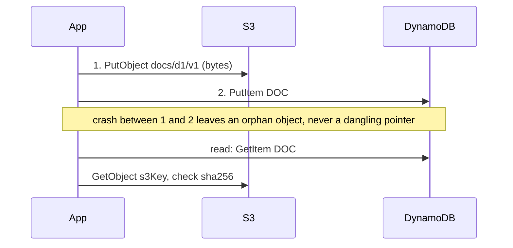

A DynamoDB item can be at most **400 KB**, and we pay per 4 KB read and per 1 KB written, every time we touch it. Item size is therefore both a hard limit and a cost lever. This page covers keeping items small, and what to do when the data really is big.

**Small items are cheap items.** A 40 KB item costs 40 write units for a one-byte change, and an unbounded list inside an item makes every append more expensive until it hits the limit. So we **split by access pattern** (vertical partitioning): data that's read or written separately, such as a summary, details and reviews, becomes separate items under the same partition key. What we can't split, we **compress**, since large text or JSON attributes gzip well and fit in a Binary attribute. And **big blobs belong in S3**: the object goes in S3, while DynamoDB keeps a pointer and the metadata. Chunking a blob across items works, but it's rarely the better choice.

| # | Pattern | What we'll learn |
|---|---|---|
| 17 | [Keep items small (item collections)](#17--keep-items-small-use-item-collections) | One item per child instead of a growing list; measured read costs |
| 18 | [Vertical partitioning](#18--vertical-partitioning) | Splitting a fat entity into SUMMARY / DETAILS / ... items |
| 19 | [Compression](#19--compression) | Gzipping a large attribute into Binary |
| 20 | [Offload large items to S3](#20--offload-large-items-to-s3) | Pointer + metadata + checksum in DynamoDB, the object in S3 |
| 21 | [Chunking](#21--chunking) | Splitting a blob across items with a manifest, and why S3 usually wins |

## 17 · Keep items small (use item collections)

**Code:** [17-small-items-item-collections.py](https://github.com/jfgrea27/dynamodb-patterns/blob/main/patterns/04-item-size/17-small-items-item-collections/17-small-items-item-collections.py) · run with `just run 17`

### Problem

It's tempting to model "a post and its comments" as one item with a `comments` list. That list grows without bound. Reading just the title then costs as much as reading every comment, and every append rewrites the whole item.

### Pattern

We keep each item small and bounded, and model "has many" as **separate items in the same partition** (an [item collection](../02-modelling/#04--single-table-design)) rather than as a list attribute:

| PK        | SK                              | attributes           |
|-----------|---------------------------------|----------------------|
| `POST#p2` | `POST`                          | title, comment_count |
| `POST#p2` | `COMMENT#2026-10-20T10:00`      | by, text             |
| `POST#p2` | `COMMENT#2026-10-20T10:01`      | by, text             |

- **Post only:** `GetItem(PK, SK=POST)`. This stays cheap no matter how many comments there are.
- **Latest N comments:** `Query(PK, SK begins_with COMMENT#, ScanIndexForward=False, Limit=N)`.

### In practice

The script builds the same post both ways with 50 comments, and asks DynamoDB what each read costs with `ReturnConsumedCapacity="TOTAL"`:

```python
# BAD: comments appended to a list on the post item.
table.put_item(Item={"PK": "POST#p1", "SK": "POST", "title": "Hello", "comments": []})
for i in range(50):
    table.update_item(
        Key={"PK": "POST#p1", "SK": "POST"},
        UpdateExpression="SET comments = list_append(comments, :c)",
        ExpressionAttributeValues={":c": [{"by": f"user{i}", "text": "Nice post! " * 20}]},
    )
resp = table.get_item(Key={"PK": "POST#p1", "SK": "POST"}, ReturnConsumedCapacity="TOTAL")

# GOOD: the post is small. Each comment is its own item in the same collection.
table.put_item(Item={"PK": "POST#p2", "SK": "POST", "title": "Hello", "comment_count": 50})
with table.batch_writer() as batch:
    for i in range(50):
        batch.put_item(Item={"PK": "POST#p2", "SK": f"COMMENT#2026-10-20T10:{i:02d}", "by": f"user{i}", "text": "Nice post! " * 20})

# Latest 5 comments, without reading the other 45
resp = table.query(
    KeyConditionExpression=Key("PK").eq("POST#p2") & Key("SK").begins_with("COMMENT#"),
    ScanIndexForward=False,
    Limit=5,
    ReturnConsumedCapacity="TOTAL",
)
```

```text
>>> UpdateItem p17-small-items
    key:        {PK: 'POST#p1', SK: 'POST'}
    update:     SET comments = list_append(comments, [{by: 'user0', text: 'Nice post! Nice post! Nice post! Nice post! Nice post! N...'}])
    ... (+47 more UpdateItem calls not shown)

>>> GetItem p17-small-items
    key:        {PK: 'POST#p1', SK: 'POST'}

=== BAD: one big item - read cost for just the title ===
{
  "TableName": "p17-small-items",
  "CapacityUnits": 1.5
}

>>> PutItem p17-small-items
    item:       {PK: 'POST#p2', SK: 'POST', title: 'Hello', comment_count: 50}

>>> BatchWriteItem
    p17-small-items: 25 puts, 0 deletes

>>> BatchWriteItem
    p17-small-items: 25 puts, 0 deletes

>>> GetItem p17-small-items
    key:        {PK: 'POST#p2', SK: 'POST'}

=== GOOD: post only - read cost ===
{
  "TableName": "p17-small-items",
  "CapacityUnits": 0.5
}

>>> Query p17-small-items
    key:        (PK = 'POST#p2' AND begins_with(SK, 'COMMENT#'))
    Limit:      5
    ScanIndexForward: False

=== GOOD: latest 5 comments ===
{
  "count": 5,
  "consumed": {
    "TableName": "p17-small-items",
    "CapacityUnits": 0.5
  },
  "first": "COMMENT#2026-10-20T10:49"
}
```

With only 50 short comments, reading the title from the big item already costs 3x as much as reading the small post item, and that gap grows with every comment. On the item-collection side, the latest 5 comments cost the same 0.5 units, and the first one back is the newest (`10:49`).

### Why

- **Cost.** Reads are billed per 4 KB and writes per 1 KB of the *whole item*. Updating one field on a 300 KB item costs 300 WCUs.
- **No 400 KB cliff.** Each comment is its own item.
- **Paging.** We can [page](../03-querying/#14--pagination-with-cursors) through comment items. We can't page through a list attribute.

### Trade-offs

- Showing a post with all its comments is now a `Query` rather than a `GetItem`. That's still one request.
- Counts must be kept on the parent, e.g. with [atomic counters](../05-consistency/#24--atomic-counters) or [Streams-maintained aggregates](../06-lifecycle-and-events/#32--streams-maintained-aggregates).

As a rule of thumb, a small list with a hard upper limit (say, 5 tags) is fine as an attribute. Anything unbounded or large should be separate items. [Vertical partitioning](#18--vertical-partitioning) and [single-table design](../02-modelling/#04--single-table-design) build on the same idea.

### Gotchas

- Pass `ReturnConsumedCapacity="TOTAL"` to see what a request really costs, as the script does.
- Hot item collections can still hit the per-partition throughput limit (~1,000 WCU / 3,000 RCU). See [write sharding](../07-performance-and-scale/#35--write-sharding).

## 18 · Vertical partitioning

**Code:** [18-vertical-partitioning.py](https://github.com/jfgrea27/dynamodb-patterns/blob/main/patterns/04-item-size/18-vertical-partitioning/18-vertical-partitioning.py) · run with `just run 18`

### Problem

One logical entity has grown into a fat item: summary fields, a long description, specs, reviews, stock. Two things go wrong:

- **Reads are expensive.** A listing page that needs only the name and price still pays for the whole item, because reads are billed per 4 KB.
- **Writes are expensive.** Updating one counter (`stock`) is billed on the **full item size**, because writes are billed per 1 KB of the item.

It also creeps towards the 400 KB limit.

### Pattern

We split the entity into several items under the **same partition key**, grouped by how they're accessed:

| PK           | SK           | attributes            | Access                   |
|--------------|--------------|-----------------------|--------------------------|
| `PRODUCT#p2` | `SUMMARY`    | name, price           | listing pages (hot)      |
| `PRODUCT#p2` | `INVENTORY`  | stock                 | changes often            |
| `PRODUCT#p2` | `DETAILS`    | description, specs    | product page only        |
| `PRODUCT#p2` | `REVIEW#u1`  | user, text            | paged, unbounded         |

- **Listing:** `GetItem SK=SUMMARY`. Small and cheap.
- **Stock change:** `UpdateItem SK=INVENTORY`. Billed on a tiny item.
- **Product page:** `Query PK=PRODUCT#p2`, which returns all the parts in one request. Or `BatchGetItem` for exactly the parts we need.

### In practice

The script stores a ~52 KB kettle once as a single `ALL` item, and once split into parts, then compares the consumed capacity of the listing read and of a stock change:

```python
fat = {
    "PK": "PRODUCT#p1", "SK": "ALL",
    "name": "Kettle", "price": 30, "stock": 12,
    "description": "x" * 20_000,
    "specs": {f"spec{i}": "y" * 100 for i in range(100)},
    "reviews": [{"user": f"u{i}", "text": "z" * 200} for i in range(100)],
}
table.put_item(Item=fat)

# Split by access pattern: hot/small fields vs. cold/large fields, same PK.
with table.batch_writer() as batch:
    batch.put_item(Item={"PK": "PRODUCT#p2", "SK": "SUMMARY", "name": "Kettle", "price": 30})
    batch.put_item(Item={"PK": "PRODUCT#p2", "SK": "INVENTORY", "stock": 12})  # changes often
    batch.put_item(Item={"PK": "PRODUCT#p2", "SK": "DETAILS", "description": fat["description"], "specs": fat["specs"]})
    for r in fat["reviews"]:
        batch.put_item(Item={"PK": "PRODUCT#p2", "SK": f"REVIEW#{r['user']}", **r})

# Stock updates now write a tiny item instead of rewriting the whole product.
resp = table.update_item(
    Key={"PK": "PRODUCT#p2", "SK": "INVENTORY"},
    UpdateExpression="ADD stock :d",
    ExpressionAttributeValues={":d": -1},
    ReturnConsumedCapacity="TOTAL",
)
```

```text
>>> PutItem p18-vertical-partitioning
    item:       {PK: 'PRODUCT#p1', SK: 'ALL', name: 'Kettle', price: 30, stock: 12, description: 'xxxxxxxxxxxxxxxxxxxxxxxxxxxxxxxxxxxxxxxxxxxxxxxxxxxxxxxx...', specs: {spec0: 'yyyyyyyyyyyyyyyyyyyyyyyyyyyyyyyyyyyyyyyyyyyyyyyyyyyyyyyy...', ...}, reviews: [{user: 'u0', text: 'zzzzzzzzzzzzzzzzzzzzzzzzzzzzzzzzzzzzzzzzzzzzzzzzzzzzzzzz...'}, ... +95]}

>>> GetItem p18-vertical-partitioning
    key:        {PK: 'PRODUCT#p1', SK: 'ALL'}

=== Fat item: read units to show name + price ===
6.5

>>> BatchWriteItem
    p18-vertical-partitioning: 25 puts, 0 deletes
    ... (+2 more BatchWriteItem calls not shown)

>>> GetItem p18-vertical-partitioning
    key:        {PK: 'PRODUCT#p2', SK: 'SUMMARY'}

=== Split: read units for SUMMARY ===
0.5

>>> UpdateItem p18-vertical-partitioning
    key:        {PK: 'PRODUCT#p2', SK: 'INVENTORY'}
    update:     ADD stock -1

=== Split: write units for a stock change ===
1.0

>>> UpdateItem p18-vertical-partitioning
    key:        {PK: 'PRODUCT#p1', SK: 'ALL'}
    update:     ADD stock -1

=== Fat item: write units for the same stock change ===
52.0

>>> Query p18-vertical-partitioning
    key:        PK = 'PRODUCT#p2'
    Limit:      5

=== Item collection query (first 5 by SK) ===
[
  "DETAILS",
  "INVENTORY",
  "REVIEW#u0",
  "REVIEW#u1",
  "REVIEW#u10"
]

>>> BatchGetItem
    p18-vertical-partitioning: 2 keys, e.g. {PK: 'PRODUCT#p2', SK: 'SUMMARY'}

=== Summary + inventory via BatchGetItem ===
[
  "INVENTORY",
  "SUMMARY"
]
```

The listing read drops from 6.5 to 0.5 read units, and the stock change from **52 to 1** write unit, for exactly the same logical operation. The item collection query also shows why sort-key naming matters: the parts come back in SK order (`DETAILS`, `INVENTORY`, `REVIEW#...`). The reviews sort as strings (`u10` before `u2`), and `SUMMARY` sorts after all of them.

### Why

- We pay only for the bytes each access pattern needs.
- Hot, frequently updated fields don't rewrite cold, large ones.
- Unbounded parts (reviews) become separate items and can't hit the 400 KB limit.

### Trade-offs

- Reading the whole entity takes a `Query` (or several gets) instead of one `GetItem`.
- Changes that span parts need a [transaction](../05-consistency/#25--transactions) to stay atomic.
- The app has to put the parts back together.

### Gotchas

- Choose sort keys so that useful groups are contiguous. A `begins_with` or range query can then fetch "summary + details" without the reviews.
- Don't over-split. Fields that are always read and written together belong on the same item.
- If one part is still too big, [compress](#19--compression) it or [move it to S3](#20--offload-large-items-to-s3).

This builds directly on [keeping items small](#17--keep-items-small-use-item-collections) and [single-table design](../02-modelling/#04--single-table-design).

## 19 · Compression

**Code:** [19-compression.py](https://github.com/jfgrea27/dynamodb-patterns/blob/main/patterns/04-item-size/19-compression/19-compression.py) · run with `just run 19`

### Problem

Items are capped at 400 KB, and we pay per 1 KB written and per 4 KB read. Large text attributes (JSON blobs, transcripts, HTML) push items towards the limit, and cost more on every access.

### Pattern

We compress large attributes in the application (gzip, zstd, brotli) and store them as a **Binary** (`B`) attribute. Anything we filter on or project stays as a normal, uncompressed attribute:

| PK        | SK           | status    | turns | body_gz            | encoding    |
|-----------|--------------|-----------|-------|--------------------|-------------|
| `CALL#c1` | `TRANSCRIPT` | completed | 200   | `<gzip bytes>`     | `gzip+json` |

### In practice

The script builds a chatty 2,500-turn call transcript as JSON, tries to store it uncompressed, and then stores it gzipped:

```python
raw = json.dumps(transcript).encode()
compressed = gzip.compress(raw)

# Uncompressed, the item is over the 400 KB limit and DynamoDB rejects it.
table.put_item(Item={"PK": "CALL#c1", "SK": "TRANSCRIPT", "body": raw.decode()})

# Store compressed. Keep queryable fields (status, duration) as plain attributes.
table.put_item(
    Item={
        "PK": "CALL#c1",
        "SK": "TRANSCRIPT",
        "status": "completed",
        "turns": len(transcript),
        "body_gz": Binary(compressed),
        "encoding": "gzip+json",
    }
)

item = table.get_item(Key={"PK": "CALL#c1", "SK": "TRANSCRIPT"})["Item"]
restored = json.loads(gzip.decompress(item["body_gz"].value))
```

```text
=== Sizes ===
{
  "raw_bytes": 532640,
  "gzipped_bytes": 7690,
  "ratio": 69.3
}

>>> PutItem p19-compression
    item:       {PK: 'CALL#c1', SK: 'TRANSCRIPT', body: '[{"turn": 0, "speaker": "caller", "text": "Hello, how ca...'}

=== Uncompressed put failed ===
"An error occurred (ValidationException) when calling the PutItem operation: Item size has exceeded the maximum allowed s"

>>> PutItem p19-compression
    item:       {PK: 'CALL#c1', SK: 'TRANSCRIPT', status: 'completed', turns: 2500, body_gz: <7690 bytes>, encoding: 'gzip+json'}

>>> GetItem p19-compression
    key:        {PK: 'CALL#c1', SK: 'TRANSCRIPT'}

=== Read back ===
{
  "status": "completed",
  "turns": 2500,
  "first_turn": {
    "turn": 0,
    "speaker": "caller",
    "text": "Hello, how can I help you today? Hello, how can I help you today? Hello, how can I help you today? Hello, how can I help you today? Hello, how can I help you today? "
  }
}
```

The raw 532 KB document is rejected outright. Gzipped, it's 7.7 KB, which fits easily, and it reads back intact. The 69x ratio is flattered by the very repetitive demo text, but real-world text still often shrinks 5–20x.

### Why

- Text often shrinks 5–20x. That means fewer write units, fewer read units and less storage.
- It keeps a document in a single item when it would otherwise need [chunking](#21--chunking) or [offloading to S3](#20--offload-large-items-to-s3).

### Trade-offs

- DynamoDB can't see inside the blob. We can't filter on it, update part of it, or index it.
- Compression costs CPU on the client.
- The data is opaque in the console and to tools like Athena exports, so it has to be decompressed first.

### Gotchas

- Store an `encoding` attribute, so we can change the algorithm later.
- Compression helps but doesn't remove the limit. If the data can grow without bound, use [S3](#20--offload-large-items-to-s3).
- Binary values are base64-encoded on the wire, but they're billed on their raw byte size.

## 20 · Offload large items to S3

**Code:** [20-offload-to-s3.py](https://github.com/jfgrea27/dynamodb-patterns/blob/main/patterns/04-item-size/20-offload-to-s3/20-offload-to-s3.py) · run with `just run 20`

> DynamoDB Local has no S3, so the script simulates the bucket with a local temp directory. The DynamoDB side is real.

### Problem

A DynamoDB item can be at most **400 KB**, counting both attribute names and values. Documents, images, transcripts and large JSON payloads don't fit. Even items that do fit are expensive: every read of a 300 KB item costs about 75 read units (strongly consistent), or about 38 (eventually consistent).

### Pattern

We put the bytes in S3, and keep only small, queryable metadata plus a pointer in DynamoDB:

| PK        | SK     | title            | size    | sha256 | s3Bucket       | s3Key          |
|-----------|--------|------------------|---------|--------|----------------|----------------|
| `DOC#d1`  | `META` | Quarterly report | 1048576 | ab12…  | my-docs-bucket | `docs/d1/v1`   |

The write order matters: **upload to S3 first, then write the DynamoDB item.** If the process crashes in between, we're left with an orphan object rather than a dangling pointer. An S3 lifecycle rule or a sweeper job can clean up orphans.



On real AWS, the code looks like this:

```python
s3 = boto3.client("s3")
s3.put_object(Bucket=BUCKET, Key=key, Body=body)
table.put_item(Item={"PK": f"DOC#{doc_id}", "SK": "META", "s3Key": key, ...})
# read
body = s3.get_object(Bucket=item["s3Bucket"], Key=item["s3Key"])["Body"].read()
```

### In practice

The script first tries to store a 1 MB document inline, then does it properly. `LocalBlobStore` has the same `put_object` / `get_object` shape as the S3 client:

```python
s3 = LocalBlobStore(tempfile.mkdtemp(prefix="p20-s3-"))
body = os.urandom(1024 * 1024)

# Write order matters: blob FIRST, then the pointer.
s3_key = f"docs/{doc_id}/v1"
s3.put_object(Bucket=BUCKET, Key=s3_key, Body=body)
table.put_item(Item={
    "PK": f"DOC#{doc_id}", "SK": "META",
    "title": "Quarterly report",
    "contentType": "application/pdf",
    "size": len(body),
    "sha256": hashlib.sha256(body).hexdigest(),
    "s3Bucket": BUCKET,
    "s3Key": s3_key,
    "uploadedAt": int(time.time()),
})

meta = table.get_item(Key={"PK": f"DOC#{doc_id}", "SK": "META"})["Item"]
blob = s3.get_object(Bucket=meta["s3Bucket"], Key=meta["s3Key"])["Body"]
show("Fetched blob matches checksum", hashlib.sha256(blob).hexdigest() == meta["sha256"])
```

```text
>>> PutItem p20-offload-s3
    item:       {PK: 'DOC#too-big', SK: 'META', body: <1048576 bytes>}

=== Storing 1 MB inline fails ===
"Item size has exceeded the maximum allowed size"

>>> PutItem p20-offload-s3
    item:       {PK: 'DOC#d1', SK: 'META', title: 'Quarterly report', contentType: 'application/pdf', size: 1048576, sha256: '4a8e0309324a38f117c58cb7461447c23fb29941ee2f293de72dceef...', s3Bucket: 'my-docs-bucket', s3Key: 'docs/d1/v1', uploadedAt: 1792496909}

>>> GetItem p20-offload-s3
    key:        {PK: 'DOC#d1', SK: 'META'}

=== DynamoDB item (small, queryable metadata) ===
{
  "s3Key": "docs/d1/v1",
  "size": 1048576,
  "sha256": "4a8e0309324a38f117c58cb7461447c23fb29941ee2f293de72dceef1e83bf0a",
  "SK": "META",
  "uploadedAt": 1792496909,
  "PK": "DOC#d1",
  "title": "Quarterly report",
  "contentType": "application/pdf",
  "s3Bucket": "my-docs-bucket"
}

=== Fetched blob matches checksum ===
true
```

The inline write is rejected. The pointer item is a few hundred bytes, so listing and searching documents stays cheap, and the checksum lets the reader confirm the bytes it fetched are the ones the metadata describes.

### Why

- There's no size limit in practice: S3 objects can be up to 5 TB.
- Lists and queries stay cheap, because they only read small items.
- S3 storage costs far less per GB than DynamoDB.
- Clients can download directly from S3 using presigned URLs.

### Trade-offs

- Getting the content takes two calls.
- There's no cross-service transaction, so we have to handle orphans and failures ourselves.
- Deletes must remove both sides. A [Streams](../06-lifecycle-and-events/#31--dynamodb-streams--cdc) handler can delete the S3 object when the item is deleted.

### Gotchas

- Use **versioned or immutable keys** (`docs/d1/v2`). Overwriting the same key lets readers see the new blob with the old metadata.
- Store a checksum, so readers can detect mismatches.
- If the payload is only somewhat too big, try [compression](#19--compression) first.

See also [vertical partitioning](#18--vertical-partitioning), [chunking](#21--chunking) and [keeping items small](#17--keep-items-small-use-item-collections).

## 21 · Chunking

**Code:** [21-chunking.py](https://github.com/jfgrea27/dynamodb-patterns/blob/main/patterns/04-item-size/21-chunking/21-chunking.py) · run with `just run 21`

### Problem

A value is bigger than the 400 KB item limit even after [compression](#19--compression), and we can't (or won't) use S3.

### Pattern

We split the value into fixed-size pieces and store each piece as its own item under the same partition key, with a zero-padded sort key. A manifest item records how many chunks there are:

| PK                | SK           | attributes              |
|-------------------|--------------|-------------------------|
| `DOC#report-2026` | `CHUNK#0000` | data (300 KB), version  |
| `DOC#report-2026` | `CHUNK#0001` | data (300 KB), version  |
| `DOC#report-2026` | `CHUNK#0002` | data, version           |
| `DOC#report-2026` | `MANIFEST`   | chunks=4, size, version |

To read it back, we `Query(PK=DOC#..., SK begins_with CHUNK#)` and concatenate the pieces in order.

### In practice

The script splits ~1 MB of random bytes into 300 KB chunks, writes them alongside a manifest, then reads them back with a paged query:

```python
CHUNK_SIZE = 300 * 1024  # stay safely under the 400 KB item limit
blob = os.urandom(1_000_000)  # ~1 MB - too big for one item
chunks = [blob[i : i + CHUNK_SIZE] for i in range(0, len(blob), CHUNK_SIZE)]

with table.batch_writer() as batch:
    batch.put_item(Item={"PK": DOC_ID, "SK": "MANIFEST", "chunks": len(chunks), "size": len(blob), "version": 1})
    for i, chunk in enumerate(chunks):
        batch.put_item(Item={"PK": DOC_ID, "SK": f"CHUNK#{i:04d}", "data": Binary(chunk), "version": 1})

# Read: one Query returns the chunks in SK order. Query pages at 1 MB, so loop.
parts, kwargs = [], {"KeyConditionExpression": Key("PK").eq(DOC_ID) & Key("SK").begins_with("CHUNK#")}
while True:
    resp = table.query(**kwargs)
    parts.extend(item["data"].value for item in resp["Items"])
    if "LastEvaluatedKey" not in resp:
        break
    kwargs["ExclusiveStartKey"] = resp["LastEvaluatedKey"]
```

```text
>>> BatchWriteItem
    p21-chunking: 5 puts, 0 deletes

=== Wrote ===
{
  "bytes": 1000000,
  "chunks": 4
}

>>> Query p21-chunking
    key:        (PK = 'DOC#report-2026' AND begins_with(SK, 'CHUNK#'))

>>> GetItem p21-chunking
    key:        {PK: 'DOC#report-2026', SK: 'MANIFEST'}

=== Reassembled ===
{
  "chunks_read": 4,
  "expected": 4,
  "matches": true
}
```

The manifest plus 4 chunks go in as 5 puts in a single batch, and a single query returns all 4 chunks in order. The reassembled bytes match the original, and the chunk count matches the manifest.

### Why

- No extra service is needed. Everything stays in DynamoDB, including backups, streams and IAM.
- Reads stay in one partition and come back ordered by the sort key.

### Trade-offs

- **This is usually the wrong choice.** [Offloading to S3](#20--offload-large-items-to-s3) is cheaper and simpler for large blobs, since DynamoDB storage and throughput cost much more per GB than S3.
- Reading 1 MB costs about 250 RCUs (strongly consistent), whereas an S3 GET is a flat fee.
- Writes aren't atomic unless we use a [transaction](../05-consistency/#25--transactions) (max 100 items, 4 MB total). Without one, readers can see a half-written document.

### Gotchas

- Zero-pad chunk numbers (`0001`, not `1`). Otherwise `CHUNK#10` sorts before `CHUNK#2`.
- Put a `version` on every chunk and on the manifest. Readers should reject a mix of versions. Writers should write the new chunks first, then flip the manifest.
- `Query` returns at most 1 MB per page, so we always follow `LastEvaluatedKey`.
- When a document shrinks, delete the extra chunks left over from the old version.
