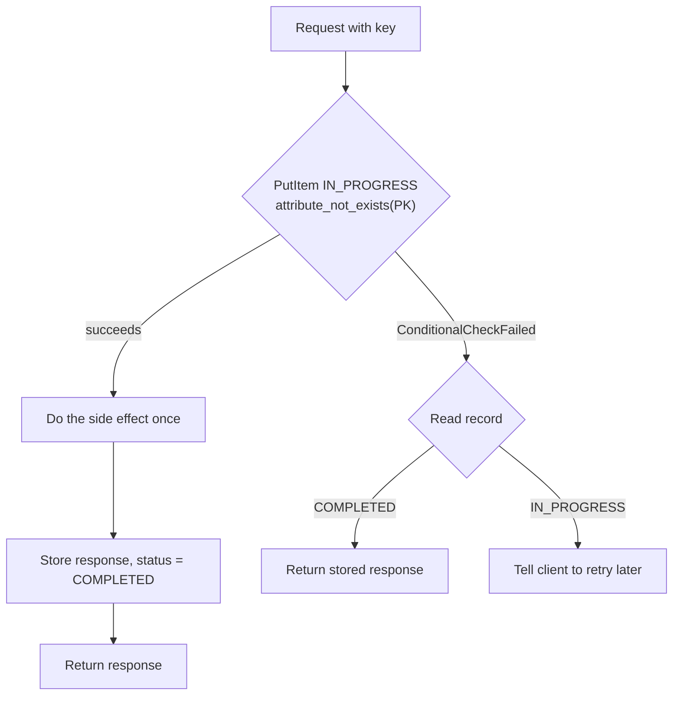

This part is about staying correct when many clients write at once. DynamoDB has no locks in the usual sense. Instead, every write can carry a **condition** that DynamoDB checks atomically on the server, and every pattern on this page is built from that one primitive (plus transactions for the multi-item cases).

The ideas build on each other. **Conditional writes** reject a write unless the item is in the state we expect: it doesn't exist yet, a field has a given value, or there's enough balance left. **Optimistic locking** is just a conditional write on a `version` number: we read, change, and write only if the version hasn't moved, retrying if it has. **Atomic updates** (`ADD`, `SET x = x + :n`) change a value on the server, so there's no read-modify-write race at all. **Transactions** make up to 100 writes all-or-nothing, and they're also how we enforce uniqueness on a non-key attribute, by writing a sentinel item in the same transaction. **Idempotency keys** make retries safe: we record the request ID with a condition, so the second attempt gets the stored result back.

Two warnings round it off. **GSIs lag behind the table**, so we should never use a GSI read to decide whether a write is safe. And **distributed locks** are conditional writes with a lease, kept for the rare cases that genuinely need mutual exclusion.

| # | Pattern | What we'll learn |
|---|---|---|
| 22 | [Conditional writes](#22--conditional-writes) | Create-only, update-if-exists, business-rule conditions |
| 23 | [Optimistic locking](#23--optimistic-locking) | Version checks and a retry loop |
| 24 | [Atomic counters](#24--atomic-counters) | `ADD` vs read-then-write under concurrency; floors and sequences |
| 25 | [Transactions](#25--transactions) | `TransactWriteItems`, cancellation reasons, `TransactGetItems` |
| 26 | [Unique constraints on non-key attributes](#26--unique-constraints-on-non-key-attributes) | Sentinel items for unique emails; changing a unique value |
| 27 | [Idempotency keys](#27--idempotency-keys) | Exactly-once effects for retried requests |
| 28 | [GSIs are eventually consistent](#28--gsis-are-eventually-consistent) | Why GSI reads can be stale, and the workarounds |
| 29 | [Distributed locking](#29--distributed-locking) | Leases, heartbeats, owner-checked release, takeover |

---

## 22 · Conditional writes

**Code:** [22-conditional-writes.py](https://github.com/jfgrea27/dynamodb-patterns/blob/main/patterns/05-consistency/22-conditional-writes/22-conditional-writes.py) · run with `just run 22`

### Problem

`PutItem` replaces whatever is already there, and `UpdateItem` creates the item if it doesn't exist (an upsert). Without guards, we get accidental overwrites, "ghost" items created by updates that should have failed, and broken business rules such as negative balances or double bookings.

### Pattern

We add a `ConditionExpression` to the write. DynamoDB checks it **atomically on the server**, and if it's false, the write is rejected with `ConditionalCheckFailedException`.

A handful of conditions cover most needs:

| Goal                         | Condition                                       |
|------------------------------|-------------------------------------------------|
| Create only, no overwrite    | `attribute_not_exists(PK)`                      |
| Update only if item exists   | `attribute_exists(PK)`                          |
| Optimistic lock              | `version = :expected` ([23](#23--optimistic-locking)) |
| Business rule                | `credits >= :amount AND #status = :active`      |
| State machine transition     | `#status = :from` (e.g. only PENDING → PAID)    |

### In practice

The script runs through the first, second and fourth rows of that table against a user with 10 credits. The business-rule guard looks like this:

```python
spend = lambda amount: table.update_item(
    Key={"PK": "USER#alice", "SK": "PROFILE"},
    UpdateExpression="SET credits = credits - :a",
    ConditionExpression="credits >= :a AND #s = :active",
    ExpressionAttributeNames={"#s": "status"},
    ExpressionAttributeValues={":a": amount, ":active": "active"},
)
```

```text
>>> PutItem p22-conditional-writes
    item:       {PK: 'USER#alice', SK: 'PROFILE', name: 'Alice', credits: 10, status: 'active'}
    condition:  attribute_not_exists(PK)

=== Create alice (first time) ===
"OK"

>>> PutItem p22-conditional-writes
    item:       {PK: 'USER#alice', SK: 'PROFILE', name: 'Alice', credits: 10, status: 'active'}
    condition:  attribute_not_exists(PK)

=== Create alice again (would overwrite) ===
"ConditionalCheckFailedException"

>>> UpdateItem p22-conditional-writes
    key:        {PK: 'USER#bob', SK: 'PROFILE'}
    condition:  attribute_exists(PK)
    update:     SET name = 'Bob'

=== Update bob (doesn't exist) ===
"ConditionalCheckFailedException"

>>> UpdateItem p22-conditional-writes
    key:        {PK: 'USER#alice', SK: 'PROFILE'}
    condition:  credits >= 7 AND status = 'active'
    update:     SET credits = credits - 7

=== Spend 7 credits ===
"OK"

>>> UpdateItem p22-conditional-writes
    key:        {PK: 'USER#alice', SK: 'PROFILE'}
    condition:  credits >= 7 AND status = 'active'
    update:     SET credits = credits - 7

=== Spend 7 more (only 3 left) ===
"ConditionalCheckFailedException"

>>> UpdateItem p22-conditional-writes
    key:        {PK: 'USER#alice', SK: 'PROFILE'}
    condition:  credits >= 7
    update:     SET credits = credits - 7
    ReturnValuesOnConditionCheckFailure: ALL_OLD

=== Item at failure time ===
{
  "credits": 3,
  "SK": "PROFILE",
  "name": "Alice",
  "PK": "USER#alice",
  "status": "active"
}
```

The second create is refused instead of overwriting Alice. The update to Bob is refused instead of quietly creating a half-empty Bob. The second spend is refused because only 3 credits are left. The last call asks for `ALL_OLD` on failure, so the error hands back the item as it was when the condition failed (3 credits), and we don't need a second read to find out why.

### Why

- It's an atomic check-and-write with no transaction and no lock.
- It costs the same as a normal write.
- It's the building block for uniqueness ([26](#26--unique-constraints-on-non-key-attributes)), idempotency ([27](#27--idempotency-keys)) and locks ([29](#29--distributed-locking)).

### Trade-offs

- A condition can only look at the **one item** being written. For rules that span several items, we need [transactions](#25--transactions) (`ConditionCheck`).
- A failed write still uses write capacity.

### Gotchas

- `attribute_not_exists(PK)` means "no item with this full key exists". It does not check the whole partition.
- Reserved words (`status`, `name`, `count`…) need `ExpressionAttributeNames` (`#s`).
- Passing `ReturnValuesOnConditionCheckFailure="ALL_OLD"` gets the current item back on failure, which saves a re-read. The item comes back in the raw `{"S": ...}` form, so we have to deserialize it ourselves (the script uses `TypeDeserializer` for this).

---

## 23 · Optimistic locking

**Code:** [23-optimistic-locking.py](https://github.com/jfgrea27/dynamodb-patterns/blob/main/patterns/05-consistency/23-optimistic-locking/23-optimistic-locking.py) · run with `just run 23`

### Problem

Two clients read the same item, change it in memory, and write it back. The second write silently overwrites the first. This is a **lost update**, and DynamoDB has no row locks to stop it.

### Pattern

We keep a `version` number on the item. Every write says "only if the version is still what I read", and increments it:

```python
table.put_item(
    Item={**item, "version": v + 1},
    ConditionExpression="version = :v",
    ExpressionAttributeValues={":v": v},
)
```

If someone else wrote in between, the call fails with `ConditionalCheckFailedException`. The client then re-reads, re-applies its change and retries.

| PK           | SK     | balance | version |
|--------------|--------|---------|---------|
| `ACCOUNT#a1` | `META` | 150     | 2       |

### In practice

The script starts an account at balance 100, version 1. Clients A and B both read it. A deposits 50 and wins; B tries to withdraw 30 based on its stale read. Then B uses the standard fix, a retry loop that re-reads with `ConsistentRead=True`:

```python
def update_with_retry(change, attempts=3):
    for _ in range(attempts):
        current = table.get_item(Key=key, ConsistentRead=True)["Item"]
        try:
            save(change(current), current["version"])
            return
        except ClientError as e:
            if e.response["Error"]["Code"] != "ConditionalCheckFailedException":
                raise
    raise RuntimeError("gave up after retries")
```

```text
>>> PutItem p23-optimistic-locking
    item:       {SK: 'META', PK: 'ACCOUNT#a1', balance: 150, version: 2}
    condition:  version = 1

>>> GetItem p23-optimistic-locking
    key:        {PK: 'ACCOUNT#a1', SK: 'META'}

=== A deposited 50 ===
{
  "SK": "META",
  "PK": "ACCOUNT#a1",
  "balance": 150,
  "version": 2
}

>>> PutItem p23-optimistic-locking
    item:       {SK: 'META', PK: 'ACCOUNT#a1', balance: 70, version: 2}
    condition:  version = 1

=== B rejected ===
"ConditionalCheckFailedException"

>>> GetItem p23-optimistic-locking
    key:        {PK: 'ACCOUNT#a1', SK: 'META'}
    ConsistentRead: True

>>> PutItem p23-optimistic-locking
    item:       {SK: 'META', PK: 'ACCOUNT#a1', balance: 120, version: 3}
    condition:  version = 2

...

=== B retried on fresh data ===
{
  "SK": "META",
  "PK": "ACCOUNT#a1",
  "balance": 120,
  "version": 3
}
```

B's first write would have set the balance to 70, wiping out A's deposit. The `version = 1` condition catches it. On retry, B reads version 2 (balance 150), applies its withdrawal and writes 120 at version 3, which is the right answer.

### Why

- There are no locks to hold, expire or clean up. Contention is detected at write time.
- It costs no more than a normal write (although a failed condition still uses write capacity).
- It works with `PutItem`, `UpdateItem`, `DeleteItem` and transactions.

### Trade-offs

- Under heavy contention, clients retry a lot. In that case, use a pessimistic lock ([29](#29--distributed-locking)) or restructure the data.
- For simple numeric changes, an atomic `ADD` ([24](#24--atomic-counters)) or a guarded `UpdateItem` (`SET balance = balance - :x` with `balance >= :x`) avoids the read entirely.

### Gotchas

- Re-read with `ConsistentRead=True` before retrying. Otherwise we may get the stale version again.
- Cap the retries and add jitter.
- The Java SDK's DynamoDBMapper `@DynamoDBVersionAttribute` and PynamoDB's `VersionAttribute` do all of this for us.
- Related: [conditional writes](#22--conditional-writes).

---

## 24 · Atomic counters

**Code:** [24-atomic-counters.py](https://github.com/jfgrea27/dynamodb-patterns/blob/main/patterns/05-consistency/24-atomic-counters/24-atomic-counters.py) · run with `just run 24`

### Problem

Page views, likes, stock levels and sequence numbers all need increments. If we read the value, add one in code and write it back, we lose updates whenever two clients do it at the same time.

### Pattern

We let DynamoDB do the arithmetic with `UpdateItem`:

```python
table.update_item(
    Key={"PK": "POST#hello-world", "SK": "STATS"},
    UpdateExpression="ADD #v :one",
    ExpressionAttributeNames={"#v": "views"},
    ExpressionAttributeValues={":one": 1},
    ReturnValues="UPDATED_NEW",  # optional: get the new value back
)
```

- `ADD` (or `SET x = if_not_exists(x, :zero) + :one`) is applied atomically on the server.
- Adding a `ConditionExpression` gives us a **bounded counter**, e.g. `remaining > :zero` so tickets never oversell.
- `ReturnValues="UPDATED_NEW"` turns a counter into a **sequence generator**, for things like invoice numbers.

### In practice

The script fires 50 increments from 10 threads twice: once with `ADD`, and once with the racy read-then-put approach:

```python
def racy_increment(_):
    current = table.get_item(Key=KEY)["Item"]["views"]
    table.put_item(Item={**KEY, "views": current + 1})
```

The full output is 344 lines, almost all of it the racy loop's interleaved `GetItem`/`PutItem` pairs. Here are the interesting parts:

```text
>>> UpdateItem p24-atomic-counters
    key:        {PK: 'POST#hello-world', SK: 'STATS'}
    update:     ADD views 1
    ... (+47 more UpdateItem calls not shown)

=== After 50 concurrent increments ===
{
  "SK": "STATS",
  "views": 50,
  "PK": "POST#hello-world"
}

>>> PutItem p24-atomic-counters
    item:       {PK: 'POST#hello-world', SK: 'STATS', views: 1}

>>> PutItem p24-atomic-counters
    item:       {PK: 'POST#hello-world', SK: 'STATS', views: 1}
...
>>> PutItem p24-atomic-counters
    item:       {PK: 'POST#hello-world', SK: 'STATS', views: 6}

>>> PutItem p24-atomic-counters
    item:       {PK: 'POST#hello-world', SK: 'STATS', views: 6}

=== Racy read-modify-write after 50 'increments' (expect < 50) ===
{
  "SK": "STATS",
  "views": 6,
  "PK": "POST#hello-world"
}

>>> UpdateItem p24-atomic-counters
    key:        {PK: 'SEQUENCE#invoice', SK: 'COUNTER'}
    update:     ADD next 1
    ReturnValues: UPDATED_NEW

=== Next invoice number ===
{
  "next": 1
}

>>> UpdateItem p24-atomic-counters
    key:        {PK: 'TICKETS#gig', SK: 'COUNTER'}
    condition:  remaining > 0
    update:     ADD remaining -1

=== Ticket sale 1: sold ===

>>> UpdateItem p24-atomic-counters
    key:        {PK: 'TICKETS#gig', SK: 'COUNTER'}
    condition:  remaining > 0
    update:     ADD remaining -1

=== Ticket sale 2: sold out ===
```

`ADD` lands on exactly 50. The read-modify-write version ends on **6**: threads kept reading the same value and writing the same "+1" over each other (note the repeated `views: 1` and `views: 6` puts), so 44 increments were lost. The exact number will differ on every run, but it will almost always be well below 50. The last two blocks show `UPDATED_NEW` handing out an invoice number, and the `remaining > 0` condition refusing to sell a second ticket when only one was left.

### Why

- **No lost updates.** No read is needed, so there's no race.
- **One round trip.** There's no optimistic-lock retry loop ([23](#23--optimistic-locking)).

### Trade-offs

- **Not idempotent.** If the request times out and we retry it, we may count twice. That's fine for view counts but not for money. When exact counts matter, use [idempotency keys](#27--idempotency-keys) or a [transaction](#25--transactions) with a `ClientRequestToken`.
- **Hot keys.** A single counter item is limited to about 1,000 WCU/s. For very high write rates, shard the counter ([write sharding](../07-performance-and-scale/#35--write-sharding)) or aggregate from a stream ([streams-maintained aggregates](../06-lifecycle-and-events/#32--streams-maintained-aggregates)).

### Gotchas

- Many common names are reserved words (`views`, `count`, `name`, `status`, `total`, `next`...). Use `ExpressionAttributeNames`.
- `ADD` on a missing attribute starts at 0. `SET x = x + :n` fails on a missing attribute unless we wrap it in `if_not_exists`.
- Numbers come back as `Decimal` in boto3.

---

## 25 · Transactions

**Code:** [25-transactions.py](https://github.com/jfgrea27/dynamodb-patterns/blob/main/patterns/05-consistency/25-transactions/25-transactions.py) · run with `just run 25`

### Problem

Placing an order touches three items: we create the order, decrement the stock and bump the customer's order count. If one write succeeds and another fails, the data is left inconsistent: an order without stock taken, or stock taken without an order.

### Pattern

We use `TransactWriteItems` for all-or-nothing writes. Each action can have its own `ConditionExpression`, and if any condition fails, nothing is written.

| Action | Key                          | Condition                  |
|--------|------------------------------|----------------------------|
| Put    | `USER#alice` / `ORDER#o1`    | `attribute_not_exists(PK)` |
| Update | `PRODUCT#widget` / `STOCK`   | `stock >= :qty`            |
| Update | `USER#alice` / `PROFILE`     | none                       |

- When a transaction fails, the error includes `CancellationReasons`, one per action, so we can see which condition failed.
- `ClientRequestToken` makes the call idempotent for 10 minutes. A retry with the same token doesn't apply the writes twice.
- `TransactGetItems` reads up to 100 items as one consistent snapshot.

### In practice

The script starts with 3 widgets in stock and `orderCount: 0`, then places an order for 2 (fine) and an order for 5 (not enough stock):

```python
client.transact_write_items(
    TransactItems=[
        {"Put": {..., "Item": {"PK": "USER#alice", "SK": f"ORDER#{order_id}", "qty": qty},
                 "ConditionExpression": "attribute_not_exists(PK)"}},
        {"Update": {..., "Key": {"PK": "PRODUCT#widget", "SK": "STOCK"},
                    "UpdateExpression": "SET stock = stock - :q",
                    "ConditionExpression": "stock >= :q", ...}},
        {"Update": {..., "Key": {"PK": "USER#alice", "SK": "PROFILE"},
                    "UpdateExpression": "ADD orderCount :one", ...}},
    ],
    # Same token within 10 minutes = same transaction, so retries are safe.
    ClientRequestToken=f"place-order-{order_id}",
)
```

```text
>>> TransactWriteItems
    - Put p25-transactions
        item:       {PK: 'USER#alice', SK: 'ORDER#o1', qty: 2}
        condition:  attribute_not_exists(PK)
    - Update p25-transactions
        key:        {PK: 'PRODUCT#widget', SK: 'STOCK'}
        condition:  stock >= 2
        update:     SET stock = stock - 2
    - Update p25-transactions
        key:        {PK: 'USER#alice', SK: 'PROFILE'}
        update:     ADD orderCount 1

=== Order o1 (qty 2) succeeded ===

>>> TransactWriteItems
    - Put p25-transactions
        item:       {PK: 'USER#alice', SK: 'ORDER#o2', qty: 5}
        condition:  attribute_not_exists(PK)
    - Update p25-transactions
        key:        {PK: 'PRODUCT#widget', SK: 'STOCK'}
        condition:  stock >= 5
        update:     SET stock = stock - 5
    - Update p25-transactions
        key:        {PK: 'USER#alice', SK: 'PROFILE'}
        update:     ADD orderCount 1

=== Order o2 (qty 5) cancelled - per-item reasons ===
[
  "None",
  "ConditionalCheckFailed",
  "None"
]

>>> TransactGetItems
    - Get p25-transactions
        key:        {PK: 'PRODUCT#widget', SK: 'STOCK'}
    - Get p25-transactions
        key:        {PK: 'USER#alice', SK: 'PROFILE'}
    - Get p25-transactions
        key:        {PK: 'USER#alice', SK: 'ORDER#o2'}

=== TransactGetItems: stock, profile, ORDER#o2 ===
[
  {
    "SK": "STOCK",
    "stock": 1,
    "PK": "PRODUCT#widget"
  },
  {
    "SK": "PROFILE",
    "orderCount": 1,
    "PK": "USER#alice"
  },
  null
]
```

`CancellationReasons` points straight at the second action, the stock check. The `TransactGetItems` snapshot then proves nothing from the failed transaction leaked through: stock is still 1, `orderCount` is still 1, and `ORDER#o2` doesn't exist, even though the order `Put` and the counter `Update` had nothing wrong with them on their own.

### Why

- **Correctness.** Use it for invariants that span items: stock never goes negative, a username stays unique (see [26](#26--unique-constraints-on-non-key-attributes)), a balance transfer debits and credits together.
- **No custom saga or rollback code** for the simple cases.

### Trade-offs

- **Twice the cost.** Each item in a transaction uses 2 WCUs/RCUs instead of 1.
- **Limits.** Up to 100 actions and 4 MB in total, and we can't touch the same item twice in one transaction.
- **Conflicts.** Concurrent transactions on the same items fail with `TransactionConflict`, and hot items in transactions make contention worse.
- We can't read a value and then use it in the same transaction. Conditions only compare against constants we pass in.
- For a single-item invariant, a [conditional write](#22--conditional-writes) is cheaper, and so is an [atomic counter](#24--atomic-counters).

### Gotchas

- `TransactionCanceledException` is a `ClientError`. Read `e.response["CancellationReasons"]`, because the error message alone is vague.
- Transactions work within one region. On global tables, other regions see the writes replicated item by item, not as one atomic unit ([global tables](../08-operations/#40--global-tables-multi-region)).
- Streams emit one record per item, not one per transaction ([Streams / CDC](../06-lifecycle-and-events/#31--dynamodb-streams--cdc)).

---

## 26 · Unique constraints on non-key attributes

**Code:** [26-unique-constraints.py](https://github.com/jfgrea27/dynamodb-patterns/blob/main/patterns/05-consistency/26-unique-constraints/26-unique-constraints.py) · run with `just run 26`

### Problem

DynamoDB only enforces uniqueness on the primary key. We want "email must be unique across users", but email isn't the key, and GSIs don't enforce uniqueness.

### Pattern

For each unique value, we write a **sentinel item** whose key *is* that value. We write it in the **same transaction** as the main item, with `attribute_not_exists(PK)` on both.

| PK                  | SK        | attributes        |
|---------------------|-----------|-------------------|
| `USER#alice`        | `PROFILE` | email=a@x.com     |
| `EMAIL#a@x.com`     | `EMAIL`   | user_id=alice     |
| `USER#bob`          | `PROFILE` | email=bob@x.com   |
| `EMAIL#bob@x.com`   | `EMAIL`   | user_id=bob       |

- **Create:** `TransactWriteItems[ Put user (not exists), Put EMAIL# sentinel (not exists) ]`
- **Change email:** `TransactWriteItems[ Delete old sentinel, Put new sentinel (not exists), Update user (email = old) ]`
- **Delete user:** delete the user and the sentinel together.

### In practice

Creating a user is a two-item transaction. Note the `email.lower()` when building the sentinel key:

```python
client.transact_write_items(
    TransactItems=[
        {"Put": {"TableName": TABLE,
                 "Item": {"PK": f"USER#{user_id}", "SK": "PROFILE", "email": email},
                 "ConditionExpression": "attribute_not_exists(PK)"}},
        {"Put": {"TableName": TABLE,
                 "Item": {"PK": f"EMAIL#{email.lower()}", "SK": "EMAIL", "user_id": user_id},
                 "ConditionExpression": "attribute_not_exists(PK)"}},
    ]
)
```

Alice signs up with `a@x.com`. Then Bob tries `A@x.com`:

```text
>>> TransactWriteItems
    - Put p26-unique-constraints
        item:       {PK: 'USER#bob', SK: 'PROFILE', email: 'A@x.com'}
        condition:  attribute_not_exists(PK)
    - Put p26-unique-constraints
        item:       {PK: 'EMAIL#a@x.com', SK: 'EMAIL', user_id: 'bob'}
        condition:  attribute_not_exists(PK)

=== bob tries A@x.com (same email, different case) ===
{
  "error": "TransactionCanceledException",
  "reasons": [
    "None",
    "ConditionalCheckFailed"
  ]
}
```

Bob then signs up with `b@x.com`, tries to change it to the taken `a@x.com` (refused on the new-sentinel `Put`), and finally changes it to `bob@x.com`:

```text
>>> TransactWriteItems
    - Delete p26-unique-constraints
        key:        {PK: 'EMAIL#b@x.com', SK: 'EMAIL'}
    - Put p26-unique-constraints
        item:       {PK: 'EMAIL#a@x.com', SK: 'EMAIL', user_id: 'bob'}
        condition:  attribute_not_exists(PK)
    - Update p26-unique-constraints
        key:        {PK: 'USER#bob', SK: 'PROFILE'}
        condition:  email = 'b@x.com'
        update:     SET email = 'a@x.com'

=== bob changes email to a@x.com (taken) ===
{
  "error": "TransactionCanceledException",
  "reasons": [
    "None",
    "ConditionalCheckFailed",
    "None"
  ]
}

>>> TransactWriteItems
    - Delete p26-unique-constraints
        key:        {PK: 'EMAIL#b@x.com', SK: 'EMAIL'}
    - Put p26-unique-constraints
        item:       {PK: 'EMAIL#bob@x.com', SK: 'EMAIL', user_id: 'bob'}
        condition:  attribute_not_exists(PK)
    - Update p26-unique-constraints
        key:        {PK: 'USER#bob', SK: 'PROFILE'}
        condition:  email = 'b@x.com'
        update:     SET email = 'bob@x.com'

=== bob changes email to bob@x.com ===
"OK"

>>> GetItem p26-unique-constraints
    key:        {PK: 'EMAIL#bob@x.com', SK: 'EMAIL'}

=== Who owns bob@x.com? ===
{
  "SK": "EMAIL",
  "user_id": "bob",
  "PK": "EMAIL#bob@x.com"
}

>>> Scan p26-unique-constraints

=== All items ===
[
  "EMAIL#a@x.com | EMAIL",
  "EMAIL#bob@x.com | EMAIL",
  "USER#alice | PROFILE",
  "USER#bob | PROFILE"
]
```

Because the sentinel key is lower-cased, `A@x.com` collides with Alice's `a@x.com`, and the reasons list tells us it was the email (the second action) that failed, not the user. The failed email change deleted nothing: `EMAIL#b@x.com` survived until the successful change replaced it. The final scan is exactly the table from the pattern above, and "who owns `bob@x.com`?" is a single `GetItem`.

### Why

- Real uniqueness, enforced by DynamoDB, with no race conditions.
- The sentinel is also a free lookup: "which user has this email?" is a `GetItem`.

### Trade-offs

- Transactions cost 2x write capacity and allow at most 100 items.
- Each unique attribute adds one item per entity.
- All writers must use the same transactional path. A plain `PutItem` that skips the sentinel breaks the rule.

### Gotchas

- Normalise the value before using it as a key (lower-case emails, trim spaces). Otherwise `A@x.com` and `a@x.com` are "different".
- On failure, look at `CancellationReasons` to see which item's condition failed (user exists vs. email taken).
- See [transactions](#25--transactions) and [conditional writes](#22--conditional-writes).

---

## 27 · Idempotency keys

**Code:** [27-idempotency-keys.py](https://github.com/jfgrea27/dynamodb-patterns/blob/main/patterns/05-consistency/27-idempotency-keys/27-idempotency-keys.py) · run with `just run 27`

### Problem

Networks fail after the work is done but before the response arrives. Clients, SDKs, queues (SQS, EventBridge) and Lambda all retry. Without protection, a retried "charge card" request charges the card twice.

### Pattern

The client sends a unique **idempotency key** with each logical request, and the server records it in DynamoDB:

| PK                     | SK       | status                     | response     | expiresAt   |
|------------------------|----------|----------------------------|--------------|-------------|
| `IDEMPOTENCY#req-123`  | `RECORD` | `IN_PROGRESS`/`COMPLETED`  | stored result| epoch + 24h |



1. **Claim:** `PutItem` with `attribute_not_exists(PK)`. Only the first request wins.
2. **Work:** do the side effect once.
3. **Complete:** store the response and set `status = COMPLETED`.
4. **Retry:** the conditional put fails, so we read the record and return the stored response. If it's still `IN_PROGRESS`, we tell the client to retry later.

A TTL on `expiresAt` cleans up old records ([TTL for expiry](../06-lifecycle-and-events/#30--ttl-for-expiry)).

### In practice

The script wraps a fake `charge_card` (it appends to a `charges` list in place of a payment provider):

```python
try:
    table.put_item(
        Item={**key, "status": "IN_PROGRESS", "expiresAt": int(time.time()) + 24 * 3600},
        ConditionExpression="attribute_not_exists(PK)",
    )
except cond_failed:
    record = table.get_item(Key=key, ConsistentRead=True)["Item"]
    if record["status"] == "COMPLETED":
        return record["response"]  # replay the stored result
    raise RuntimeError("request already in progress - retry later")
```

```text
>>> PutItem p27-idempotency-keys
    item:       {PK: 'IDEMPOTENCY#req-123', SK: 'RECORD', status: 'IN_PROGRESS', expiresAt: 1792583312}
    condition:  attribute_not_exists(PK)

>>> UpdateItem p27-idempotency-keys
    key:        {PK: 'IDEMPOTENCY#req-123', SK: 'RECORD'}
    update:     SET status = 'COMPLETED', response = {chargeId: 'ch_1', amount: 50}

=== First call ===
{
  "chargeId": "ch_1",
  "amount": 50
}

>>> PutItem p27-idempotency-keys
    item:       {PK: 'IDEMPOTENCY#req-123', SK: 'RECORD', status: 'IN_PROGRESS', expiresAt: 1792583312}
    condition:  attribute_not_exists(PK)

>>> GetItem p27-idempotency-keys
    key:        {PK: 'IDEMPOTENCY#req-123', SK: 'RECORD'}
    ConsistentRead: True

=== Client retries same key ===
{
  "chargeId": "ch_1",
  "amount": 50
}

>>> PutItem p27-idempotency-keys
    item:       {PK: 'IDEMPOTENCY#req-456', SK: 'RECORD', status: 'IN_PROGRESS', expiresAt: 1792583312}
    condition:  attribute_not_exists(PK)

>>> UpdateItem p27-idempotency-keys
    key:        {PK: 'IDEMPOTENCY#req-456', SK: 'RECORD'}
    update:     SET status = 'COMPLETED', response = {chargeId: 'ch_2', amount: 20}

=== New key ===
{
  "chargeId": "ch_2",
  "amount": 20
}

=== Card was actually charged ===
[
  50,
  20
]
```

The retry of `req-123` never reaches the `UpdateItem`: its claim fails, so it reads the record and replays `ch_1`. Three calls produce two charges, which is exactly what the client meant.

### Why

- It gives us **exactly-once effects** on top of at-least-once delivery.
- Retries become safe everywhere: API handlers, SQS consumers, stream processors.

### Trade-offs

- It's an extra write (or two) per request.
- **Crashes.** If we crash between claim and complete, the record stays `IN_PROGRESS`. Give it a short in-progress timeout so it can be reclaimed, e.g. an `inProgressExpiry` attribute checked in the claim condition.
- The side effect itself (e.g. a payment provider) should also accept our idempotency key. DynamoDB can't roll back an external call.

### Gotchas

- Derive the key from the client's request ID or a hash of the payload, not from a server-side timestamp.
- Decide what a retry with the same key but a *different* payload means. Usually it's an error: store a payload hash and compare.
- AWS Lambda Powertools (`aws_lambda_powertools.utilities.idempotency`) implements this pattern on top of DynamoDB.
- Related: [conditional writes](#22--conditional-writes), and [transactions](#25--transactions) with `ClientRequestToken`.

---

## 28 · GSIs are eventually consistent

**Code:** [28-gsi-eventual-consistency.py](https://github.com/jfgrea27/dynamodb-patterns/blob/main/patterns/05-consistency/28-gsi-eventual-consistency/28-gsi-eventual-consistency.py) · run with `just run 28`

### Problem

GSIs are updated **asynchronously**, after the table write succeeds. A read straight after a write can miss the new item or return the old version, and `ConsistentRead=True` is rejected on a GSI.

### Pattern

We either design so this doesn't matter, or work around it:

1. **Read your own writes from the base table.** After a write, `GetItem`/`Query` the table by primary key with `ConsistentRead=True`.
2. **Return what you wrote.** The API response uses the item we just wrote, not a re-query of the index.
3. **Short retry with backoff** when we must read from the index (see `query_gsi_until_found` below).
4. **Never rely on a GSI for invariants.** A GSI doesn't enforce uniqueness, and it can lag. Use [conditional writes](#22--conditional-writes) or [transactions](#26--unique-constraints-on-non-key-attributes) on the base table instead.

### In practice

DynamoDB Local updates indexes instantly, so the script can't reproduce the lag itself. What it can show is the rejected consistent read, both workarounds, and a GSI happily holding a duplicate:

```python
def query_gsi_until_found(value, attempts=5):
    for i in range(attempts):
        items = table.query(IndexName="GSI1", KeyConditionExpression=Key("GSI1PK").eq(value))["Items"]
        if items:
            return items, i + 1
        time.sleep(0.05 * 2**i)
    return [], attempts
```

```text
>>> Query p28-gsi-consistency
    key:        GSI1PK = 'EMAIL#a@x.com'
    IndexName:  GSI1
    ConsistentRead: True

=== ConsistentRead=True on a GSI ===
"Consistent reads are not supported on global secondary indexes"

>>> PutItem p28-gsi-consistency
    item:       {PK: 'USER#1', SK: 'PROFILE', GSI1PK: 'EMAIL#a@x.com', GSI1SK: 'USER#1'}

>>> Query p28-gsi-consistency
    key:        GSI1PK = 'EMAIL#a@x.com'
    IndexName:  GSI1

=== Immediate GSI read after write (Local is instant; AWS may return 0) ===
1

>>> GetItem p28-gsi-consistency
    key:        {PK: 'USER#1', SK: 'PROFILE'}
    ConsistentRead: True

=== Strongly consistent read from the base table ===
{
  "SK": "PROFILE",
  "PK": "USER#1",
  "GSI1PK": "EMAIL#a@x.com",
  "GSI1SK": "USER#1"
}

>>> Query p28-gsi-consistency
    key:        GSI1PK = 'EMAIL#a@x.com'
    IndexName:  GSI1

=== GSI read with retry (found after 1 attempt(s)) ===
[
  {
    "SK": "PROFILE",
    "PK": "USER#1",
    "GSI1PK": "EMAIL#a@x.com",
    "GSI1SK": "USER#1"
  }
]

>>> PutItem p28-gsi-consistency
    item:       {PK: 'USER#2', SK: 'PROFILE', GSI1PK: 'EMAIL#a@x.com', GSI1SK: 'USER#2'}

>>> Query p28-gsi-consistency
    key:        GSI1PK = 'EMAIL#a@x.com'
    IndexName:  GSI1

=== Two users with the same email in the GSI ===
[
  "USER#1",
  "USER#2"
]
```

Locally the immediate index read finds the item and the retry succeeds first time. On AWS, that `1` could be a `0`, which is why the retry exists. The last block is the real lesson: two users now share `EMAIL#a@x.com` in the index, and nothing stopped it.

### Why

- Replication to an index usually takes well under a second, but there's no upper bound. During throttling or heavy writes it can take longer.
- "Check the GSI, then write" is a race. Two users can register the same email if we check uniqueness via a GSI.

### Trade-offs

- Strongly consistent reads on the base table cost twice as much as eventually consistent ones.
- LSIs **do** support strong consistency, but they must be created with the table, they cap each item collection at 10 GB, and they share the partition's throughput.

### Gotchas

- **Back-pressure.** If a GSI is under-provisioned, it throttles **writes to the base table**. Provision GSIs at least as high as the table, or use on-demand ([capacity modes](../08-operations/#38--capacity-modes-on-demand-vs-provisioned)).
- DynamoDB Local updates indexes instantly, so it won't reproduce this. Test the logic, not the timing.

---

## 29 · Distributed locking

**Code:** [29-distributed-locking.py](https://github.com/jfgrea27/dynamodb-patterns/blob/main/patterns/05-consistency/29-distributed-locking/29-distributed-locking.py) · run with `just run 29`

### Problem

Several workers or instances must not do the same job at the same time: a nightly invoice run, a migration, processing one customer's queue. We need a lock that every machine can see.

### Pattern

The lock is an item. We **acquire** it with a conditional put that only succeeds if the lock doesn't exist or its lease has expired. We **release** it with a conditional delete that only succeeds if we still own it.

| PK                 | SK     | owner    | expiresAt (epoch) |
|--------------------|--------|----------|-------------------|
| `LOCK#invoice-run` | `LOCK` | worker-A | 1792494214        |

```python
# acquire
put_item(Item=lock,
         ConditionExpression="attribute_not_exists(PK) OR expiresAt < :now")
# heartbeat (extend lease)
update_item(SET expiresAt = :later, ConditionExpression="owner = :me")
# release
delete_item(ConditionExpression="owner = :me")
```

### In practice

The script uses a 2-second lease and walks through four scenes:

1. A acquires the lock, and B is refused.
2. A heartbeats, then releases; B acquires.
3. B crashes without releasing. After the lease expires, C takes over.
4. "Zombie" B tries to release C's lock and is refused.

```text
>>> PutItem p29-distributed-locking
    item:       {PK: 'LOCK#invoice-run', SK: 'LOCK', owner: 'worker-A', expiresAt: 1792496915}
    condition:  attribute_not_exists(PK) OR expiresAt < 1792496913

=== worker-A acquires ===
true

>>> PutItem p29-distributed-locking
    item:       {PK: 'LOCK#invoice-run', SK: 'LOCK', owner: 'worker-B', expiresAt: 1792496915}
    condition:  attribute_not_exists(PK) OR expiresAt < 1792496913

=== worker-B tries while A holds it ===
false

>>> UpdateItem p29-distributed-locking
    key:        {PK: 'LOCK#invoice-run', SK: 'LOCK'}
    condition:  owner = 'worker-A'
    update:     SET expiresAt = 1792496915

...

>>> DeleteItem p29-distributed-locking
    key:        {PK: 'LOCK#invoice-run', SK: 'LOCK'}
    condition:  owner = 'worker-A'

=== worker-A releases ===
true

>>> PutItem p29-distributed-locking
    item:       {PK: 'LOCK#invoice-run', SK: 'LOCK', owner: 'worker-B', expiresAt: 1792496915}
    condition:  attribute_not_exists(PK) OR expiresAt < 1792496913

=== worker-B acquires after release ===
true

... worker-B crashes, waiting 3s for the lease to expire ...

>>> PutItem p29-distributed-locking
    item:       {PK: 'LOCK#invoice-run', SK: 'LOCK', owner: 'worker-C', expiresAt: 1792496918}
    condition:  attribute_not_exists(PK) OR expiresAt < 1792496916

=== worker-C takes over the expired lock ===
true

>>> DeleteItem p29-distributed-locking
    key:        {PK: 'LOCK#invoice-run', SK: 'LOCK'}
    condition:  owner = 'worker-B'

=== zombie worker-B tries to release C's lock ===
false

>>> GetItem p29-distributed-locking
    key:        {PK: 'LOCK#invoice-run', SK: 'LOCK'}

=== lock still held by ===
"worker-C"
```

The timestamps tell the story. B's lease runs until `…915`, so when C arrives at `…916` the `expiresAt < 1792496916` half of the condition is true and C takes over. When B wakes up and tries to clean up, the `owner = 'worker-B'` condition stops it deleting a lock that's no longer B's.

### Why

- **No extra infrastructure.** There's no Redis, ZooKeeper or etcd to run.
- **Crash-safe.** The lease means a dead holder can't block everyone forever.
- **Safe release.** The owner check stops one worker from deleting another's lock.

### Trade-offs

- **Leases depend on clocks.** A paused process (GC pause, slow network) can wake up after its lease has expired and *think* it still holds the lock. Holders must heartbeat well before expiry and stop work if a heartbeat fails.
- For strict safety, use a **fencing token**: a number that increases on every acquisition (e.g. `ADD fencingToken :1` on an item that's never deleted). The protected resource then rejects writes that carry an older token.
- Each acquire, heartbeat and release costs a write. That's fine for coarse locks, but not for millisecond-level ones.

### Gotchas

- Also set `expiresAt` as the table's TTL attribute ([TTL for expiry](../06-lifecycle-and-events/#30--ttl-for-expiry)) so abandoned lock items get cleaned up. Don't rely on TTL for correctness, though: deletion can lag by hours. The `expiresAt < :now` condition is what makes takeover work.
- The ready-made library is the [DynamoDB Lock Client](https://github.com/awslabs/amazon-dynamodb-lock-client) (Java). In Python, `python-dynamodb-lock` follows the same design.
- Related: [conditional writes](#22--conditional-writes) and [optimistic locking](#23--optimistic-locking). Prefer optimistic locking if we only need to protect a single item.
