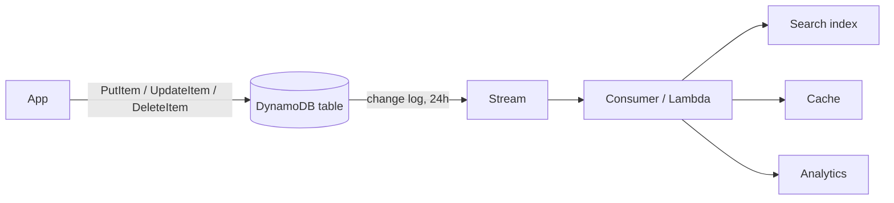
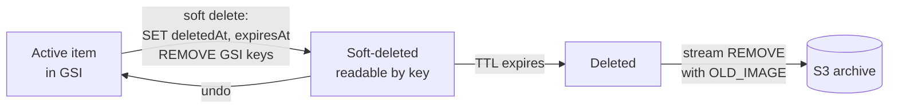

So far we have looked at data as a snapshot: what goes in the keys, how we read it back, how we keep writes safe. This page is about what happens to data **over time**, and how to react when it changes.

DynamoDB gives us two building blocks here. **TTL** expires items after an epoch-seconds timestamp at no write cost. Deletion is lazy, though (it can take hours to days), so we still filter out expired items on read. **DynamoDB Streams** is change data capture: an ordered log of every insert, update and delete, each carrying the old and/or new image, delivered in order per item for 24 hours. A Lambda (or any other consumer) projects those changes into search indexes, caches, analytics or other tables.

Put them together and we get two very useful patterns. **Aggregates via streams**: instead of counting at read time, we apply each change as a delta to a running total, so reads become a single `GetItem`. **Soft delete, then archive**: we mark an item deleted (and drop it out of sparse indexes), let TTL remove it, and let the stream's `REMOVE` event copy it to S3.

| # | Pattern | What we'll learn |
|---|---|---|
| 30 | [TTL for expiry](#30--ttl-for-expiry) | Enabling TTL, filtering expired items, the milliseconds bug |
| 31 | [DynamoDB Streams / CDC](#31--dynamodb-streams--cdc) | Reading a stream and projecting it into another store |
| 32 | [Streams-maintained aggregates](#32--streams-maintained-aggregates) | Running totals from `INSERT`/`MODIFY`/`REMOVE` deltas |
| 33 | [Soft delete & archival](#33--soft-delete--archival) | Soft delete, then TTL, then archive to S3 via the stream |

---

## 30 · TTL for expiry

**Code:** [30-ttl-expiry.py](https://github.com/jfgrea27/dynamodb-patterns/blob/main/patterns/06-lifecycle-and-events/30-ttl-expiry/30-ttl-expiry.py) · run with `just run 30`

### Problem

Plenty of data has a shelf life: sessions, OTP codes, idempotency records, locks, caches and old events all need deleting eventually. The obvious answer is a cron job that scans for old items and deletes them, but that job costs capacity (every scan and every delete is billed) and it is one more thing to run and monitor.

### Pattern

We enable **Time To Live** on a Number attribute holding an **epoch time in seconds**. Once that time has passed, DynamoDB deletes the item in the background, for free.

```python
client.update_time_to_live(
    TableName="...",
    TimeToLiveSpecification={"Enabled": True, "AttributeName": "expiresAt"},
)
table.put_item(Item={"PK": "USER#alice", "SK": "SESSION#abc", "expiresAt": int(time.time()) + 3600})
```

Items decide for themselves whether they expire. An item whose `expiresAt` is in the past is eligible for deletion, one in the future is kept, and one without the attribute at all never expires:

| PK           | SK            | expiresAt    | result             |
|--------------|---------------|--------------|--------------------|
| `USER#alice` | `SESSION#old` | now − 60     | eligible to delete |
| `USER#alice` | `SESSION#new` | now + 3600   | kept               |
| `USER#alice` | `PROFILE`     | (missing)    | never expires      |

### In practice

The script enables TTL, writes the three items above, then queries the partition twice: once raw, once with a filter that hides anything already expired. Finally it writes a session with a **millisecond** timestamp to show the most common TTL bug.

```python
raw = table.query(KeyConditionExpression=Key("PK").eq("USER#alice"))["Items"]

fresh = table.query(
    KeyConditionExpression=Key("PK").eq("USER#alice"),
    FilterExpression=Attr("expiresAt").not_exists() | Attr("expiresAt").gt(int(time.time())),
)["Items"]

# Common mistake: milliseconds instead of seconds
table.put_item(Item={"PK": "USER#alice", "SK": "SESSION#bug", "expiresAt": int(time.time() * 1000)})
```

```text
>>> UpdateTimeToLive p30-ttl-expiry

>>> DescribeTimeToLive p30-ttl-expiry

=== TTL status ===
{
  "TimeToLiveStatus": "ENABLED",
  "AttributeName": "expiresAt"
}

>>> BatchWriteItem
    p30-ttl-expiry: 3 puts, 0 deletes

>>> Query p30-ttl-expiry
    key:        PK = 'USER#alice'

=== Raw query (may include expired items) ===
[
  "PROFILE",
  "SESSION#new",
  "SESSION#old"
]

>>> Query p30-ttl-expiry
    key:        PK = 'USER#alice'
    filter:     (attribute_not_exists(expiresAt) OR expiresAt > 1792496917)

=== Filtered query (live items only) ===
[
  "PROFILE",
  "SESSION#new"
]

>>> PutItem p30-ttl-expiry
    item:       {PK: 'USER#alice', SK: 'SESSION#bug', expiresAt: 1792496917261}

>>> GetItem p30-ttl-expiry
    key:        {PK: 'USER#alice', SK: 'SESSION#bug'}

=== Milliseconds TTL value (wrong!) ===
{
  "SK": "SESSION#bug",
  "expiresAt": 1792496917261,
  "PK": "USER#alice"
}
```

The raw query still returns `SESSION#old` even though it expired a minute ago. That is exactly what happens on AWS too, because the TTL sweeper runs whenever it gets round to it. The filtered query is what our application should actually use. The last item has `expiresAt: 1792496917261`, three extra digits, which TTL reads as a date tens of thousands of years from now, so it will never be deleted.

### Why

- **Free deletes.** TTL deletes use no write capacity.
- **No sweeper jobs** to write, schedule or monitor.
- **TTL deletes show up in Streams**, tagged with `userIdentity.principalId = dynamodb.amazonaws.com`, so we can archive expired items to S3 (see [31](#31--dynamodb-streams--cdc) and [33](#33--soft-delete--archival)).

### Trade-offs

- **It's not precise.** Deletion usually happens within a few days of expiry, and expired items stay readable until then.
- We get **one TTL attribute per table**. Items without it never expire.

### Gotchas

- **Always filter expired items on read:** `attribute_not_exists(expiresAt) OR expiresAt > :now`.
- **Seconds, not milliseconds.** A millisecond value looks like a date tens of thousands of years away, so the item is never deleted. The script above shows this bug.
- Items that expired **more than 5 years ago** are ignored by TTL, and the value must be a **Number**, not a String.
- Turning TTL on or off can take **up to an hour** on AWS.
- DynamoDB Local accepts `UpdateTimeToLive`, but we shouldn't rely on it to delete items on the AWS schedule. Locally, test the read-side filter instead.

---

## 31 · DynamoDB Streams / CDC

**Code:** [31-streams-cdc.py](https://github.com/jfgrea27/dynamodb-patterns/blob/main/patterns/06-lifecycle-and-events/31-streams-cdc/31-streams-cdc.py) · run with `just run 31`

### Problem

When an item changes, other systems often need to know about it: a search index, a cache, an analytics pipeline, another service. The tempting approach is for the application to write to DynamoDB *and* then call those systems. But if the process crashes between the two calls, they are out of sync, and nothing will ever notice. This is the classic **dual write** problem.

### Pattern

We turn on **DynamoDB Streams**. Every insert, update and delete is written to an ordered, durable change log that is kept for 24 hours. A consumer (usually a Lambda) reads that log and pushes changes downstream. The table write becomes the single source of truth, and the stream acts as a built-in **transactional outbox**.



When we enable a stream we choose what each record carries:

| Stream view type     | Record contains        | Use for                         |
|----------------------|------------------------|---------------------------------|
| `KEYS_ONLY`          | keys only              | "something changed, re-read it" |
| `NEW_IMAGE`          | item after the change  | search sync, replication        |
| `OLD_IMAGE`          | item before the change | auditing deletes                |
| `NEW_AND_OLD_IMAGES` | both                   | diffs, aggregates ([32](#32--streams-maintained-aggregates)) |

In AWS we don't poll the stream by hand. We attach a Lambda through an event source mapping:

```python
lambda_client.create_event_source_mapping(
    EventSourceArn=table.latest_stream_arn,
    FunctionName="sync-to-search",
    StartingPosition="LATEST",
    BatchSize=100,
    BisectBatchOnFunctionError=True,
    DestinationConfig={"OnFailure": {"Destination": dlq_arn}},
)
```

### In practice

DynamoDB Local supports Streams, so this one runs locally as-is. The script writes, updates and deletes an order. It never calls a second system. Then it reads the stream by hand (describe → shards → iterator → records), the way a Lambda trigger would for us, and replays it into a dict that stands in for a search index.

```python
table = recreate_table("p31-streams-cdc", stream="NEW_AND_OLD_IMAGES")

def handle(record):
    event = record["eventName"]  # INSERT | MODIFY | REMOVE
    keys = record["dynamodb"]["Keys"]
    doc_id = f'{keys["PK"]["S"]}|{keys["SK"]["S"]}'
    if event == "REMOVE":
        search_index.pop(doc_id, None)
    else:
        search_index[doc_id] = record["dynamodb"]["NewImage"]
```

```text
>>> PutItem p31-streams-cdc
    item:       {PK: 'ORDER#o1', SK: 'META', status: 'PLACED', total: 42}

>>> UpdateItem p31-streams-cdc
    key:        {PK: 'ORDER#o1', SK: 'META'}
    update:     SET status = 'SHIPPED'

>>> DeleteItem p31-streams-cdc
    key:        {PK: 'ORDER#o1', SK: 'META'}

=== Processing stream records ===

>>> DescribeStream

>>> GetShardIterator

>>> GetRecords
    Limit:      100
INSERT  ORDER#o1|META  status: None -> PLACED  index size=1
MODIFY  ORDER#o1|META  status: PLACED -> SHIPPED  index size=1
REMOVE  ORDER#o1|META  status: SHIPPED -> None  index size=0

>>> GetRecords
    Limit:      100

=== Search index after replay ===
{}
```

Three table writes produce three stream records, in order, each with the before and after `status`. The consumer adds the order to the index, updates it, then removes it, so the index ends up empty, matching the table. The second, empty `GetRecords` is the consumer catching up. A real consumer would keep polling.

### Why

- **No dual writes.** If the table write succeeds, the change event will exist.
- **Changes arrive in order per item.** Records for one key are ordered within a shard.
- **Decoupled.** We can add new consumers later without touching the writer.

### Trade-offs

- **At-least-once delivery.** The same record can be delivered more than once, so consumers must be idempotent ([27 · Idempotency keys](../05-consistency/#27--idempotency-keys)).
- **24-hour retention.** If a consumer is broken for longer than that, events are lost. If we need longer retention or more than 2 consumers, Kinesis Data Streams for DynamoDB is the alternative.
- **Downstream is eventually consistent.** Readers of the search index see changes a little later than readers of the table.
- A shard supports **about 2 concurrent readers**. If more systems need the events, fan out through EventBridge or SNS.

### Gotchas

- A failing record **blocks its shard** and is retried until it expires. Always set `BisectBatchOnFunctionError`, a max retry count and an on-failure destination.
- TTL deletes appear on the stream with `userIdentity.principalId = "dynamodb.amazonaws.com"`. We use that to tell expiry apart from user deletes ([30](#30--ttl-for-expiry), [33](#33--soft-delete--archival)).
- DynamoDB Local supports Streams, so the script needs no simulation.

---

## 32 · Streams-maintained aggregates

**Code:** [32-streams-aggregates.py](https://github.com/jfgrea27/dynamodb-patterns/blob/main/patterns/06-lifecycle-and-events/32-streams-aggregates/32-streams-aggregates.py) · run with `just run 32`

### Problem

"How many orders does this store have, and what's the revenue?" is a perfectly normal question, but DynamoDB has no `COUNT(*)` or `SUM()`. Computing the answer at read time means querying every order item and adding them up in the client, which gets slower and more expensive as the data grows.

### Pattern

We store the answer as **its own item** and keep it current from the stream ([31](#31--dynamodb-streams--cdc)). Writers only ever write orders. A stream consumer turns each change into a delta and applies it with an atomic `ADD` ([24 · Atomic counters](../05-consistency/#24--atomic-counters)).

| PK         | SK          | type  | attributes               |
|------------|-------------|-------|--------------------------|
| `STORE#s1` | `ORDER#o1`  | Order | total=42                 |
| `STORE#s1` | `ORDER#o2`  | Order | total=20                 |
| `STORE#s1` | `STATS`     | —     | orderCount=2, revenue=62 |

With `NEW_AND_OLD_IMAGES` on the stream, every record tells us exactly how the totals should move:

- `INSERT` → count +1, revenue +new
- `MODIFY` → count 0, revenue +(new − old)
- `REMOVE` → count −1, revenue −old

Reading the aggregate is then a single `GetItem(PK=STORE#s1, SK=STATS)`.

### In practice

The script writes three orders, changes o2's total from 17 to 20, and deletes o3. Then the consumer drains the stream and applies each change as a delta:

```python
def apply(record):
    img_old = record["dynamodb"].get("OldImage", {})
    img_new = record["dynamodb"].get("NewImage", {})
    if (img_new or img_old).get("type", {}).get("S") != "Order":
        return  # ignore our own aggregate writes (they're on the stream too!)

    old_total = int(img_old["total"]["N"]) if img_old else 0
    new_total = int(img_new["total"]["N"]) if img_new else 0
    count_delta = {"INSERT": 1, "REMOVE": -1}.get(record["eventName"], 0)

    store = (img_new or img_old)["PK"]["S"]
    table.update_item(
        Key={"PK": store, "SK": "STATS"},
        UpdateExpression="ADD orderCount :c, revenue :r",
        ExpressionAttributeValues={":c": count_delta, ":r": new_total - old_total},
    )
```

```text
>>> PutItem p32-streams-aggregates
    item:       {PK: 'STORE#s1', SK: 'ORDER#o1', type: 'Order', total: 42}
...
>>> UpdateItem p32-streams-aggregates
    key:        {PK: 'STORE#s1', SK: 'ORDER#o2'}
    update:     SET total = 20

>>> DeleteItem p32-streams-aggregates
    key:        {PK: 'STORE#s1', SK: 'ORDER#o3'}

=== Consuming stream ===

>>> DescribeStream

>>> GetShardIterator

>>> GetRecords
    Limit:      100

>>> UpdateItem p32-streams-aggregates
    key:        {PK: 'STORE#s1', SK: 'STATS'}
    update:     ADD orderCount 1, revenue 42
INSERT  count +1  revenue +42

>>> UpdateItem p32-streams-aggregates
    key:        {PK: 'STORE#s1', SK: 'STATS'}
    update:     ADD orderCount 1, revenue 17
INSERT  count +1  revenue +17

>>> UpdateItem p32-streams-aggregates
    key:        {PK: 'STORE#s1', SK: 'STATS'}
    update:     ADD orderCount 1, revenue 99
INSERT  count +1  revenue +99
MODIFY  count +0  revenue +3
REMOVE  count -1  revenue -99
    ... (+2 more UpdateItem calls not shown)

>>> GetItem p32-streams-aggregates
    key:        {PK: 'STORE#s1', SK: 'STATS'}

=== Aggregate item (read with one GetItem) ===
{
  "SK": "STATS",
  "orderCount": 2,
  "revenue": 62,
  "PK": "STORE#s1"
}

>>> Query p32-streams-aggregates
    key:        (PK = 'STORE#s1' AND begins_with(SK, 'ORDER#'))

=== Recomputed from orders ===
{
  "orderCount": 2,
  "revenue": 62
}
```

Each record becomes one `ADD`: three inserts, then the `MODIFY` adds only the difference (+3), and the `REMOVE` takes o3 back out. (The request log collapses the last two `UpdateItem` calls, but their deltas are printed.) The aggregate item reads `orderCount: 2, revenue: 62`, which matches the slow way of querying every order and summing.

### Why

- **Cheap reads.** O(1) instead of O(number of orders).
- **Writers stay simple.** There's no extra update or transaction on the hot path.
- **No contention on the write path.** Many writers don't fight over the stats item, because only the consumer updates it.

### Trade-offs

- **Eventually consistent.** The aggregate lags the orders by the stream delay, usually under a second.
- **At-least-once delivery.** A retried batch can apply a delta twice. For exact numbers, record the processed `eventID`s or the stream sequence number and skip duplicates ([27 · Idempotency keys](../05-consistency/#27--idempotency-keys)), or rebuild the aggregate periodically from the source.
- A very hot aggregate item can still hit the **1,000 WCU per partition** limit. Batch the deltas in the consumer (sum a whole batch, then one `ADD`), or shard the counter ([35 · Write sharding](../07-performance-and-scale/#35--write-sharding)).
- The alternative is updating the aggregate inside a `TransactWriteItems` along with the order ([25 · Transactions](../05-consistency/#25--transactions)). That is strongly consistent, but it costs 2x and serialises writers on one item.

### Gotchas

- The consumer's own writes to the `STATS` item **also appear on the stream**. If we don't filter them out (the script checks `type == "Order"`), we get an infinite loop. In AWS, use event-source-mapping **filter criteria** to drop them before the Lambda even runs.

---

## 33 · Soft delete & archival

**Code:** [33-soft-delete-archival.py](https://github.com/jfgrea27/dynamodb-patterns/blob/main/patterns/06-lifecycle-and-events/33-soft-delete-archival/33-soft-delete-archival.py) · run with `just run 33`

### Problem

Users delete things and then want them back ("trash", "undo"). Compliance may require us to keep deleted records somewhere. At the same time, we don't want deleted items cluttering our queries, and we don't want to pay to store them in DynamoDB forever.

### Pattern

We do it in three stages, each building on a pattern we've already seen:

1. **Soft delete.** An `UpdateItem` sets `deletedAt`, sets a TTL attribute (`expiresAt`), and `REMOVE`s the GSI key attributes. Because GSIs are sparse ([10 · Sparse index](../02-modelling/#10--sparse-index)), the item disappears from list views straight away, but it is still readable by key for undo or a trash view.
2. **Hard delete.** When `expiresAt` passes, DynamoDB TTL deletes the item for free ([30](#30--ttl-for-expiry)).
3. **Archive.** A stream consumer ([31](#31--dynamodb-streams--cdc)) sees the `REMOVE` and writes the old image to S3, where it's cheap to keep and queryable with Athena.



| PK       | SK     | title     | GSI1PK        | deletedAt  | expiresAt  |
|----------|--------|-----------|---------------|------------|------------|
| `DOC#d1` | `META` | Q3 plan   | `FOLDER#work` |            |            |
| `DOC#d2` | `META` | Old draft | *(removed)*   | 1792494255 | +30 days   |

**Undo** is just the reverse update: `SET GSI1PK = :folder, GSI1SK = :sk REMOVE deletedAt, expiresAt`.

### In practice

DynamoDB Local accepts `UpdateTimeToLive` but never actually expires items, so the script **simulates** the hard delete with a plain `DeleteItem`, and archives into a dict rather than S3. In AWS the consumer would call:

```python
s3.put_object(Bucket="archive", Key=..., Body=json.dumps(old_image))
```

The soft delete itself is one update:

```python
RETENTION = 30 * 24 * 3600
table.update_item(
    Key={"PK": "DOC#d2", "SK": "META"},
    UpdateExpression="SET deletedAt = :now, expiresAt = :exp REMOVE GSI1PK, GSI1SK",
    ExpressionAttributeValues={":now": int(time.time()), ":exp": int(time.time()) + RETENTION},
)
```

```text
>>> Query p33-soft-delete-archival
    key:        GSI1PK = 'FOLDER#work'
    IndexName:  GSI1

=== Folder before delete ===
[
  "Q3 plan",
  "Old draft",
  "Budget"
]

>>> UpdateItem p33-soft-delete-archival
    key:        {PK: 'DOC#d2', SK: 'META'}
    update:     SET deletedAt = 1792496918, expiresAt = 1795088918 REMOVE GSI1PK, GSI1SK

>>> Query p33-soft-delete-archival
    key:        GSI1PK = 'FOLDER#work'
    IndexName:  GSI1

=== Folder after soft delete (d2 hidden) ===
[
  "Q3 plan",
  "Budget"
]

>>> GetItem p33-soft-delete-archival
    key:        {PK: 'DOC#d2', SK: 'META'}

=== d2 is still there for undo / trash view ===
{
  "SK": "META",
  "deletedAt": 1792496918,
  "PK": "DOC#d2",
  "title": "Old draft",
  "expiresAt": 1795088918
}

>>> DeleteItem p33-soft-delete-archival
    key:        {PK: 'DOC#d2', SK: 'META'}

>>> DescribeStream

>>> GetShardIterator

>>> GetRecords
archived archive/DOC#d2.json (deleted by TTL: False)

>>> GetRecords

=== Fake S3 bucket ===
{
  "archive/DOC#d2.json": "{\"deletedAt\": {\"N\": \"1792496918\"}, \"SK\": {\"S\": \"META\"}, \"PK\": {\"S\": \"DOC#d2\"}, \"title\": {\"S\": \"Old draft\"}, \"expiresAt\": {\"N\": \"1795088918\"}}"
}
```

After the soft delete, "Old draft" vanishes from the folder listing without any filter on the index query, yet a `GetItem` by key still finds it with its `deletedAt` and `expiresAt` (30 days out). When it is finally deleted, the stream consumer archives the old image. Here it reports `deleted by TTL: False` because we deleted it ourselves. On AWS, a real TTL expiry would report `True`.

### Why

- **Undo for free.** Nothing is lost until the retention window ends.
- **Queries stay clean.** Index queries need no `deletedAt` filter, because the item simply isn't in the index.
- **Cheap long-term storage.** S3 costs a fraction of DynamoDB storage, and TTL deletes consume no write capacity.

### Trade-offs

- Base-table queries on the item collection *will* still return soft-deleted items. Filter on `attribute_not_exists(deletedAt)` there, or move deleted items to a different SK prefix (e.g. `DELETED#META`).
- Unique constraints ([26 · Unique constraints](../05-consistency/#26--unique-constraints-on-non-key-attributes)) must decide whether a soft-deleted item still "owns" its unique value.
- The archive is eventually consistent with the table.

### Gotchas

- The stream view type must include the old image (`OLD_IMAGE` or `NEW_AND_OLD_IMAGES`), or there is nothing to archive.
- Tell TTL deletes apart from user deletes with `record["userIdentity"]["principalId"] == "dynamodb.amazonaws.com"` (and `type == "Service"`).
- **Local simulation:** DynamoDB Local accepts `UpdateTimeToLive` but never actually expires items. The script hard-deletes with `DeleteItem` instead, and writes the archive into a dict rather than S3.

---

Next up: [07 - Performance & scale](../07-performance-and-scale/), where we look at what happens when too much traffic lands on too few keys.
