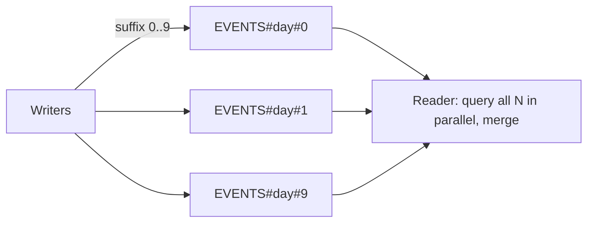

DynamoDB scales by spreading data across partitions, and each partition has a throughput ceiling of about **3,000 reads and 1,000 writes per second**. That one fact explains almost every performance problem we'll meet: it nearly always comes down to **too much traffic on too few partition key values**.

**High-cardinality partition keys** (user ID, order ID) spread traffic naturally, while low-cardinality ones (status, date, country) create hot partitions. When one logical key really is hot, **write sharding** splits it into `KEY#0..N`, either with random suffixes plus a scatter-gather read, or with calculated suffixes so we can still do a direct get. **Caching** (DAX or a read-through cache) absorbs repeated reads of the same hot items, at the cost of staleness. And **time-series data**, which is written to "now" and mostly read recently, wants keys bucketed by time, with old data expired by TTL or by rotating a table per period.

| # | Pattern | What we'll learn |
|---|---|---|
| 34 | [High-cardinality partition keys](#34--high-cardinality-partition-keys) | Measuring key distribution; moving low-cardinality lookups to a GSI |
| 35 | [Write sharding](#35--write-sharding) | Random vs calculated shard suffixes, parallel reads |
| 36 | [Caching (DAX / ElastiCache)](#36--caching-dax--elasticache) | Read-through and write-through caching, hit rates, staleness |
| 37 | [Time-series tables](#37--time-series-tables) | Table-per-period rotation vs time-bucketed keys with TTL |

---

## 34 · High-cardinality partition keys

**Code:** [34-high-cardinality-keys.py](https://github.com/jfgrea27/dynamodb-patterns/blob/main/patterns/07-performance-and-scale/34-high-cardinality-keys/34-high-cardinality-keys.py) · run with `just run 34`

### Problem

DynamoDB hashes the partition key to choose a physical partition. If the key has only a few distinct values (`status`, `country`, `date`, or `tenant` when one tenant is huge), traffic piles onto a few partitions. Those partitions get throttled while the rest of the table sits idle, and we're paying for capacity we can't use.

### Pattern

We choose a partition key with **many distinct values that are used about evenly**. User ID, order ID, device ID and session ID are all good examples.

| Choice       | Distinct values | Verdict |
|--------------|-----------------|---------|
| `status`     | 3               | ❌ hot partitions |
| `date`       | 1 per day       | ❌ today's partition gets all writes |
| `customerId` | 100k+           | ✅ |
| `orderId`    | millions        | ✅ |

If we still need to query by a low-cardinality attribute, we put it in a GSI. But GSIs have the same per-partition limits, so we either shard the GSI key too ([35](#35--write-sharding)) or make it sparse ([10 · Sparse index](../02-modelling/#10--sparse-index)).

### In practice

The script generates 1,000 orders across 300 customers and three statuses. It counts how the items would spread under each key choice, keys the table by customer, and puts status on a GSI with a 4-way shard suffix:

```python
"PK": f"CUSTOMER#{o['customer']}",
"SK": f"ORDER#{o['order_id']}",
"status": o["status"],
# the GSI has the same cardinality problem, so add a shard suffix
"GSI1PK": f"STATUS#{o['status']}#{int(o['order_id'][1:]) % 4}",
"GSI1SK": f"ORDER#{o['order_id']}",
```

```text
=== BAD: PK=status -> distinct partition keys ===
{
  "distinct": 3,
  "items_per_key": {
    "SHIPPED": 336,
    "PENDING": 333,
    "DELIVERED": 331
  }
}

>>> BatchWriteItem
    p34-high-cardinality: 25 puts, 0 deletes
    ... (+37 more BatchWriteItem calls not shown)

=== GOOD: PK=customer -> distinct partition keys ===
{
  "distinct": 290,
  "max_items_on_one_key": 9
}

>>> Query p34-high-cardinality
    key:        PK = 'CUSTOMER#c234'

=== Orders for CUSTOMER#c234 ===
[
  "ORDER#o0000",
  "ORDER#o0416",
  "ORDER#o0674",
  "ORDER#o0704"
]

>>> Query p34-high-cardinality
    key:        GSI1PK = 'STATUS#PENDING#0'
    IndexName:  GSI1

>>> Query p34-high-cardinality
    key:        GSI1PK = 'STATUS#PENDING#1'
    IndexName:  GSI1

>>> Query p34-high-cardinality
    key:        GSI1PK = 'STATUS#PENDING#2'
    IndexName:  GSI1
    ... (+1 more Query calls not shown)

=== PENDING orders via sharded GSI ===
333
```

With `status` as the key, a thousand items land on just 3 keys, around 330 each. With `customer` as the key, the same data spreads over 290 keys with at most 9 items on any one. The "pending orders" question still works: we query all 4 shards of the GSI and merge, getting back all 333.

### Why

- Throughput is spread evenly across partitions, so the table's capacity is actually usable.
- We avoid throttling that only shows up under load, which is the worst time to find out.

### Trade-offs

- A high-cardinality key often means a query "by status" needs a GSI, or a different design.
- Item collections (data stored together under one key) get smaller, so we pick the key that is both spread out **and** matches how we read the data ([02 · Access-pattern-first design](../02-modelling/#02--access-pattern-first-design)).

### Gotchas

- What counts is **uneven traffic**, not just the number of distinct values. A million users where one celebrity gets 90% of the traffic is still a hot key.
- Use **CloudWatch Contributor Insights** to find hot keys in production.
- Throttling on a GSI **also throttles writes to the base table**.

---

## 35 · Write sharding

**Code:** [35-write-sharding.py](https://github.com/jfgrea27/dynamodb-patterns/blob/main/patterns/07-performance-and-scale/35-write-sharding/35-write-sharding.py) · run with `just run 35`

### Problem

Sometimes every write naturally goes to one partition key, such as "today's events" (`EVENTS#2026-10-20`). A single partition handles about **1,000 WCU and 3,000 RCU per second**. Above that we get throttled, however much capacity the table has overall. Adaptive capacity helps, but it can't split the traffic for a single key.

### Pattern

We add a suffix to the hot key so writes spread over N partitions. On read, we query all N and merge the results. This is **scatter-gather**.

| PK                    | SK          |
|-----------------------|-------------|
| `EVENTS#2026-10-20#0` | `EVT#00017` |
| `EVENTS#2026-10-20#1` | `EVT#00003` |
| …                     | …           |
| `EVENTS#2026-10-20#9` | `EVT#00199` |



There are two ways to pick the suffix:

- **Random suffix** (`random % N`). Writes spread best, but to read one item we must query every shard.
- **Calculated suffix** (`hash(order_id) % N`). Writes still spread well, and if we know the ID we can work out the shard and do a direct `GetItem`.

### In practice

The script writes 200 events with a random suffix over 10 shards and reads them back in parallel. Then it writes three orders with a calculated suffix and fetches one directly.

```python
def query_shard(shard):
    resp = table.query(KeyConditionExpression=Key("PK").eq(f"EVENTS#{DAY}#{shard}"))
    return resp["Items"]

# Scatter-gather: query all shards in parallel, merge the results.
with ThreadPoolExecutor(max_workers=SHARDS) as pool:
    results = list(pool.map(query_shard, range(SHARDS)))

def shard_for(order_id: str) -> int:
    return int(hashlib.md5(order_id.encode()).hexdigest(), 16) % SHARDS
```

```text
>>> BatchWriteItem
    p35-write-sharding: 25 puts, 0 deletes
    ... (+5 more BatchWriteItem calls not shown)

>>> Query p35-write-sharding
    key:        PK = 'EVENTS#2026-10-20#0'

>>> Query p35-write-sharding
    key:        PK = 'EVENTS#2026-10-20#1'

>>> Query p35-write-sharding
    key:        PK = 'EVENTS#2026-10-20#2'
    ... (+7 more Query calls not shown)

=== Random suffix: items per shard ===
{
  "shard 0": 26,
  "shard 1": 14,
  "shard 2": 21,
  "shard 3": 22,
  "shard 4": 21,
  "shard 5": 20,
  "shard 6": 15,
  "shard 7": 22,
  "shard 8": 22,
  "shard 9": 17
}

=== Total gathered ===
200

>>> PutItem p35-write-sharding
    item:       {PK: 'ORDERS#2026-10-20#3', SK: 'ORDER#o-1001', total: 10}

>>> PutItem p35-write-sharding
    item:       {PK: 'ORDERS#2026-10-20#7', SK: 'ORDER#o-1002', total: 10}

>>> PutItem p35-write-sharding
    item:       {PK: 'ORDERS#2026-10-20#5', SK: 'ORDER#o-1003', total: 10}

>>> GetItem p35-write-sharding
    key:        {PK: 'ORDERS#2026-10-20#7', SK: 'ORDER#o-1002'}

=== Calculated suffix: direct GetItem for o-1002 (shard 7) ===
{
  "SK": "ORDER#o-1002",
  "total": 10,
  "PK": "ORDERS#2026-10-20#7"
}
```

The random suffix spreads 200 writes roughly evenly (14 to 26 per shard), and reading "all of today" takes 10 queries to gather them back. With the calculated suffix, `o-1002` always hashes to shard 7, so a single `GetItem` finds it without touching the other shards.

### Why

- Write throughput grows **roughly N times** for that logical key.
- It's the standard fix for time-bucketed keys, global leaderboards, vote counters and similar hot keys.

### Trade-offs

- Reads that need "all of today" cost N queries, so run them in parallel.
- Sorting across shards happens in the client, as a merge.
- Changing N later means old and new data use different shard counts. Store N alongside the data, or version it.

### Gotchas

- **Don't shard by default.** First fix the key so it has high cardinality ([34](#34--high-cardinality-partition-keys)), and shard only the keys that are truly hot.
- Hot **reads** are often better solved with a cache ([36](#36--caching-dax--elasticache)) than with sharding.
- For counters, shard the counter items and sum them on read (see [24 · Atomic counters](../05-consistency/#24--atomic-counters)).

---

## 36 · Caching (DAX / ElastiCache)

**Code:** [36-caching.py](https://github.com/jfgrea27/dynamodb-patterns/blob/main/patterns/07-performance-and-scale/36-caching/36-caching.py) · run with `just run 36`

### Problem

Some keys are read far more than others: a product page, a config item, a celebrity profile. One partition serves at most about 3,000 RCU/s, and paying for the same read over and over is wasteful anyway.

### Pattern

We put a cache in front of DynamoDB. There are two common choices:

- **DAX (DynamoDB Accelerator):** a managed, API-compatible cache. We swap the client and keep the same calls, and get microsecond reads. It has an **item cache** (for `GetItem`/`BatchGetItem`) and a **query cache** (for `Query`/`Scan`).
- **ElastiCache / Redis:** more control, for example caching computed views built from several items, but we manage invalidation ourselves.

Whichever we use, the strategies are the same:

| Strategy      | Read                                    | Write                                |
|---------------|-----------------------------------------|--------------------------------------|
| Read-through  | cache miss → read DynamoDB → fill cache | write to DynamoDB only               |
| Write-through | from cache                              | write DynamoDB, then update cache    |
| TTL           | entries expire after N seconds          | n/a, bounds how stale data can get   |

### In practice

DynamoDB Local has no DAX, so the script **simulates** it with a tiny in-process read-through cache: a dict keyed by primary key, with a TTL. With real DAX the code barely changes:

```python
from amazondax import AmazonDaxClient
dax = AmazonDaxClient.resource(endpoint_url="daxs://my-cluster.xxxx.dax-clusters.us-east-1.amazonaws.com")
table = dax.Table("my-table")          # same API as boto3
table.get_item(Key={"PK": "PRODUCT#p1", "SK": "META"})
```

The stand-in cache, trimmed:

```python
def get(self, key):
    k = (key["PK"], key["SK"])
    hit = self.store.get(k)
    if hit and hit[1] > time.monotonic():
        self.hits += 1
        return hit[0]
    self.misses += 1
    item = self.table.get_item(Key=key).get("Item")
    self.store[k] = (item, time.monotonic() + self.ttl)
    return item

def put(self, item):
    # Write-through: update DynamoDB, then the cache
    self.table.put_item(Item=item)
    self.store[(item["PK"], item["SK"])] = (item, time.monotonic() + self.ttl)
```

The script reads a hot key 100 times, updates it from "another process" that bypasses the cache, waits for the TTL (0.5 s), and finally writes through the cache:

```text
>>> PutItem p36-caching
    item:       {PK: 'PRODUCT#p1', SK: 'META', name: 'Widget', price: 10}

>>> GetItem p36-caching
    key:        {PK: 'PRODUCT#p1', SK: 'META'}

=== 100 reads of a hot key ===
{
  "dynamodb_reads": 1,
  "cache_hits": 99
}

>>> UpdateItem p36-caching
    key:        {PK: 'PRODUCT#p1', SK: 'META'}
    update:     SET price = 12

=== Right after an external update (stale) ===
{
  "price": 10
}

>>> GetItem p36-caching
    key:        {PK: 'PRODUCT#p1', SK: 'META'}

=== After TTL expiry (fresh) ===
{
  "price": 12
}

>>> PutItem p36-caching
    item:       {PK: 'PRODUCT#p1', SK: 'META', name: 'Widget', price: 15}

=== After write-through ===
{
  "price": 15
}
```

A hundred reads cost one `GetItem`. That's the whole point. But the external update to `price = 12` isn't seen: the cache keeps serving `10` until the entry expires, and only then does a fresh `GetItem` pick up `12`. The write-through at the end updates both, so the next read sees `15` straight away without touching DynamoDB.

### Why

- Takes read load off hot partitions.
- Much lower latency, and cheaper when the hit rate is high.

### Trade-offs

- **Stale reads.** DAX is eventually consistent. Strongly consistent reads skip the cache, and writes from other clients aren't seen until the TTL expires (as the output shows).
- Another piece of infrastructure (a cluster in a VPC) to run and pay for.
- No help for write-heavy keys (see [35](#35--write-sharding)).

### Gotchas

- In DAX the item cache and the query cache are **separate**. A write updates the item cache but **not** cached query results.
- Short TTLs bound staleness but lower the hit rate, so tune them for each kind of data.
- Before adding a cache, check whether a better key design ([34](#34--high-cardinality-partition-keys)) or [denormalisation](../02-modelling/#11--denormalization-and-duplication) removes the hot read in the first place.

---

## 37 · Time-series tables

**Code:** [37-time-series-tables.py](https://github.com/jfgrea27/dynamodb-patterns/blob/main/patterns/07-performance-and-scale/37-time-series-tables/37-time-series-tables.py) · run with `just run 37`

### Problem

Time-series data (metrics, events, logs) has three traits that work against a naive design:

- **Writes all go to "now"**, so a `date` partition key gets hot.
- **Recent data is read a lot**, while old data is almost never read.
- **Old data must be deleted**, and deleting item by item costs a write unit per item.

### Pattern

There are two common shapes.

**Option A: one table per period** (day, week or month).

| Table             | Status                                      |
|-------------------|---------------------------------------------|
| `metrics-2026-10` | current: high write capacity                |
| `metrics-2026-09` | read-only: low capacity                     |
| `metrics-2026-08` | expired: **drop the table** (free, instant) |

We create the next period's table ahead of time, point writers at the current table, and drop whole tables once they pass retention.

**Option B: one table, a time-bucketed partition key, plus TTL** ([30 · TTL for expiry](../06-lifecycle-and-events/#30--ttl-for-expiry)).

| PK                     | SK                          | value | expires_at |
|------------------------|-----------------------------|-------|------------|
| `SENSOR#s1#2026-10-20` | `2026-10-20T01:20:00+00:00` | 80    | 1763600400 |

The bucket (sensor + day) keeps partitions bounded and spreads writes, and the ISO timestamp in the sort key gives us range queries with `between`.

### In practice

The script does both. For option A it creates three monthly tables, then drops the oldest with a single `DeleteTable`. For option B it writes nine readings into a day bucket, each with an `expires_at` 30 days out, and range-queries one hour.

```python
# Option A: retention = 2 months, drop the oldest table. One API call.
client.delete_table(TableName=f"p37-metrics-{oldest}")

# Option B: one partition per sensor per day, TTL removes old items
batch.put_item(
    Item={
        "PK": f"SENSOR#s1#{ts:%Y-%m-%d}",
        "SK": ts.isoformat(),
        "value": hour * 60 + minute,
        "expires_at": int(ts.timestamp()) + retention,
    }
)

resp = table.query(
    KeyConditionExpression=Key("PK").eq("SENSOR#s1#2026-10-20") & Key("SK").between("2026-10-20T01:00", "2026-10-20T02:00")
)
```

```text
>>> BatchWriteItem
    p37-metrics-2026-10: 5 puts, 0 deletes

>>> BatchWriteItem
    p37-metrics-2026-09: 5 puts, 0 deletes

>>> BatchWriteItem
    p37-metrics-2026-08: 5 puts, 0 deletes

=== Tables before rotation ===
[
  "p37-metrics-2026-08",
  "p37-metrics-2026-09",
  "p37-metrics-2026-10",
  "p37-metrics-ttl"
]

=== Tables after dropping the oldest ===
[
  "p37-metrics-2026-09",
  "p37-metrics-2026-10",
  "p37-metrics-ttl"
]

>>> UpdateTimeToLive p37-metrics-ttl

>>> BatchWriteItem
    p37-metrics-ttl: 9 puts, 0 deletes

>>> Query p37-metrics-ttl
    key:        (PK = 'SENSOR#s1#2026-10-20' AND SK BETWEEN '2026-10-20T01:00' AND '2026-10-20T02:00')

=== Bucketed query: 01:00-02:00 ===
[
  [
    "2026-10-20T01:00:00+00:00",
    60
  ],
  [
    "2026-10-20T01:20:00+00:00",
    80
  ],
  [
    "2026-10-20T01:40:00+00:00",
    100
  ]
]

>>> DescribeTimeToLive p37-metrics-ttl

=== TTL status ===
{
  "TimeToLiveStatus": "ENABLED",
  "AttributeName": "expires_at"
}
```

Dropping August's data is one call, with no per-item deletes and no write capacity spent. (On AWS we'd also lower the read-only tables' provisioned capacity, or switch them to on-demand.) In option B, the `between` on the ISO sort key returns exactly the three readings from 01:00 to 02:00, and TTL is enabled to clear them out after 30 days. Locally, though, TTL won't actually delete them on schedule.

### Why

- **Option A:** dropping a table costs nothing and uses no write capacity. Each period can be tuned separately (capacity, table class, e.g. Standard-IA for old tables).
- **Option B:** simpler to run, with one table and one schema. TTL deletes are free (no WCU).

### Trade-offs

- **Option A:** the app must route requests to the right table, a query across periods hits several tables, and we need automation to create and drop tables.
- **Option B:** TTL deletes are not instant (see Gotchas). Too fine a bucket means many queries for a long range, and too coarse a bucket gets hot.

### Gotchas

- TTL deletes usually happen within a few days of expiry, not at the moment of expiry. Filter out `expires_at < now` on read if it matters.
- DynamoDB Local accepts the TTL setting, but don't rely on it to delete items on schedule.
- For heavy writes, combine the bucket with a shard suffix ([35](#35--write-sharding)).
- For analytics over history, export to S3 instead ([41 · Analytics outside DynamoDB](../08-operations/#41--analytics-outside-dynamodb)).

---

Next up: [08 - Operations](../08-operations/), covering capacity modes, backups, global tables and analytics.
