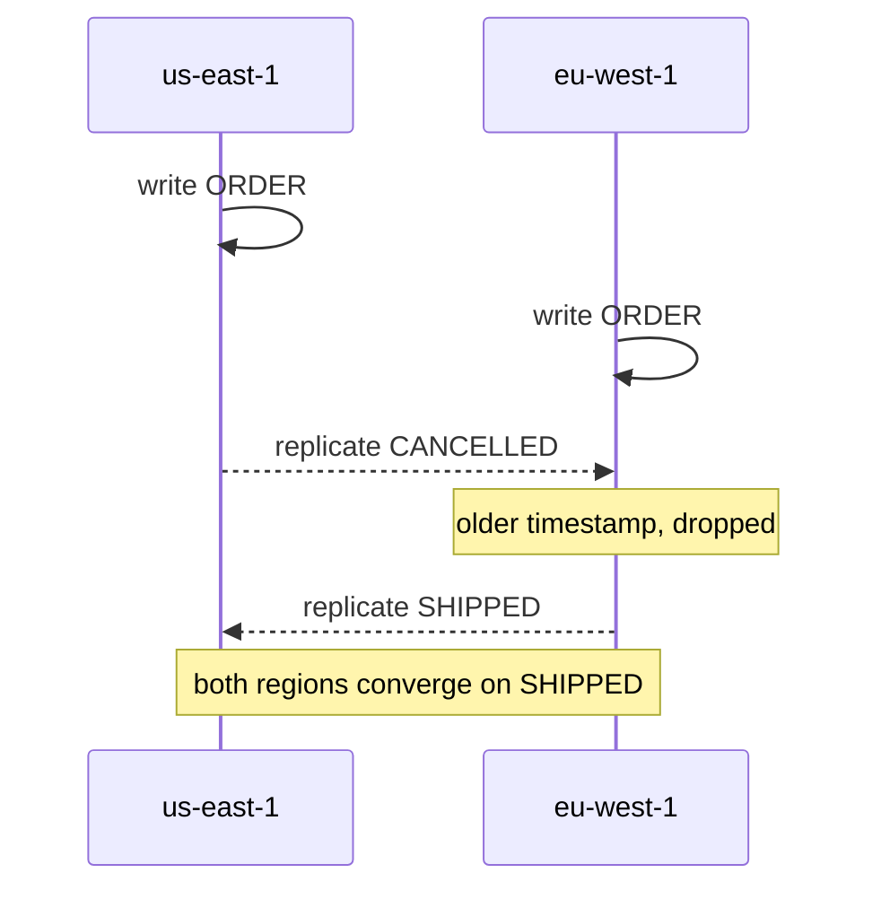

So far we've been designing tables. This page is about running them in production: choosing a capacity mode, protecting data, going multi-region, and getting data out for analytics without hurting the live table.

Four ideas run through it. **Capacity modes:** on-demand needs no planning and scales instantly, while provisioned with auto scaling is cheaper for steady, predictable traffic, and we can switch between them. **Backups:** point-in-time recovery restores to any second in the last 35 days, on-demand backups are kept until we delete them, and a restore always creates a *new* table. **Global tables** replicate a table across regions, active-active; concurrent writes to the same item resolve as last-writer-wins, so we route each item's writes to one home region when that matters. And **analytics belongs elsewhere**: export to S3 (which uses no table capacity) and query with Athena, or use zero-ETL to Redshift or OpenSearch, rather than running reporting Scans against the live table.

DynamoDB Local doesn't support most of these APIs, so the demos make the real calls, show that they fail locally, and then simulate the behaviour.

| # | Pattern | You'll learn |
|---|---|---|
| 38 | [Capacity modes](#38--capacity-modes-on-demand-vs-provisioned) | Sizing read/write units; switching modes; auto scaling |
| 39 | [PITR & backups](#39--point-in-time-recovery--backups) | Enabling PITR, on-demand backups, restore-to-new-table |
| 40 | [Global tables](#40--global-tables-multi-region) | Adding replicas; last-writer-wins and how to avoid losing writes |
| 41 | [Analytics outside DynamoDB](#41--analytics-outside-dynamodb) | Export to S3 format; querying the export instead of the table |

## 38 · Capacity modes: on-demand vs provisioned

**Code:** [38-capacity-modes.py](https://github.com/jfgrea27/dynamodb-patterns/blob/main/patterns/08-operations/38-capacity-modes/38-capacity-modes.py) · run with `just run 38`

### Problem

DynamoDB bills for throughput in one of two ways. Pick the wrong one and we either overpay a lot, or get throttled when traffic spikes.

### Pattern

The rule of thumb is: **start on on-demand, and move to provisioned + auto scaling once traffic is steady and predictable.**

| Mode                       | You pay for                         | Best for                                      |
|----------------------------|-------------------------------------|-----------------------------------------------|
| On-demand (`PAY_PER_REQUEST`) | each request (RRU / WRU)         | new apps, spiky or unknown traffic, dev/test, low volume |
| Provisioned + auto scaling | capacity per hour, used or not      | steady, predictable traffic at scale          |
| Provisioned + reserved capacity | 1- or 3-year commitment        | large, stable baseline                        |

The capacity-unit maths is the same in both modes:

- **1 RCU** = 1 strongly consistent read/sec of up to 4 KB, *or* 2 eventually consistent reads.
- **1 WCU** = 1 write/sec of up to 1 KB.
- Transactions cost **2x**. Sizes round **up**, so a 1.1 KB write is 2 WCU.

For example, with 3 KB items, 500 reads/s and 100 writes/s, we need 500 RCU for strong reads (250 for eventual) and 300 WCU.

Auto scaling uses a separate service, Application Auto Scaling, with a target-tracking policy (e.g. keep utilisation at 70%).

### In practice

The script sizes the table, switches it to provisioned, prints the auto scaling setup (DynamoDB Local doesn't have Application Auto Scaling, so it's printed rather than executed), and switches back:

```python
def rcu(item_kb, reads_per_sec, consistent=True):
    units = -(-item_kb // 4)  # ceil
    return units * reads_per_sec * (1 if consistent else 0.5)


def wcu(item_kb, writes_per_sec):
    return -(-item_kb // 1) * writes_per_sec


client.update_table(
    TableName=TABLE,
    BillingMode="PROVISIONED",
    ProvisionedThroughput={"ReadCapacityUnits": 250, "WriteCapacityUnits": 300},
)
...
client.update_table(TableName=TABLE, BillingMode="PAY_PER_REQUEST")
```

```text
=== Start: on-demand ===
{
  "BillingMode": "PAY_PER_REQUEST",
  "ProvisionedThroughput": {
    "ReadCapacityUnits": 0,
    "WriteCapacityUnits": 0
  }
}

=== Sizing for 3 KB items, 500 reads/s, 100 writes/s ===
{
  "RCU (strong)": 500,
  "RCU (eventual)": 250.0,
  "WCU": 300
}

>>> UpdateTable p38-capacity-modes

=== After switching to provisioned ===
{
  "BillingMode": "PROVISIONED",
  "ProvisionedThroughput": {
    "ReadCapacityUnits": 250,
    "WriteCapacityUnits": 300
  }
}

=== Auto scaling setup (AWS only, not executed) ===
{
  "register_scalable_target": {
    "ServiceNamespace": "dynamodb",
    "ResourceId": "table/p38-capacity-modes",
    "ScalableDimension": "dynamodb:table:WriteCapacityUnits",
    "MinCapacity": 50,
    "MaxCapacity": 1000
  },
  "put_scaling_policy": {
    "PolicyType": "TargetTrackingScaling",
    "TargetTrackingScalingPolicyConfiguration": {
      "TargetValue": 70.0,
      "PredefinedMetricSpecification": {
        "PredefinedMetricType": "DynamoDBWriteCapacityUtilization"
      }
    }
  }
}

>>> UpdateTable p38-capacity-modes

=== Back to on-demand ===
{
  "BillingMode": "PAY_PER_REQUEST",
  ...
}
```

A 3 KB item rounds up to one 4 KB read unit, so 500 strong reads/s is 500 RCU, and half that for eventual reads. On the write side it rounds up to three 1 KB units, so 100 writes/s is 300 WCU. The switch between modes is a single `UpdateTable` call in each direction.

### Why

- **On-demand** needs no capacity planning, never throttles because of "too little provisioned", and costs nothing when idle.
- **Provisioned** is roughly 5–7x cheaper per request at sustained utilisation.

### Trade-offs

- On-demand gets expensive at high, steady volume.
- Provisioned auto scaling reacts in minutes, not seconds. A sudden spike can throttle before it scales. Burst capacity (up to 5 minutes of unused capacity) helps a little.
- On-demand still has limits. A new on-demand table instantly handles up to about 2x its previous peak, and can scale further over time. We can also set a maximum throughput per table as a cost guard.

### Gotchas

- Per-partition limits apply in both modes: about **3,000 RCU / 1,000 WCU per partition key**. A hot key throttles no matter how much capacity the table has ([34](../07-performance-and-scale/#34--high-cardinality-partition-keys), [35](../07-performance-and-scale/#35--write-sharding)).
- GSIs have their own capacity in provisioned mode. An under-provisioned GSI throttles writes to the **base table**.
- We can only switch modes a limited number of times per 24 hours.
- Look at `ConsumedCapacity` (`ReturnConsumedCapacity="TOTAL"`) to measure real costs before choosing ([13](../03-querying/#13--filter-expressions-dont-reduce-cost)).

## 39 · Point-in-time recovery & backups

**Code:** [39-pitr-backups.py](https://github.com/jfgrea27/dynamodb-patterns/blob/main/patterns/08-operations/39-pitr-backups/39-pitr-backups.py) · run with `just run 39`

### Problem

A bad deploy, a buggy migration or a fat-fingered script overwrites or deletes data. DynamoDB replicates for durability, but it faithfully replicates our mistakes too. We need a way back.

### Pattern

We use both kinds of backup, and possibly AWS Backup on top:

| Feature                       | What it is                                         | Use for                                  |
|-------------------------------|----------------------------------------------------|------------------------------------------|
| **Point-in-time recovery (PITR)** | continuous backup; restore to any second in the last 1–35 days | accidental writes/deletes, bad deploys   |
| **On-demand backup**          | named full snapshot, kept until deleted            | before migrations, compliance, long retention |
| **AWS Backup**                | schedules, retention rules, cross-account/region copies | org-wide backup policy                   |

In AWS, the calls look like this:

```python
client.update_continuous_backups(
    TableName="orders",
    PointInTimeRecoverySpecification={"PointInTimeRecoveryEnabled": True, "RecoveryPeriodInDays": 35},
)
client.create_backup(TableName="orders", BackupName="before-migration")
client.restore_table_to_point_in_time(
    SourceTableName="orders", TargetTableName="orders-restored",
    RestoreDateTime=datetime(2026, 10, 20, 9, 55),
)
```

### In practice

**DynamoDB Local doesn't implement any of the backup APIs**, so this one is simulated. The script makes the real calls anyway, so we can see them fail, and then uses a scan-and-write-back snapshot as a stand-in:

```python
attempt("Enable PITR", client.update_continuous_backups, TableName=TABLE,
        PointInTimeRecoverySpecification={"PointInTimeRecoveryEnabled": True, "RecoveryPeriodInDays": 35})
backup = attempt("Create on-demand backup", client.create_backup, TableName=TABLE, BackupName="before-migration")

local_snapshot = table.scan()["Items"]  # local stand-in for a backup

# Oops - a bad deploy zeroes the balance.
table.update_item(Key={"PK": "ACCOUNT#1", "SK": "META"}, UpdateExpression="SET balance = :z", ExpressionAttributeValues={":z": 0})

# Restores ALWAYS create a NEW table; you then swap traffic or copy items back.
attempt("Restore to latest restorable time", client.restore_table_to_point_in_time,
        SourceTableName=TABLE, TargetTableName=f"{TABLE}-restored", UseLatestRestorableTime=True)
```

```text
>>> PutItem p39-pitr-backups
    item:       {PK: 'ACCOUNT#1', SK: 'META', balance: 100}

>>> UpdateContinuousBackups p39-pitr-backups

=== Enable PITR: not supported by DynamoDB Local ===
"An unknown operation was requested."

>>> CreateBackup p39-pitr-backups

=== Create on-demand backup: not supported by DynamoDB Local ===
"An unknown operation was requested."

>>> Scan p39-pitr-backups

>>> UpdateItem p39-pitr-backups
    key:        {PK: 'ACCOUNT#1', SK: 'META'}
    update:     SET balance = 0

=== After bad deploy ===
{
  "balance": 0,
  "SK": "META",
  "PK": "ACCOUNT#1"
}

>>> RestoreTableToPointInTime

=== Restore to latest restorable time: not supported by DynamoDB Local ===
"An unknown operation was requested."

>>> BatchWriteItem
    p39-pitr-backups: 1 puts, 0 deletes

=== Local stand-in: restored from snapshot ===
{
  "SK": "META",
  "balance": 100,
  "PK": "ACCOUNT#1"
}
```

The story is the same one we'd live through in AWS: an account with a balance of 100, a bad deploy that zeroes it, and a restore that brings the 100 back. Locally the restore is a `BatchWriteItem` of the snapshot. In AWS it would be a new `orders-restored` table that we copy from or swap to.

### Why

- **PITR is the cheapest insurance we can buy.** Turn it on for every table that matters, ideally by default in IaC.
- Backups have **no performance impact** and use no table capacity.

### Trade-offs

- **A restore always creates a new table.** We then either point the app at it, or copy the damaged items back. A partial copy-back is usually better, because writes made after the incident are kept.
- Restores take minutes to hours, depending on table size.
- The restored table does **not** keep everything. Auto scaling policies, TTL settings, IAM policies, CloudWatch alarms, tags and stream settings must all be set again. GSIs and LSIs can be included.
- PITR is billed per GB-month of table size.

### Gotchas

- Deleting a table with PITR keeps a system backup for 35 days. Enable **deletion protection** (`DeletionProtectionEnabled=True`) as well.
- TTL deletes are also "real" deletes. PITR can bring back expired items if we restore to an earlier time ([30](../06-lifecycle-and-events/#30--ttl-for-expiry)).
- For long-term archival or analytics, use Export to S3 instead ([41](#41--analytics-outside-dynamodb)). It also needs PITR enabled.

## 40 · Global tables (multi-region)

**Code:** [40-global-tables.py](https://github.com/jfgrea27/dynamodb-patterns/blob/main/patterns/08-operations/40-global-tables/40-global-tables.py) · run with `just run 40`

### Problem

Our users are spread across continents, and cross-region latency adds 100+ ms per request. Or we need to survive a whole AWS region going down. A single-region table can't do either.

### Pattern

We make the table a **global table**: a fully managed replica in every chosen region. Each replica accepts reads **and writes** (active-active). DynamoDB replicates changes between regions asynchronously, usually in about a second.

```python
client.update_table(
    TableName="orders",
    ReplicaUpdates=[{"Create": {"RegionName": "eu-west-1"}}],
)
```

Conflicts, where the same item is written in two regions before replication catches up, are resolved by **last writer wins**, using an internal timestamp. The losing write is discarded with no error.



### In practice

DynamoDB Local doesn't support replicas, so the script simulates two regions with dicts. Each write is stamped with a timestamp and queued for asynchronous replication, and the replicator only applies a write if it's newer than what the target already has:

```python
def replicate():
    while replication_log:
        target, key, item = replication_log.pop(0)
        current = regions[target].get(key)
        if current is None or item["_ts"] > current["_ts"]:
            regions[target][key] = item  # last writer wins
        else:
            print(f"  {target}: dropped older write from {item['_region']} ({item['status']})")
```

It then shows three things: a write in one region becoming visible in the other after replication, a conflict, and the fix.

```text
>>> UpdateTable p40-global-tables

=== Add replica: not supported by DynamoDB Local ===
"Nothing to update"

=== Normal case: write in one region, read anywhere (after replication) ===
us-east-1  wrote ORDER#o1: PLACED

=== Before replication (eu-west-1 is stale) ===
{
  "us-east-1": {
    "ORDER#o1": "PLACED"
  },
  "eu-west-1": {}
}

=== After replication ===
{
  "us-east-1": {
    "ORDER#o1": "PLACED"
  },
  "eu-west-1": {
    "ORDER#o1": "PLACED"
  }
}

=== Conflict: both regions update the same item before replicating ===
us-east-1  wrote ORDER#o1: CANCELLED
eu-west-1  wrote ORDER#o1: SHIPPED
  eu-west-1: dropped older write from us-east-1 (CANCELLED)

=== Converged (CANCELLED was silently lost!) ===
{
  "us-east-1": {
    "ORDER#o1": "SHIPPED"
  },
  "eu-west-1": {
    "ORDER#o1": "SHIPPED"
  }
}

=== Mitigation: give each item a home region and only write there ===
eu-west-1  wrote ORDER#o2: PLACED
eu-west-1  wrote ORDER#o2: PAID

=== No conflicts possible ===
{
  "us-east-1": {
    "ORDER#o1": "SHIPPED",
    "ORDER#o2": "PAID"
  },
  "eu-west-1": {
    "ORDER#o1": "SHIPPED",
    "ORDER#o2": "PAID"
  }
}
```

The conflict is the scary part. A customer cancelled the order in `us-east-1`, a warehouse shipped it in `eu-west-1` a moment later, and both regions converge on `SHIPPED`. The cancellation is gone, and nobody got an error. Once `ORDER#o2` has a home region and is only ever written there, its writes are applied in order and conflicts can't happen.

### Why

- **Low latency.** Users read and write in their nearest region.
- **High availability.** 99.999% SLA. If a region fails, we route traffic to another.
- **Fully managed.** No replication code to write or run.

### Trade-offs

- **Cross-region reads are eventually consistent.** Strong reads only see writes made in the same region.
- **Last-writer-wins can lose data.** Avoid concurrent writes to one item from several regions by giving items a home region ("write locally, read globally"). Conditional writes and transactions are only checked in the region where they run.
- **Cost.** We pay for replicated writes in every region, plus cross-region data transfer.
- **Multi-Region strong consistency (MRSC)** is available as an option. Writes are synchronously replicated across 3 regions, which removes the conflicts, at the cost of higher write latency and some limits (e.g. no transactions).

### Gotchas

- All replicas must have the same key schema, GSIs, and TTL and stream settings. Changes are made once and applied everywhere.
- Counters ([24](../05-consistency/#24--atomic-counters)) and optimistic locking ([23](../05-consistency/#23--optimistic-locking)) are only safe if all writes for an item go to one region.
- TTL deletes ([30](../06-lifecycle-and-events/#30--ttl-for-expiry)) replicate too, and consume write capacity in the replica regions.
- Use the current version (2019.11.21). The legacy 2017 version needs a manual migration.

## 41 · Analytics outside DynamoDB

**Code:** [41-analytics-export.py](https://github.com/jfgrea27/dynamodb-patterns/blob/main/patterns/08-operations/41-analytics-export/41-analytics-export.py) · run with `just run 41`

### Problem

"Revenue by country last quarter." "Top 100 customers." Questions like these need to read the **whole table** and group or sort by attributes that aren't keys. In DynamoDB that means a full Scan, which is slow, expensive, and eats the capacity our live traffic needs ([12](../03-querying/#12--avoid-scan-use-parallel-scan-for-batch-jobs)).

### Pattern

**DynamoDB serves the application. Analytics runs on a copy.** There are three common ways to get that copy:

| Option                              | How                                                      | Freshness        |
|-------------------------------------|----------------------------------------------------------|------------------|
| **Export to S3** + Athena / Glue / Spark | `ExportTableToPointInTime`, full or incremental, in DynamoDB JSON or Ion | snapshot (minutes–hours) |
| **Zero-ETL to Redshift / OpenSearch** | managed integration, no pipeline code                   | near real-time   |
| **Streams → Firehose → S3**         | change events into a data lake ([31](../06-lifecycle-and-events/#31--dynamodb-streams--cdc)) | near real-time   |

The export is a single call:

```python
client.export_table_to_point_in_time(
    TableArn=table_arn,
    S3Bucket="my-analytics-bucket",
    S3Prefix="exports/orders",
    ExportFormat="DYNAMODB_JSON",        # or "ION"
    ExportType="INCREMENTAL_EXPORT",     # or "FULL_EXPORT" (default)
)
```

Then we query it in Athena:

```sql
SELECT item.country.S AS country, COUNT(*) AS orders, SUM(CAST(item.total.N AS int)) AS revenue
FROM orders_export GROUP BY 1;
```

### In practice

DynamoDB Local has no export API, so this one is simulated too. The script seeds 500 orders, tries the real export, and then does a 4-segment parallel scan into gzipped files in the same `{"Item": {...}}` line format a real export writes. Finally it runs the GROUP BY in Python, reading only the files:

```python
def export_segment(segment):
    path = export_dir / f"segment-{segment}.json.gz"
    kwargs = dict(TableName=TABLE, Segment=segment, TotalSegments=SEGMENTS)
    with gzip.open(path, "wt") as f:
        while True:
            resp = client.scan(**kwargs)  # clients are thread-safe; resource objects are not
            for item in resp["Items"]:
                # same line format as a real DYNAMODB_JSON export
                f.write(json.dumps({"Item": {k: ser.serialize(v) for k, v in item.items()}}, default=str) + "\n")
            if "LastEvaluatedKey" not in resp:
                break
            kwargs["ExclusiveStartKey"] = resp["LastEvaluatedKey"]


with ThreadPoolExecutor(SEGMENTS) as pool:
    counts = list(pool.map(export_segment, range(SEGMENTS)))
```

```text
>>> BatchWriteItem
    p41-analytics-export: 25 puts, 0 deletes
    ... (+17 more BatchWriteItem calls not shown)

>>> ExportTableToPointInTime

=== ExportTableToPointInTime: not supported by DynamoDB Local ===
"UnknownOperationException"

>>> Scan p41-analytics-export
    Segment:    0
    TotalSegments: 4

>>> Scan p41-analytics-export
    Segment:    1
    TotalSegments: 4

>>> Scan p41-analytics-export
    Segment:    2
    TotalSegments: 4
    ... (+1 more Scan calls not shown)

=== Exported ===
{
  "dir": ".../p41-export-gbtkfbg8/data",
  "items per segment": [
    142,
    122,
    114,
    122
  ]
}

=== Revenue by country (computed off the table) ===
{
  "DE": {
    "orders": 127,
    "revenue": 13240
  },
  "FR": {
    "orders": 125,
    "revenue": 11535
  },
  "UK": {
    "orders": 120,
    "revenue": 11979
  },
  "US": {
    "orders": 128,
    "revenue": 12867
  }
}
```

The four segments split the 500 items roughly evenly, and each one is scanned in parallel. Once the export exists, the revenue-by-country report never touches the table again. We could re-run it, change it, or add a `JOIN`, and DynamoDB would never notice.

### Why

- **Exports use no table capacity.** They read from PITR backups, not the live table.
- **It's the right tool.** SQL engines do joins, GROUP BY and ad-hoc filters; DynamoDB doesn't.
- **It's cheap.** S3 storage and per-query Athena pricing beat scanning the table again and again.

### Trade-offs

- **The data is a little stale.** A snapshot, or seconds to minutes behind with zero-ETL or streams.
- It's another system to manage: a Glue catalog, partitions, and schema drift from DynamoDB's schemaless items.
- Single-table designs ([04](../02-modelling/#04--single-table-design)) export as one mixed table. We'll need views per entity type (`WHERE item.type.S = 'Order'`).

### Gotchas

- Export needs **PITR enabled** on the table ([39](#39--point-in-time-recovery--backups)).
- Numbers are exported as strings (`{"N": "42"}`), so cast them in SQL.
- If we *must* scan the live table (a small table, or a one-off job), use a parallel scan from a client (boto3 clients are thread-safe, resource objects aren't), consider a rate limiter, and prefer eventually consistent reads.
