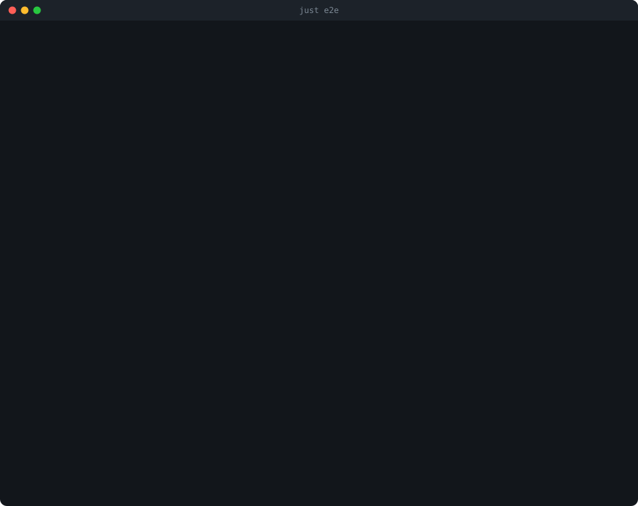

*A run of `just e2e` against plain `http://example.com`. The rest of this article follows the HTTPS version of the same request.*

You type `https://example.com` and a page appears about 300 ms later. In that time your machine has sent and received **26 packets**, used 6 protocols and run a full TLS 1.3 handshake. Almost none of that shows up in your code: you call `fetch()` or `requests.get()` and get back a string.

This article takes that one request and goes through it **one OSI layer at a time**, from the Ethernet frame up to the HTTP response. At each layer we look at the real bytes from a real capture: what each field is, why it's there and what it tells you.

The decoding is done by [osiview](https://github.com/jfgrea27/osiview), a small Rust tool I wrote for this. It makes a request, captures every packet the request caused and decodes each one from layer 2 up to layer 7. For HTTPS it also decrypts the TLS itself. The parsers are written by hand from the RFCs, with no packet libraries, so the code snippets below are the whole decoder for each header and not a wrapper around one.

---

## The setup

Live capture uses Linux's `AF_PACKET` sockets, so on macOS osiview runs in a Docker container:

```sh
git clone https://github.com/jfgrea27/osiview && cd osiview
just e2e https://example.com      # every packet, one line per layer
just e2e https://example.com -v   # field tables and hexdumps for every packet
```

On Linux you can run it directly, after giving the binary permission to open raw sockets:

```sh
cargo build
sudo setcap cap_net_raw,cap_net_admin+ep target/debug/osiview
target/debug/osiview https://example.com
```

Here is the shortened output of the run used in this article. Each packet gets a header line, then one line for each layer it carries:

```text
osiview: example.com -> 104.20.23.154, 172.66.147.243 (own DNS query to 192.168.5.1:53)
osiview: connected 172.17.0.5:40650 -> 104.20.23.154:443
━━━ 26 packets caused by GET https://example.com/ ━━━

#1    11:40:20.023589  →  arp request who-has 172.17.0.1 tell 172.17.0.5 (66:11:e1:c8:85:9c)
#2    +0.008 ms        ←  arp reply 172.17.0.1 is-at 32:69:d9:1e:2d:58
#3    +0.009 ms        →  dns query 0xf522 A example.com
      L2 eth    66:11:e1:c8:85:9c → 32:69:d9:1e:2d:58  IPv4
      L3 ipv4   172.17.0.5 → 192.168.5.1  ttl 64  57 B  DF
      L4 udp    42134 → 53 (dns)  29 B  (checksum offload)
      L7 dns    query 0xf522 A example.com
#4    +7.917 ms        ←  dns response 0xf522 NOERROR A example.com: 104.20.23.154, 172.66.147.243
#5    +8.456 ms        →  flow 1 · handshake 1/3 (SYN)
#6    +23.779 ms       ←  flow 1 · handshake 2/3 (SYN-ACK)
#7    +23.813 ms       →  flow 1 · handshake 3/3 (ACK)
#8    +24.416 ms       →  flow 1 · data 233 B from client
      L2 eth    66:11:e1:c8:85:9c → 32:69:d9:1e:2d:58  IPv4
      L3 ipv4   172.17.0.5 → 104.20.23.154  ttl 64  285 B  DF
      L4 tcp    40650 → 443 (https)  [PSH, ACK]  seq 1 ack 1  win 502  ts  233 B  (checksum offload)
      L5 tls    ClientHello sni example.com, alpn http/1.1, 3 cipher suites (228 B)
...
#26   +287.309 ms      →  arp request who-has 172.17.0.5 tell 172.17.0.5 (66:11:e1:c8:85:9c)

⏱  DNS 8.5 ms  ·  TCP handshake RTT 15.3 ms  ·  server response 14.3 ms  ·  total 287.3 ms
```

Grouped by what they're for, the 26 packets are:

| Packets | What | Layer |
|---|---|---|
| #1–2 | ARP: find the MAC address of the gateway | L2 |
| #3–4 | DNS: find the IP address of `example.com` | L7 over UDP (L4) |
| #5–7 | TCP three-way handshake | L4 |
| #8–14 | TLS 1.3 handshake | L5/L6 |
| #16, #18, #20 | Encrypted HTTP request and response | L7 inside L6 |
| #20–25 | TLS `close_notify`, then the TCP teardown (FIN, ACK) | L5, L4 |
| #9, #11, … | Bare TCP ACKs | L4 |
| #26 | An unrelated ARP announcement caught at the end | L2 |

The rest of the article goes through these layer by layer.

---

## Encapsulation: one frame, byte by byte

The OSI model makes one main promise: **each layer wraps the one above it**. Before going into each layer, here is a whole frame taken apart. Packet #3, the DNS query, is small enough to annotate every byte (71 bytes). `osiview read -v` prints its hexdump:

```text
00000000  32 69 d9 1e 2d 58 66 11  e1 c8 85 9c 08 00 45 00  |2i..-Xf.......E.|
00000010  00 39 ac c1 40 00 40 11  1c 33 ac 11 00 05 c0 a8  |.9..@.@..3......|
00000020  05 01 a4 96 00 35 00 25  71 f6 f5 22 01 00 00 01  |.....5.%q.."....|
00000030  00 00 00 00 00 00 07 65  78 61 6d 70 6c 65 03 63  |.......example.c|
00000040  6f 6d 00 00 01 00 01                              |om.....|
```

Split into layers:

```text
┌─ L2 Ethernet (14 B) ──────────────────────────────────────────────────────┐
│ 32 69 d9 1e 2d 58   dst MAC (the gateway)                                 │
│ 66 11 e1 c8 85 9c   src MAC (us)                                          │
│ 08 00               EtherType: IPv4                                       │
│ ┌─ L3 IPv4 (20 B) ──────────────────────────────────────────────────────┐ │
│ │ 45 00 00 39 ac c1 40 00 40 11 1c 33   ver/ihl, tos, len 57, id, DF,   │ │
│ │                                       ttl 64, proto 17 (UDP), csum    │ │
│ │ ac 11 00 05         src 172.17.0.5                                    │ │
│ │ c0 a8 05 01         dst 192.168.5.1                                   │ │
│ │ ┌─ L4 UDP (8 B) ────────────────────────────────────────────────────┐ │ │
│ │ │ a4 96 00 35 00 25 71 f6   src 42134, dst 53, len 37, csum         │ │ │
│ │ │ ┌─ L7 DNS (29 B) ───────────────────────────────────────────────┐ │ │ │
│ │ │ │ f5 22 01 00 00 01 00 00 00 00 00 00   id, flags, 1 question   │ │ │ │
│ │ │ │ 07 example 03 com 00                  the name, as labels     │ │ │ │
│ │ │ │ 00 01 00 01                           type A, class IN        │ │ │ │
│ │ │ └───────────────────────────────────────────────────────────────┘ │ │ │
│ │ └───────────────────────────────────────────────────────────────────┘ │ │
│ └───────────────────────────────────────────────────────────────────────┘ │
└───────────────────────────────────────────────────────────────────────────┘
```

**29 bytes** of question, wrapped in **42 bytes** of headers. Each header tells the receiver two things: who the data is for at this layer, and which protocol to hand the rest to. The Ethernet header says `0x0800` (IPv4). The IPv4 header says protocol `17` (UDP). The UDP header says port `53` (DNS).

osiview's code follows the same shape. Every parser reads its header from a byte slice and returns a view of the header plus the payload, which it passes up to the next layer. They all read through one small bounds-checked reader:

```rust
// src/cursor.rs
pub(crate) struct Cursor<'a> {
    data: &'a [u8],
    size: usize,
    curr_pos: usize,
}

impl<'a> Cursor<'a> {
    pub(crate) fn read_u16_be(&mut self) -> Option<u16> {
        let bytes = self.read_bytes(2)?;
        Some(u16::from_be_bytes(bytes.try_into().unwrap()))
    }

    pub(crate) fn read_bytes(&mut self, n: usize) -> Option<&'a [u8]> {
        if self.remaining() < n {
            None // a truncated or hostile packet is a `None`, never a panic
        } else {
            let bytes = &self.data[self.curr_pos..self.curr_pos + n];
            self.curr_pos += n;
            Some(bytes)
        }
    }
}
```

Two points:

- **Big-endian everywhere.** Network byte order is big-endian, so `00 39` is 57 and not 14592.
- **Zero-copy.** `read_bytes` returns a slice of the original buffer (`&'a [u8]`) and doesn't copy it. Each parsed header borrows from the frame it came from.

---

## L1: Physical

**TLDR;** out of scope: the NIC removes it before software sees anything.

On a real Ethernet cable, each frame starts with a 7-byte preamble and a 1-byte start-of-frame delimiter, and ends with a 4-byte CRC (the FCS). The network card checks these and strips them, so the first byte the kernel gives us is the destination MAC. Layer 1 is electrical signals, light and radio, and software can't see it.

---

## L2: Data link (Ethernet and ARP)

**TLDR;** gets a frame to the next machine on the same network, addressed by MAC.

Spec: IEEE 802.3, RFC 826 (ARP). Code: `src/level2.rs`.

### Capturing frames

Everything starts with one syscall. A packet socket with `ETH_P_ALL` asks the kernel for a copy of every frame, in both directions, on every interface:

```rust
// src/level2.rs: Capture::open
// The protocol argument is in network byte order (htons).
let proto = (libc::ETH_P_ALL as u16).to_be();
let raw = unsafe { libc::socket(libc::AF_PACKET, libc::SOCK_RAW, libc::c_int::from(proto)) };
```

osiview opens this socket **before** sending anything, so the kernel starts queuing frames for it straight away and nothing is missed. This needs `CAP_NET_RAW`, which is why the binary needs `setcap` (or `--cap-add NET_RAW` in Docker).

### The Ethernet header

An Ethernet II header is 14 bytes: destination MAC, source MAC and EtherType. The parser is almost as short as that description:

```rust
// src/level2.rs
pub fn parse(data: &'a [u8]) -> Option<Self> {
    let mut c = Cursor::new(data);
    let dst = MacAddr::read(&mut c)?;
    let src = MacAddr::read(&mut c)?;
    let mut ether_type = c.read_u16_be()?;

    let mut vlan = None;
    if ether_type == ETHERTYPE_VLAN {           // 0x8100: an 802.1Q tag sits in between
        vlan = Some(VlanTag::from_tci(c.read_u16_be()?));
        ether_type = c.read_u16_be()?;
    }

    let payload = c.read_bytes(c.remaining())?; // handed up to layer 3
    Some(EthernetFrame { dst, src, vlan, ether_type, payload })
}
```

The destination comes **first** on purpose: a NIC can decide after 6 bytes whether the frame is for it, and drop it if not.

In our capture, all 26 frames go between only two MAC addresses: `66:11:e1:c8:85:9c` (the container) and `32:69:d9:1e:2d:58` (its gateway). Even when the IP destination is Cloudflare's server, the Ethernet destination is **always the gateway**. A MAC address only means something on the local network. It gets the frame to the next hop, and the next hop builds a new frame for the hop after that.

### ARP: who has 172.17.0.1?

Before it can send packet #3, the container needs the gateway's MAC address. It knows the gateway's IP (`172.17.0.1`, from its routing table) but not its MAC. ARP is the protocol that maps one to the other:

```text
#1  →  arp request who-has 172.17.0.1 tell 172.17.0.5 (66:11:e1:c8:85:9c)
      L2 eth    66:11:e1:c8:85:9c → ff:ff:ff:ff:ff:ff (broadcast)  ARP
#2  ←  arp reply 172.17.0.1 is-at 32:69:d9:1e:2d:58
```

The request goes to `ff:ff:ff:ff:ff:ff`, the broadcast address, so every machine on the network receives it. Only the one that owns `172.17.0.1` replies, and the reply is unicast. Here are the request's fields:

```text
  arp request who-has 172.17.0.1 tell 172.17.0.5 (66:11:e1:c8:85:9c)
    htype    00 01              Ethernet
    ptype    08 00              IPv4
    hlen     06                 6 bytes
    plen     04                 4 bytes
    oper     00 01              request
    sha      66 11 e1 c8 85 9c  66:11:e1:c8:85:9c
    spa      ac 11 00 05        172.17.0.5
    tha      00 00 00 00 00 00  00:00:00:00:00:00   ← the unknown we're asking for
    tpa      ac 11 00 01        172.17.0.1
```

ARP was designed in 1982 to work with any link layer and any network protocol, so the address lengths are fields in the packet (`hlen`, `plen`) rather than constants. The parser reads them first and then uses them to size the address fields:

```rust
// src/level2.rs
let hlen = c.read_u8()? as usize;
let plen = c.read_u8()? as usize;
let oper = c.read_u16_be()?;
let sha = c.read_bytes(hlen)?;
let spa = c.read_bytes(plen)?;
let tha = c.read_bytes(hlen)?;
let tpa = c.read_bytes(plen)?;
```

The reply came back in **8 µs**, which is quick because the "network" here is a virtual bridge inside one VM. The kernel caches the answer, so the other 23 IP packets reuse it without asking again.

(Packet #26, `who-has 172.17.0.5 tell 172.17.0.5`, is the container announcing its own address, a *gratuitous ARP*. Our request didn't cause it; it just happened before the capture stopped.)

---

## L3: Network (IPv4)

**TLDR;** gets a packet across many networks to its destination, addressed by IP.

Spec: RFC 791, RFC 1071 (checksum). Code: `src/level3.rs`.

Ethernet gets a frame to the next machine. IP gets a packet to the final destination, through as many routers as needed. Here is the IPv4 header of the SYN (packet #5):

```text
  ipv4 172.17.0.5 > 104.20.23.154, TCP (6), ttl 64, id 0x833d, length 60, DF, checksum OK
    ver/ihl  45                 version 4, header 20 bytes
    tos      00                 dscp 0, ecn 0
    length   00 3c              60 bytes total
    id       83 3d              33597
    flags    40 00              DF, offset 0
    ttl      40                 64
    proto    06                 TCP
    checksum 8b ba              OK
    src      ac 11 00 05        172.17.0.5
    dst      68 14 17 9a        104.20.23.154
```

What each field is for:

- **`ver/ihl` `45`**: two 4-bit fields in one byte. Version 4, and a header length of 5 *32-bit words* (20 bytes). If the IHL is above 5, IP options follow.
- **`length`**: the total packet size. IP needs it because Ethernet pads short frames to 60 bytes, and layer 2 can't tell padding from data.
- **`id` and `flags`**: used for fragmentation. `DF` (*Don't Fragment*) is set on every packet we send: Linux prefers to discover the path MTU and size its packets to fit, rather than have routers split them.
- **`ttl` `64`**: decremented by every router, and the packet is dropped when it reaches 0. This stops packets looping forever (and it is how `traceroute` works). Our packets leave with 64 and the replies arrive with 63, so they went through one router to get here.
- **`proto` `06`**: what's inside, the same idea as EtherType one layer up. 6 is TCP and 17 is UDP.

The parser reads the version and header length from the first byte, then reads exactly that many bytes:

```rust
// src/level3.rs
let first = Cursor::new(data).read_u8()?;
if first >> 4 != 4 {
    return None;
}
let ihl = first & 0x0f;
if ihl < 5 {
    return None;
}
let header_len = usize::from(ihl) * 4;
// ...
let total = usize::from(total_length);
let wanted = total - header_len;
let payload = c.read_bytes(wanted.min(available))?; // drops any Ethernet padding
```

### The Internet checksum

IPv4, ICMP, UDP and TCP all use the same 16-bit checksum from RFC 1071. You add the data as 16-bit words with *one's-complement* addition (any carry out of the top bit is added back in at the bottom), and invert the result:

```rust
// src/level3.rs
pub fn internet_checksum(chunks: &[&[u8]]) -> u16 {
    let mut sum: u64 = 0;
    let mut high: Option<u8> = None;
    for &b in chunks.iter().flat_map(|c| c.iter()) {
        match high.take() {
            None => high = Some(b),
            Some(h) => sum += u64::from(u16::from_be_bytes([h, b])),
        }
    }
    if let Some(h) = high {
        sum += u64::from(h) << 8; // odd length: pad with a zero byte
    }
    // Fold the carries back in until the sum fits in 16 bits.
    while sum >> 16 != 0 {
        sum = (sum & 0xffff) + (sum >> 16);
    }
    !(sum as u16)
}
```

The neat part is that **verifying uses the same function**: run it over the header *including* the checksum field, and a correct header gives `0`. It also takes a list of chunks, because TCP and UDP checksums cover a "pseudo-header" (source IP, destination IP, protocol, length) that isn't in the segment itself. So a layer-4 checksum also protects layer-3 addresses: a packet delivered to the wrong IP fails its TCP checksum.

You'll see `checksum BAD` on most of our TCP and UDP packets. That isn't corruption. Linux leaves the transport checksum for the NIC to fill in (*checksum offload*), and the capture sees outgoing frames before that happens. Inside a Docker VM, the virtual interfaces skip it in both directions, since no real wire can corrupt the data.

---

## L4: Transport (UDP and TCP)

**TLDR;** gets data to the right *process* on the destination, using ports. TCP also makes it reliable.

Spec: RFC 768 (UDP), RFC 9293 (TCP). Code: `src/level4.rs`, `src/flow.rs`.

IP gets a packet to a machine. Ports get it to a process on that machine. The connection to Cloudflare is identified by the 4-tuple `172.17.0.5:40650 ↔ 104.20.23.154:443`. `443` is the well-known HTTPS port, and `40650` is an *ephemeral* port the kernel picked at random for our side.

### UDP: the DNS lookup

UDP adds only 8 bytes to IP: source port, destination port, length and checksum. It has no connection, no ordering and no retransmission. DNS uses it because a lookup is one small question and one small answer, and if one gets lost, the client asks again:

```text
    udp 42134 > 53 (dns), 29 bytes
      src port a4 96              42134
      dst port 00 35              53 (dns)
      length   00 25              37 bytes (header 8 + payload 29)
```

The question goes out, and the answer arrives 7.9 ms later. We'll decode the DNS message itself at [L7](#l7-application-dns-and-http).

### TCP: the three-way handshake

TCP turns IP's "best effort" into a reliable, ordered byte stream. It needs a connection for that, and the connection starts with three packets:

```text
              172.17.0.5:40650                   104.20.23.154:443
   +8.456 ms  │────────────────────── SYN ──────────────────────▶│
  +23.779 ms  │◀──────────────────── SYN-ACK ────────────────────│
  +23.813 ms  │────────────────────── ACK ──────────────────────▶│
```

That's one round trip (15.3 ms) before any data can be sent. Here is the SYN in full:

```text
    tcp 40650 > 443 (https) [SYN] seq 3848550790 win 64240, mss 1460, sack permitted,
        timestamps 2461819375, echo 0, wscale 7 (window × 128), 0 bytes
      src port 9e ca              40650
      dst port 01 bb              443 (https)
      seq      e5 64 39 86        3848550790
      ack      00 00 00 00        (ACK flag not set, ignored)
      offset   a0                 header 40 bytes
      flags    02                 [SYN]
      window   fa f0              64240
      option   02 04 05 b4        mss 1460
      option   04 02              sack permitted
      option   08 0a 92 bc 61 ef 00 00 00 00  timestamps 2461819375, echo 0
      option   03 03 07           wscale 7 (window × 128)
```

Each field is there for a reason:

- **`seq` 3848550790**: the *Initial Sequence Number*, chosen at random. TCP numbers every byte it sends, starting here. A random start makes it hard for an attacker to inject fake segments, and stops a segment from an old connection being accepted into a new one. osiview shows sequence numbers relative to the ISN (`seq 0`, `seq 1`, …), like Wireshark does, because the raw values are hard to read.
- **`ack`**: "I have every byte before this one". It's only meaningful once the `ACK` flag is set, from the SYN-ACK onwards.
- **`window`**: how many more bytes the sender can accept right now (flow control).
- **The options**, which are only allowed on the SYN:
  - **`mss 1460`**: the largest segment we can receive. That's the 1500-byte Ethernet MTU, minus 20 bytes of IP and 20 of TCP.
  - **`wscale 7`**: multiply every later window value by 2^7. The window field is 16 bits, so 64 KB at most, which is too small for fast networks. The server's later `win 4096` really means 4096 × 128 = **512 KB**.
  - **`sack permitted`**: allows selective acknowledgements ("I'm missing bytes X–Y but have everything after"), so a single loss doesn't force a resend of the whole window.
  - **`timestamps`**: for measuring round-trip time, and for protecting against wrapped sequence numbers on very fast links.

Parsing the fixed part of the header follows the RFC 9293 diagram field by field:

```rust
// src/level4.rs
pub fn parse(data: &'a [u8]) -> Option<Self> {
    let mut c = Cursor::new(data);
    let src_port = c.read_u16_be()?;
    let dst_port = c.read_u16_be()?;
    let seq = c.read_u32_be()?;
    let ack = c.read_u32_be()?;
    let data_offset = c.read_u8()? >> 4;     // header length in 32-bit words
    let flags = TcpFlags(c.read_u8()?);
    let window = c.read_u16_be()?;
    let checksum = c.read_u16_be()?;
    let urgent = c.read_u16_be()?;
    if data_offset < 5 {
        return None;
    }
    let options = c.read_bytes(usize::from(data_offset) * 4 - 20)?;
    let payload = c.read_bytes(c.remaining())?; // TCP has no length field
    // ...
}
```

Note the last line: **TCP has no length field**. A segment's data runs to the end of the IP payload, so TCP relies on the layer below for its length.

### Segments are not messages

This is the most important idea at layer 4: **TCP carries a byte stream, not messages.** The application writes bytes, and TCP splits them into segments however it likes. The receiver has to put them back together.

You can see this in packets #10 and #12. The server sends its TLS handshake as one 4208-byte record, and TCP splits it across two segments:

```text
#10  ←  data 2856 B from server
      L5 tls    ServerHello (122 B), change_cipher_spec (1 B), application_data (4208 B, continues)
#12  ←  data 1490 B from server
```

(Packet #10's IP length is 2908 bytes, which is more than the 1500-byte MTU. The receiving side coalesced two wire segments into one before the capture saw them, an optimisation called *GRO*. This is common in captures and is another reason not to treat a segment as a unit of meaning.)

To decode anything above layer 4, osiview has to rebuild each direction of the connection into a stream. The core of `flow.rs` is a single comparison: is this segment's sequence number behind, at or ahead of the next byte we expect?

```rust
// src/flow.rs
pub fn push(&mut self, seq: u32, data: &[u8]) -> Placement {
    let next = *self.next.get_or_insert(seq);
    // Sequence numbers wrap at 2^32: read the difference as signed.
    let distance = seq.wrapping_sub(next) as i32;

    if distance > 0 {
        // A gap before this segment: hold on to it until the gap is filled.
        self.pending.push((seq, data.to_vec()));
        return Placement::Buffered;
    }

    // `distance <= 0`: the first `-distance` bytes are ones we already have.
    let skip = distance.unsigned_abs() as usize;
    let Some(fresh) = data.get(skip..).filter(|f| !f.is_empty()) else {
        return Placement::Retransmission;
    };
    self.accept(fresh);       // append, advance `next`
    self.drain_pending();     // a buffered segment may fit now
    Placement::InOrder { new: fresh.len() }
}
```

The `wrapping_sub(..) as i32` handles sequence-number wraparound: a segment at `5` that follows one at `4294967290` is *ahead* of it, not 4 billion bytes behind.

### The bare ACKs and the teardown

About a third of the packets carry no data at all (#9, #11, #13, …). They are acknowledgements: each one tells the sender "I have everything up to byte N", so it can stop holding those bytes for a resend.

At the end, each side closes its own direction with a `FIN`, and the other side acknowledges it:

```text
  +63.227 ms  │◀────────────────────── FIN ──────────────────────│
  +63.416 ms  │───────────── encrypted 19 B (24 B) ─────────────▶│   ← our TLS close_notify
  +63.494 ms  │────────────────────── FIN ──────────────────────▶│
  +63.587 ms  │◀────────────────────── ACK ──────────────────────│
```

Like the SYN, a `FIN` uses up one sequence number, even though it has no data. That's how it gets acknowledged.

---

## L5: Session (TLS records and the handshake)

**TLDR;** sets up, keeps track of and closes the conversation: TLS's framing, handshake and state.

Spec: RFC 8446. Code: `src/level5.rs`.

The internet stack doesn't map cleanly onto OSI layers 5 and 6, and TLS does the work of both. osiview splits it in two: **layer 5** is the conversation (records, handshake messages, which keys are in use), and **layer 6** is the encoding (key derivation, encryption, certificates).

### Records

TLS has its own framing on top of the TCP stream: a 5-byte header (type, version, length), followed by the content:

```rust
// src/level5.rs
/// struct {
///     ContentType type;                       // 1 byte: 20, 21, 22 or 23
///     ProtocolVersion legacy_record_version;  // 2 bytes: 0x0301 or 0x0303
///     uint16 length;
///     opaque fragment[length];
/// } TLSPlaintext;
pub fn parse(data: &'a [u8]) -> Option<(Self, &'a [u8])> {
    let mut c = Cursor::new(data);
    let header = Cursor::new(data).read_bytes(5)?;
    let content_type = c.read_u8()?;
    let version = c.read_u16_be()?;
    let len = usize::from(c.read_u16_be()?);
    // ...
    let fragment = c.read_bytes(len)?;
    let rest = c.read_bytes(c.remaining())?;
    Some((TlsRecord { content_type, version, fragment, header }, rest))
}
```

Records and segments are independent of each other. Packet #20 carries **four** records in one segment, while the 4208-byte record above needed **two** segments.

The version field is a fossil. The ClientHello record says `TLS 1.0` (`03 01`) and the server's records say `TLS 1.2` (`03 03`), even though this is a TLS 1.3 connection. Too many middleboxes break on version numbers they don't recognise, so TLS 1.3 freezes this field and negotiates the real version in an extension instead.

### ClientHello

Packet #8, 233 bytes, is the first thing we send over TLS, and the only real message we send in plaintext. It tells the server what we support:

```text
ClientHello sni example.com, alpn http/1.1, 3 cipher suites
    cipher suites: TLS_AES_256_GCM_SHA384, TLS_AES_128_GCM_SHA256, TLS_CHACHA20_POLY1305_SHA256
    supported_groups: x25519, secp256r1, secp384r1
    signature_algorithms: ecdsa_secp384r1_sha384, ecdsa_secp256r1_sha256, ed25519, rsa_pss_rsae_sha512, ...
    key_share: x25519 (32 bytes)
    server_name: example.com
    supported_versions: TLS 1.3
    application_layer_protocol_negotiation: http/1.1
```

- **`server_name` (SNI)**: the hostname, **in plaintext**. Cloudflare serves millions of sites from the same IPs, so it needs to know which certificate to send before any encryption exists. This is also why someone watching your network can see which sites you visit even over HTTPS.
- **`key_share`**: our half of an X25519 Diffie-Hellman exchange, sent straight away on the guess that the server supports X25519. This guess is why TLS 1.3 needs one round trip for its handshake, where TLS 1.2 needed two.
- **`supported_versions`**: where the real version is negotiated (see the fossil above).
- **`application_layer_protocol_negotiation` (ALPN)**: which protocol we'll speak inside TLS. osiview offers only `http/1.1`, since it doesn't decode HTTP/2 yet.

### ServerHello, and then darkness

Packet #10 brings the server's answer:

```text
ServerHello TLS 1.3, TLS_AES_256_GCM_SHA384
    key_share: x25519 (32 bytes)
    supported_versions: TLS 1.3
change_cipher_spec (1 B)
application_data (4208 B, continues)
```

The server picked AES-256-GCM with SHA-384, and sent its own X25519 key share. At this point both sides can compute the same shared secret, and **everything after this is encrypted**. The `change_cipher_spec` record is a dummy, sent only so that middleboxes see something that looks like TLS 1.2. It does nothing in TLS 1.3.

Without keys, this is all anyone watching the network can see:

```text
      tls record application_data (23), TLS 1.2, 69 bytes
        (encrypted; decrypt with `osiview follow --keylog`)
```

Every encrypted record is sent as type 23, *application data*, so an observer can't even tell handshake messages from HTTP. The real type is inside the encryption.

### Getting the keys: the keylog

To see further, osiview needs the session's secrets. It doesn't have its own TLS client: the request itself is made by `rustls`, which can report each secret it derives, the same way browsers do with the `SSLKEYLOGFILE` environment variable:

```rust
// src/fetch.rs
impl rustls::KeyLog for MemoryKeyLog {
    fn log(&self, label: &str, client_random: &[u8], secret: &[u8]) {
        let mut text = self.0.lock().unwrap_or_else(|e| e.into_inner());
        let _ = writeln!(text, "{label} {} {}", hex(client_random), hex(secret));
    }
}
```

This produces one line per secret, keyed by the ClientHello's random value (truncated here):

```text
CLIENT_HANDSHAKE_TRAFFIC_SECRET d3709c9bdc7d9010894451523299…
SERVER_HANDSHAKE_TRAFFIC_SECRET d3709c9bdc7d9010894451523299…
CLIENT_TRAFFIC_SECRET_0 d3709c9bdc7d9010894451523299ced80b9a…
SERVER_TRAFFIC_SECRET_0 d3709c9bdc7d9010894451523299ced80b9a…
```

rustls only *makes* the request. It never sees the capture. Everything below is osiview decrypting the bytes it captured off the wire, the same way Wireshark would with a keylog file.

With the secrets, layer 5 can follow the whole conversation and its state machine (plaintext → handshake keys → application keys):

```text
--- L5 server 104.20.23.154:443 -> 172.17.0.5:40650:
    ServerHello TLS 1.3, TLS_AES_256_GCM_SHA384
    ChangeCipherSpec (middlebox compatibility; ignored in TLS 1.3)
    {EncryptedExtensions (2 extensions)}
    {Certificate: 4 certificate(s)}
    {CertificateVerify ecdsa_secp256r1_sha256, 70-byte signature}
    {Finished (verify_data 48 bytes)} - verified
    {NewSessionTicket lifetime 64800 s, ticket 208 bytes}
    {NewSessionTicket lifetime 64800 s, ticket 208 bytes}
    application data: 2 records, 753 bytes
    {Alert warning close_notify (0)}
```

(`{}` means encrypted.) That 4208-byte record that spanned two segments held four handshake messages:

- **EncryptedExtensions**: the server confirms SNI and ALPN `http/1.1`.
- **Certificate**: proves *who* the server is (decoded at L6).
- **CertificateVerify**: a signature over the handshake so far, made with the certificate's private key. It proves the server actually *holds* the key, and isn't just replaying someone else's certificate.
- **Finished**: an HMAC over the whole handshake. If anyone tampered with any message, this fails. osiview recomputes it and prints `verified`.

After the handshake, the server sends two **NewSessionTicket**s, valid for 18 hours (64800 s). A later connection can present one to skip the certificate exchange (*resumption*). Our client never comes back, so they go unused.

---

## L6: Presentation (encryption, certificates and compression)

**TLDR;** how the bytes are *encoded*, as opposed to what they mean.

Spec: RFC 8446 §5 and §7, RFC 5869 (HKDF), X.690 (DER), RFC 5280 (X.509), RFC 1952 (gzip). Code: `src/level6.rs`.

In this request, layer 6 is three encodings stacked on each other: the TLS encryption, the ASN.1 encoding of the certificates, and the gzip encoding of the HTTP body.

### From secret to key

A traffic secret isn't a key yet. TLS 1.3 builds its entire key schedule from one function, `HKDF-Expand-Label`:

```rust
// src/level6.rs
pub fn hkdf_expand_label(suite: CipherSuite, secret: &[u8], label: &str,
                         context: &[u8], len: usize) -> Option<Vec<u8>> {
    let full_label = format!("tls13 {label}");
    let mut info = Vec::with_capacity(4 + full_label.len() + context.len());
    info.extend_from_slice(&u16::try_from(len).ok()?.to_be_bytes());
    info.push(u8::try_from(full_label.len()).ok()?);
    info.extend_from_slice(full_label.as_bytes());
    info.push(u8::try_from(context.len()).ok()?);
    info.extend_from_slice(context);
    // ... HKDF-Expand(secret, info) with SHA-384 or SHA-256, from the `hkdf` crate
}

// key = HKDF-Expand-Label(secret, "key", "", key_length)
// iv  = HKDF-Expand-Label(secret, "iv",  "", 12)
```

Mixing the label (`"key"`, `"iv"`) and the output length into the input means every derived value is independent. The cryptography itself (HKDF, SHA-2, AES-GCM) comes from audited crates, as it should; osiview only builds the TLS logic around them.

### Decrypting a record

Each record is decrypted with an AEAD (here AES-256-GCM), using a nonce that changes with every record:

```rust
// src/level6.rs
// nonce      = iv XOR (64-bit record sequence number, padded to 12 bytes)
// AAD        = the 5-byte record header
// plaintext  = content ‖ real content type (1 byte) ‖ zero padding
pub fn decrypt(&mut self, header: &[u8], ciphertext: &[u8]) -> Option<(u8, Vec<u8>)> {
    let nonce = self.nonce();
    let payload = Payload { msg: ciphertext, aad: header };
    let mut inner = Aes256Gcm::new_from_slice(&self.keys.key).ok()?
        .decrypt(Nonce::from_slice(&nonce), payload).ok()?;
    self.seq += 1;

    // strip the padding: the last non-zero byte is the real content type
    while inner.last() == Some(&0) {
        inner.pop();
    }
    let content_type = inner.pop()?;
    Some((content_type, inner))
}
```

Three details stand out:

- **The sequence number is never sent.** Both sides count records. If you miss one record, every record after it fails to decrypt, which is why the TCP reassembly at L4 has to be exact.
- **The record header is authenticated** (it's the AAD), so the length and type can't be tampered with either.
- **The real content type is the last byte of the plaintext.** This is how an encrypted handshake message hides behind type 23.

With that, every record size in the capture adds up. Each encrypted record is its content, plus 1 byte for the real content type, plus a 16-byte authentication tag:

| Record | On the wire | Content | What it is |
|---|---|---|---|
| client #16 | 69 B | 52 B | `Finished`: 4-byte header + 48-byte HMAC (SHA-384) |
| client #18 | 136 B | 119 B | the `GET` request |
| server #20 | 477 B | 460 B | two `NewSessionTicket`s, 230 B each |
| server #20 | 765 B | 748 B | HTTP headers + the gzipped body chunk |
| server #20 | 22 B | 5 B | `0\r\n\r\n`: the last HTTP chunk |
| both | 19 B | 2 B | `close_notify` alert |

### Certificates: ASN.1 DER

The `Certificate` message holds four X.509 certificates, encoded in ASN.1 DER. DER is a tree of *tag-length-value* triples, and osiview reads it by hand:

```rust
// src/level6.rs
pub fn read(&mut self) -> Result<Tlv<'a>, DerError> {
    let tag = self.c.read_u8().ok_or(DerError::Truncated)?;
    let first = self.c.read_u8().ok_or(DerError::Truncated)?;
    let len = if first < 0x80 {
        usize::from(first)                    // short form: 0–127
    } else {
        let n = usize::from(first & 0x7f);    // long form: 0x80 | n, then n bytes
        let bytes = self.c.read_bytes(n).ok_or(DerError::Truncated)?;
        bytes.iter().fold(0usize, |acc, &b| (acc << 8) | usize::from(b))
    };
    let value = self.c.read_bytes(len).ok_or(DerError::Truncated)?;
    Ok(Tlv { tag, value })
}
```

(The real version also rejects indefinite and non-minimal lengths, which DER forbids.) A nested value is read with a new reader over only its parent's bytes, so a child can never claim more bytes than its parent has.

The chain:

```text
  [0] subject   CN=example.com
      issuer    Cloudflare TLS Issuing ECC CA 3
      validity  2026-09-26 → 2026-12-25
      san       DNS:example.com, DNS:*.example.com
      key       ecPublicKey P-256
  [1] subject   Cloudflare TLS Issuing ECC CA 3
      issuer    SSL.com TLS Transit ECC CA R2
  [2] subject   SSL.com TLS Transit ECC CA R2
      issuer    SSL.com TLS ECC Root CA 2022
  [3] subject   SSL.com TLS ECC Root CA 2022
      issuer    Comodo CA Limited, AAA Certificate Services
```

Each certificate is signed by the next one up. The leaf `[0]` is valid for only **90 days** and says it is for `example.com` in its *Subject Alternative Name* (modern clients ignore the `CN`). Its `P-256` key is the one that made the `CertificateVerify` signature. `[3]` is a *cross-sign*: a newer root signed by an older one, so clients that only trust the old Comodo root still accept the chain.

### Content-Encoding: gzip

The last encoding is inside HTTP itself. The response says `Content-Encoding: gzip`, so its body is compressed:

```text
[L6 Content-Encoding: gzip: 400 bytes -> 577 bytes inflated]
```

The decompression uses the `flate2` crate. It's layer 6 because it changes the encoding of the content, not its meaning.

---

## L7: Application (DNS and HTTP)

**TLDR;** what the program actually wanted to say.

Spec: RFC 1035 (DNS), RFC 9112 (HTTP/1.1). Code: `src/level7.rs`.

### DNS

Before any of the TCP, the client had to turn `example.com` into an IP. osiview uses its own resolver for this instead of `getaddrinfo`, so the query shows up as our packet and we can decode it.

A DNS message is a 12-byte header (ID, flags and four counts), followed by the questions and the answer records:

```text
      dns response 0xf522 NOERROR A example.com: 104.20.23.154, 172.66.147.243
        id       f5 22              0xf522
        flags    81 80              response, recursion desired, recursion available, NOERROR
        qdcount  00 01              1
        ancount  00 02              2
        question example.com A
        answer   example.com A ttl 0s 104.20.23.154
        answer   example.com A ttl 0s 172.66.147.243
```

- **`id` 0xf522**: chosen at random by the client and copied into the response, so the two can be matched. A predictable ID makes spoofing DNS answers easy.
- **Two `A` records**: Cloudflare returns two addresses, and the client connected to the first.
- **Names as labels**: `example.com` is written as `07 example 03 com 00`, a length byte before each label and a zero byte at the end.

DNS also has *name compression*: a byte starting with `0b11` is a pointer to a name that appeared earlier in the message. A pointer can point to another pointer, so a malicious message could loop forever. osiview's decoder only allows pointers that go *backwards*, and caps the number of jumps:

```rust
// src/level7.rs: read_name
match len >> 6 {
    0b00 => { /* a label of `len` bytes, or the end of the name if len == 0 */ }
    0b11 => {
        let low = c.read_u8()?;
        let target = (usize::from(len & 0x3f) << 8) | usize::from(low);
        if target >= pos || jumps >= MAX_NAME_JUMPS {
            return None; // forward pointer or too many jumps: refuse
        }
        jumps += 1;
        pos = target;
    }
    _ => return None, // 0b01 and 0b10 are reserved
}
```

(This particular resolver didn't bother compressing: if you look at the hexdump, `example.com` is spelled out in full in both answers.)

### HTTP

At last, the request itself: the **119 bytes** that the whole stack exists to deliver, decrypted from the captured records:

```text
--- L7 client application data (decrypted): 119 bytes
GET / HTTP/1.1
Host: example.com
User-Agent: osiview/0.1.0
Accept: */*
Accept-Encoding: gzip
Connection: close
```

And the response:

```text
--- L7 server application data (decrypted): 753 bytes
HTTP/1.1 200 OK
Date: Wed, 04 Nov 2026 11:40:20 GMT
Content-Type: text/html; charset=utf-8
Transfer-Encoding: chunked
Connection: close
Server: cloudflare
Age: 1
cf-cache-status: HIT
Content-Encoding: gzip
CF-RAY: a55357e16a5b86bf-LHR
alt-svc: h3=":443"; ma=86400

[L6 Content-Encoding: gzip: 400 bytes -> 577 bytes inflated]
<!doctype html><html lang=en><head>...<title>Example Domain</title>...
```

A few headers worth reading:

- **`Host: example.com`**: the same name as in the SNI, this time inside the encryption. One IP serves many sites, so HTTP needs the name too.
- **`Transfer-Encoding: chunked`**: the server didn't send a `Content-Length`, so the body comes in length-prefixed chunks and ends with a zero-length one (the 5-byte `0\r\n\r\n` record from L6).
- **`Connection: close`**: one request per connection, so the server sends its `FIN` straight after the response.
- **`cf-cache-status: HIT`** and **`CF-RAY: …-LHR`**: the response came from Cloudflare's cache in London, which is why "server response" took only 14 ms.
- **`alt-svc: h3=":443"`**: the server says it also speaks HTTP/3 over QUIC (UDP). A browser would use that next time, and skip most of the layer-4 handshake.

After all the layers, the content is a **577-byte** HTML page that says this domain is for use in documentation examples.

### Did we get it right?

osiview checks itself at the end:

```text
✓ the 753 decrypted bytes match exactly what the TLS client received
```

The response rebuilt from the capture (L2 frames → L3 packets → L4 reassembly → L5 records → L6 decryption) is compared byte for byte with what rustls gave the program. If any layer had a bug, such as a misread header, a segment out of order or a wrong nonce, the AEAD tag would fail or the bytes wouldn't match.

---

## Closing remarks

Here is the whole stack again, from the point of view of the HTTP request in packet #18:

| Layer | Protocol | Address | Bytes added | What it answers |
|---|---|---|---|---|
| L7 | HTTP/1.1 | `Host: example.com` | 119 (the request) | what do I want? |
| L6 | TLS record protection | — | 17 (type + tag) | how is it encoded? |
| L5 | TLS records | — | 5 | which conversation, which state? |
| L4 | TCP | port 40650 → 443 | 32 | which process, in what order? |
| L3 | IPv4 | 172.17.0.5 → 104.20.23.154 | 20 | which machine, across the internet? |
| L2 | Ethernet | `66:11:…` → `32:69:…` | 14 | which machine, on this link? |

**119 bytes of HTTP became a 207-byte frame**, and it needed 25 other packets around it: ARP to find the gateway, DNS to find the server, TCP to open and close a connection, and TLS to agree on keys and prove who the server is. On a fast network all of that takes 60 ms, and nearly all of it is just waiting for round trips.

The thing that surprised me most when writing osiview was how independent the layers are. Ethernet frames don't line up with IP routes, TCP segments don't line up with TLS records, and TLS records don't line up with HTTP messages. Each layer only trusts the length and type fields in its own header, and hands the rest up. That is exactly what makes the stack work: you can swap Ethernet for Wi-Fi, IPv4 for IPv6 or HTTP/1.1 for HTTP/2, and nothing above or below needs to know.

If you want to look at your own traffic this way, the code is in the [osiview](https://github.com/jfgrea27/osiview) repository. Every module starts with an explanation of its protocol and cites the RFC sections it implements. `osiview read` also decodes any pcap file, so you can point it at a Wireshark capture too.
